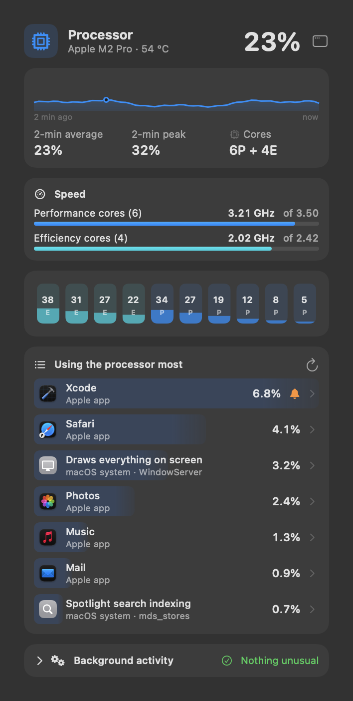
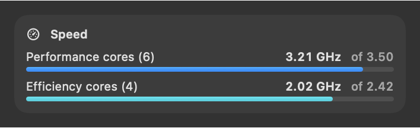
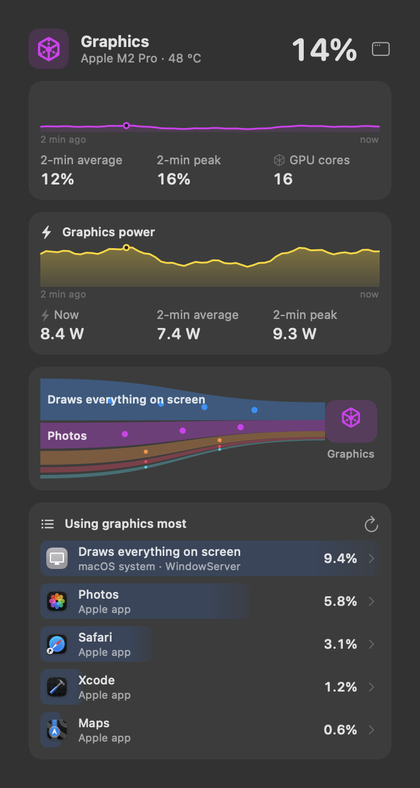
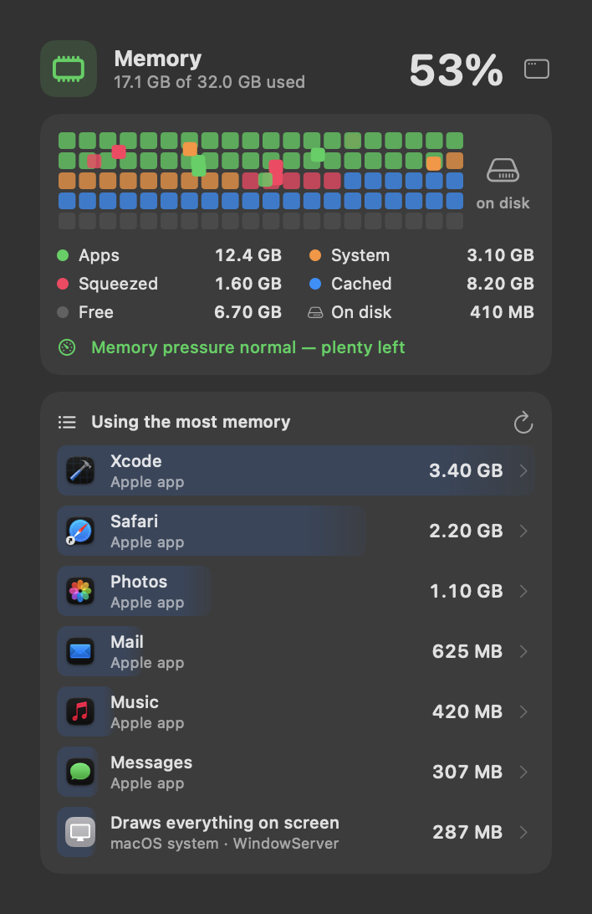

[Home](index.md) · [Getting started](Getting-started.md) · [Features](Features.md) · [Switches](Switches.md) · [Developer guide](Developer-guide.md) · [Troubleshooting](Troubleshooting.md) · [Changelog](Changelog.md) · [Download](https://github.com/MShirazAhmad/Sparewatt-docs/releases/latest)

---

# Processor, graphics and memory

---

## Processor panel

 <em>Processor panel, top to bottom: load, chip and temperature · 2-minute graph (average, peak, cores) · speed of each kind of core · one tile per core (E efficiency, P performance) · apps using the processor most · background activity (folded to one line).</em>

**Purpose.** Tell whether the processor is the reason the Mac feels slow or warm, and who is using it.

**What it does.**
- **Header:** processor load in %, with the chip's name ("Apple M1 Max") and, when the Mac has a sensor, its
  temperature underneath.
- **Load card:** a sparkline of the last 60 readings (two minutes at the default update speed) with *2-min average*,
  *2-min peak* and *Cores* ("8P + 2E": performance and efficiency cores).
- **Speed** (Apple silicon): how fast the performance cores and the efficiency cores run while they work, in GHz,
  against each kind's top speed ("3.02 GHz of 3.23"), with a bar. It reads *resting* when those cores did nothing.
  Where macOS reports the processor's watts, they show beside the title; on many Macs (an M1 Max, for one) macOS keeps
  that counter at zero for apps, and then no figure is shown rather than a made-up one.
- **Cores:** each core's load — efficiency cores (teal) first, then performance cores (blue) — as live tiles with the
  load sized to fit and E or P underneath, or as bars when live diagrams are off.
- **Using the processor most:** the apps and processes with the highest share, as a share of the **whole** processor.
- **Background activity** (see [Who is using it](Who-is-using-it.md)): one line with its status ("Nothing
  unusual" or "2 unusual"); click it for the rest.
- **Dashboard only:** *Who is using the processor* (by kind), the processor's load over 24 hours and the full
  background-processes table.

**Use cases.**
- The fan spins up during a quiet moment: open the panel and see which app is busy.
- Check whether a long export or compile is using every core or just one.
- See whether slowness is the processor at all — if it is low, look at memory or storage instead.
- See whether the processor is running at full speed during a long job, or held back (for example by the heat or Low
  Power Mode).

 <em>Speed: performance and efficiency cores while they work, against their top speeds. (Sample values.)</em>

**Benefits.**
- Load is averaged over 10 seconds by default, so you see real work, not every spike.
- Apps and their helper processes are folded together under the app's name, so "Google Chrome" is one row, not twenty.

**Where.** CPU part of the menu bar; Dashboard → **Processor**.

**Limits.** Performance/efficiency split and the speed are Apple silicon only. The speed is the time-weighted average
of the speed states each core reported over the last 2 seconds (from macOS's own counters and its frequency table),
read only while a Sparewatt panel or the dashboard is open.

---

## Graphics panel

 <em>Graphics panel: load and temperature · 2-minute graph · the graphics chip · apps using it most.</em>

**Purpose.** See how busy the graphics chip is and which app is drawing with it.

**What it does.** The same layout as the processor: a header with the chip's name, a load card with *GPU cores* (macOS
reports one load for all GPU cores together; the graph's tooltip says so), and *Using the graphics most* — measured from
the graphics time each app used over one second. *Who is using the graphics* (by kind) is on the dashboard.

**Graphics power** (since 1.14): what the graphics chip uses, in watts, as a 2-minute graph with *Now*, *2-min average*
and *2-min peak*, read from macOS's own graphics energy counter every 2 seconds. Busy % and watts differ: light work can
keep the chip busy at a low clock for a couple of watts, while games, video and AI models push the watts up. It needs no administrator password, and on one Mac it agreed
with Apple's `powermetrics` tool to within a few tenths of a watt. A Mac without the counter doesn't show it.

**Use cases.** A video, game, 3D view or a local AI model makes the Mac hot — check which one holds the graphics chip.

**Benefits.** Activity Monitor doesn't show graphics per app by default; this does.

**Who is using it, as a picture.** With live diagrams on, a flow from the top apps into the graphics chip: each band is
as thick as that app's part of the chip's work, the same figures as the list under it, and its dots go faster the more
it uses. macOS doesn't say which graphics core an app is on, so there are no per-core tiles here.

**Where.** GPU part of the menu bar; Dashboard → **Graphics**.

**Settings.** *GPU: memory it holds (shared with RAM)* adds the graphics chip's memory to the menu bar (off by default).
*Graphics above* (85%, Dashboard → Menu Bar → *Alerts*) makes the GPU part glow red, and **Still high** tells you when
the graphics chip stays above it for 5 minutes (a 10-second average, so one quiet frame doesn't end it), as for the
processor.

**Limits.** Only apps actually drawing with the graphics chip are listed; the core count is reported on Apple silicon
only.

---

## Memory panel

 <em>Memory panel: used of total · bar of apps, system, compressed, cached and free · memory pressure and swap · swap forecast · apps using the most memory.</em>

**Purpose.** Understand whether memory is the bottleneck — and what to close if it is.

**What it does.**
- **Header:** memory used, "X of Y used" (apps + system + compressed).
- **Breakdown bar** with a two-column legend of short names: *Apps*, *System*, *Squeezed*, *Cached*, *Free*. The full
  names are in the tooltips: *System (locked)*, *Squeezed (compressed)*, *Cached files* (macOS reuses these freely).
- **Memory pressure:** normal ("plenty left"), medium ("apps may slow down") or high ("quit something") — macOS's own
  judgement, more useful than the percentage.
- **Swap:** the legend's *On disk* row (spilled to disk), orange when over 1 GB under raised pressure.
- **Memory forecast:** when swap grew by more than 500 MB within the last hour, a card warns that memory will run short
  and names the app using the most.
- **Memory that keeps growing:** an app whose memory grew by more than 2 GB in the last hour, while it kept running, is
  a *worth a look* finding on the Overview: "Safari's memory grew 3.10 GB in the last hour — quitting and reopening it
  would free that." A notification with **Quit ‹app›** is optional, off by default
  ([Alerts and notifications](Alerts-and-notifications.md)).
- **Using the most memory:** apps by memory held, counted from each process's own footprint, as Activity Monitor does.
  The iOS Simulator's processes show as one *iOS Simulator* row.
- **Dashboard only:** *Who is using memory* (by kind).

**Use cases.**
- Many browser tabs and the Mac stutters: check pressure and swap, then close the biggest app.
- Before starting something memory-hungry (a virtual machine, a large dataset), check how much is really free.

**Benefits.**
- "Used memory" alone is misleading on a Mac (cached files count as used). Pressure and swap tell you whether it
  matters.
- The forecast warns before the Mac slows down, not after.

**The memory map.** With live diagrams on, the bar becomes 100 blocks, one per 1% of memory, in the legend's colours.
Blocks fly between *Apps* and *Squeezed* while macOS squeezes and unsqueezes memory, and to or from the drive while it
writes memory out or reads it back, as many and as fast as macOS's own counters say, on a log scale from 10 KB/s to
1 GB/s. With nothing moving, the map is still.

**Where.** RAM part of the menu bar; Dashboard → **Memory**.

**Settings.** *Storage turns orange when memory spills to the SSD above N GB* (off, 1 GB) — Dashboard → Menu Bar →
*Colours*.

---

[Home](index.md) · [Getting started](Getting-started.md) · [Features](Features.md) · [Switches](Switches.md) · [Developer guide](Developer-guide.md) · [Troubleshooting](Troubleshooting.md) · [Changelog](Changelog.md) · [Download](https://github.com/MShirazAhmad/Sparewatt-docs/releases/latest)

Sparewatt is free. © 2026 Shiraz Ahmad. [These pages on GitHub](https://github.com/MShirazAhmad/Sparewatt-docs)
