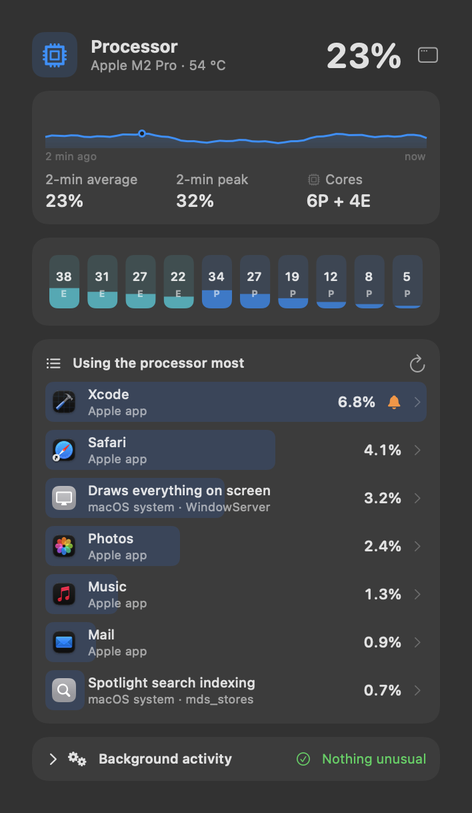
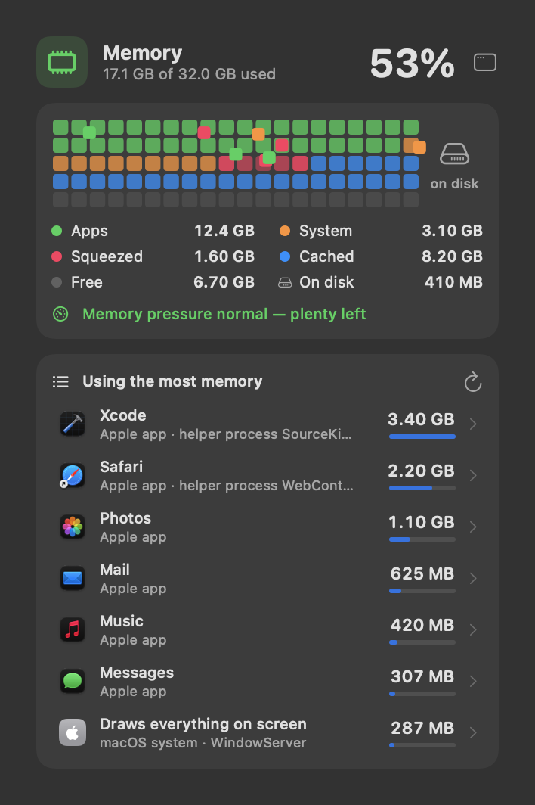
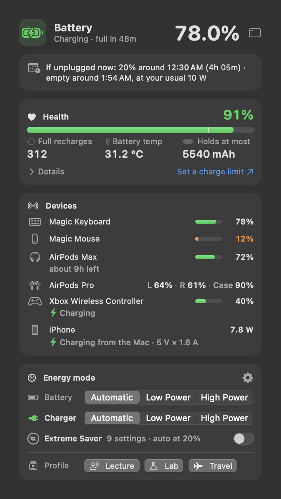
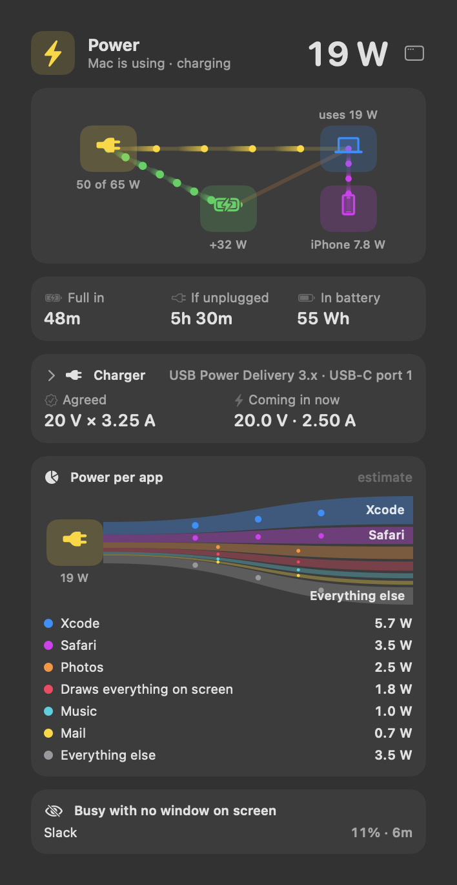
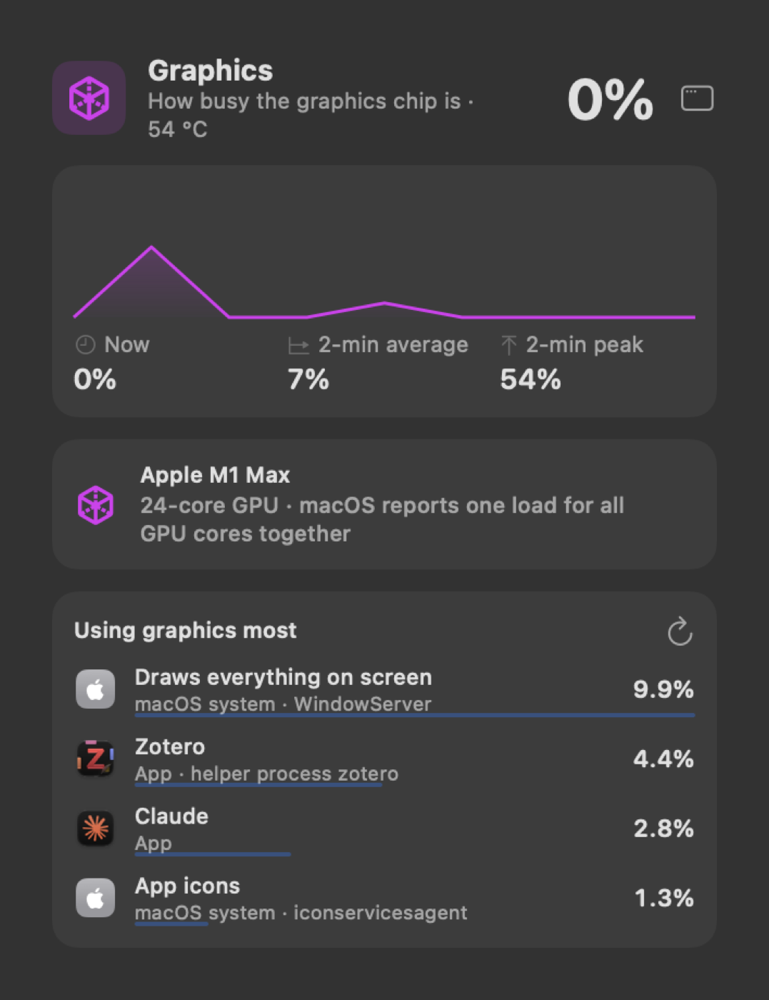
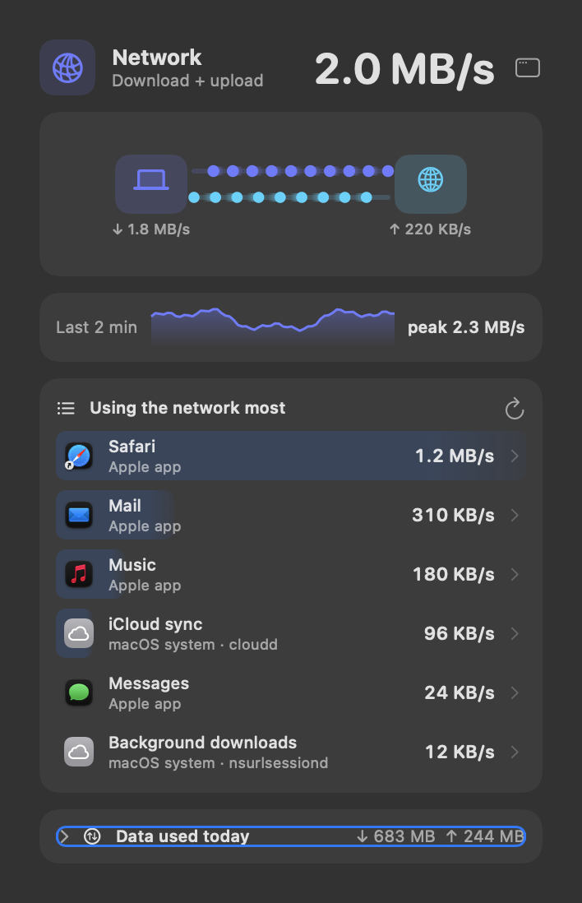
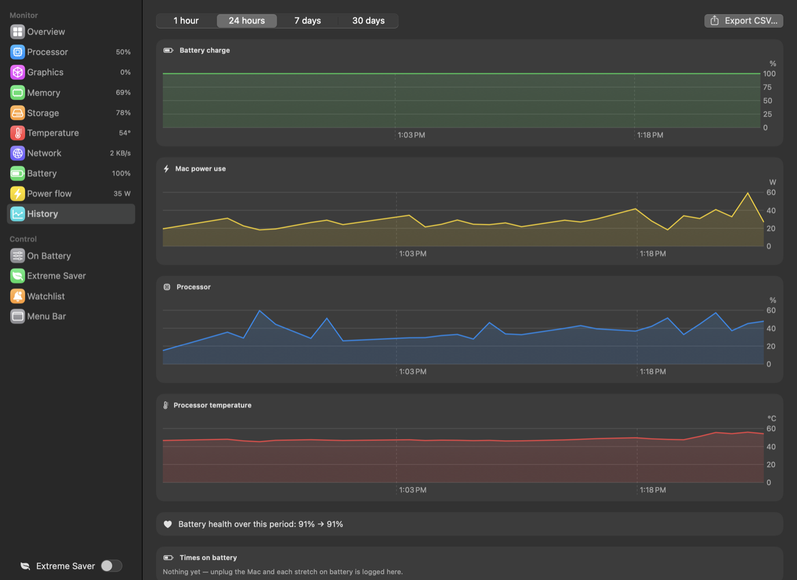
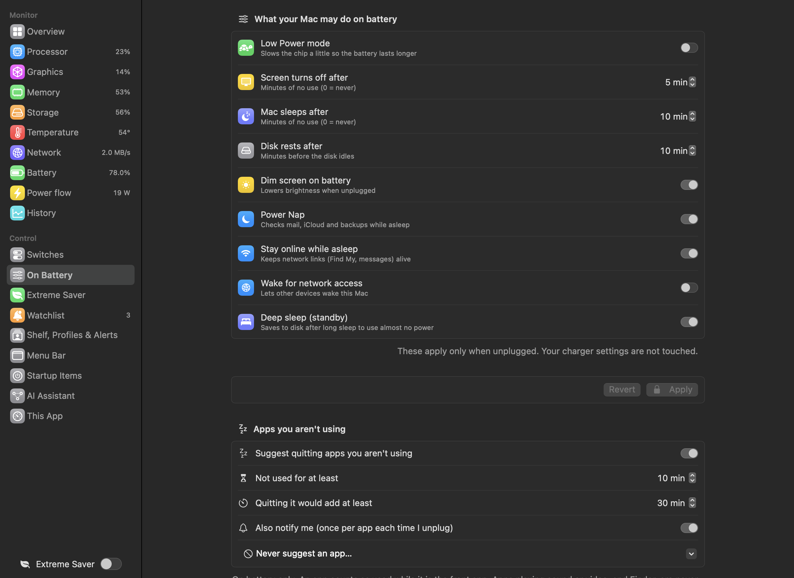

<h1 align="center">Sparewatt documentation</h1>

How to use Sparewatt, the macOS menu bar app that shows what your Mac's processor, graphics, memory, storage, battery and power are doing — and helps you keep battery time for the things you actually use.

This repository holds **documentation only** — no app code. The app itself lives in its own repository.

## Features

**[Every feature in detail](features/README.md)** — purpose, what it does, use cases, benefits, settings and limits, with a
catalogue and everyday scenarios ("a full day on battery", "the battery drops overnight", "running local AI models").

| Area | Page |
|---|---|
| Menu bar: readings, grouped item with outline, hover panels, colours, warnings | [Menu bar](features/01%20Menu%20bar.md) |
| Processor, graphics, memory | [Processor, graphics and memory](features/02%20Processor%2C%20graphics%20and%20memory.md) |
| Temperature and fans, network, storage space | [Temperature, network and storage space](features/03%20Temperature%2C%20network%20and%20storage%20space.md) |
| Named processes, quitting, background normals, Watchlist | [Who is using it](features/04%20Who%20is%20using%20it.md) |
| Battery state, charge plan, wear, overnight drain | [Battery](features/05%20Battery.md) |
| Power flow, USB power out, power per app, idle apps | [Power](features/06%20Power.md) |
| Energy modes, On Battery settings, Extreme Saver, profiles | [Power controls](features/07%20Power%20controls.md) |
| Every notification | [Alerts and notifications](features/08%20Alerts%20and%20notifications.md) |
| Latest File, Shelf, caches, Downloads tidy-up, clipboard | [Files and storage](features/09%20Files%20and%20storage.md) |
| Local services on/off | [Switches](features/10%20Switches.md) |
| Dashboard, Mac health, history, Startup Items, This App | [Dashboard, history and this app](features/11%20Dashboard%2C%20history%20and%20this%20app.md) |
| AI Assistant: an MCP server for Claude Code, Codex and other assistants | [AI Assistant](features/12%20AI%20Assistant.md) |

## Guide

| Page | What it covers |
|---|---|
| [Getting started](guide/01%20Getting%20started.md) | install, first launch, the unsigned-app warning, updating from 1.4 |
| [Menu bar and panels](guide/02%20Menu%20bar%20and%20panels.md) | the menu bar item, hover panels, what each part shows |
| [Battery and power](guide/03%20Battery%20and%20power.md) | power per app, idle-app suggestions, charge plan, wear, charger and sleep checks |
| [Controls](guide/04%20Controls.md) | energy modes, On Battery settings, Extreme Saver, profiles, Watchlist, Switches, alerts |
| [Files and storage](guide/05%20Files%20and%20storage.md) | Latest File, the Shelf, Downloads tidy-up, caches, folder sizes, clipboard |
| [Dashboard and history](guide/06%20Dashboard%20and%20history.md) | the dashboard window, history charts, battery stretches, CSV export, Mac health |
| [How the estimates work](guide/07%20How%20the%20estimates%20work.md) | energy impact, watts per app, battery time gained, the idle-app rule |
| [Privacy and permissions](guide/08%20Privacy%20and%20permissions.md) | what stays on your Mac, which prompts appear and why |
| [Troubleshooting](guide/09%20Troubleshooting.md) | hidden menu bar item, missing readings, password and permission prompts |

## Reference

- [Keyboard shortcuts](reference/Keyboard%20shortcuts.md)
- [Where Sparewatt keeps its data](reference/Data%20files.md)
- [Changelog](CHANGELOG.md)
- [Research](research/README.md) — notes on similar Mac apps and what their users complain about, written while designing Sparewatt

## Screenshots

| Processor | Memory | Temperature & fans |
|---|---|---|
|  |  |  |

| Battery | Power | Graphics | Network |
|---|---|---|---|
|  |  |  |  |

| History | On Battery settings |
|---|---|
|  |  |

Screenshots were taken before the rename; apart from the name, the app looks the same.

## License

Sparewatt is **free to download and use**. It is not open source: its code is private, and all rights are reserved.
You may share the official download unchanged and free of charge; you may not sell it, distribute changed copies, or
reverse engineer it. It comes as is, without warranty. These pages are © 2026 Shiraz Ahmad.
