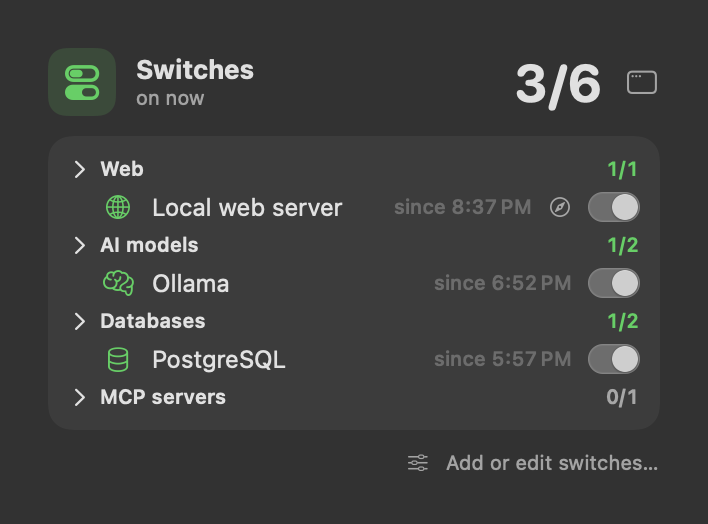
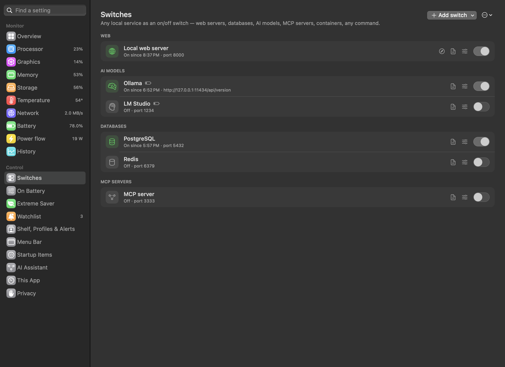

[Home](index.md) · [Getting started](Getting-started.md) · [Features](Features.md) · [Switches](Switches.md) · [Developer guide](Developer-guide.md) · [Troubleshooting](Troubleshooting.md) · [Changelog](Changelog.md) · [Download](https://github.com/MShirazAhmad/Sparewatt-docs/releases/latest)

---

# Switches

**Purpose.** Turn local services — web servers, databases, AI model servers, MCP servers, containers, background agents,
any command — on and off with one switch, see at a glance which are running, and stop the heavy ones on battery.

---

## What a switch is

<p align="center"><br><em>Switches panel: one row per group with how many are on (Web, AI models, Databases…); switches that are on, starting or failing always show.</em></p>

Each switch has:

| Field | Meaning |
|---|---|
| Name, group, icon | how it is shown; switches are grouped under headings (Web, AI models, Databases…); the icon is picked from a searchable grid of symbols |
| Start command | run in your login shell (`zsh -l`), so Homebrew, pyenv and nvm paths work |
| Stop command | optional; empty = stop what the start command launched |
| Run in folder | where the commands run (home if empty) |
| Running when | how Sparewatt knows it is on (below) |
| Open in browser | optional address, e.g. `http://127.0.0.1:8000/` |
| Status command | optional; its last line of output is shown under the switch's name while it is on ([Progress and logs](#progress-and-logs)) |
| Log file | optional; the log the service writes itself, opened by the row's log button |
| Stop on battery | stopped when you unplug, started again on the charger |
| Start when Sparewatt starts | turned on at launch |

**Running checks** (every 10 seconds while a panel or the dashboard is open, otherwise once a minute; opening the
Switches panel checks at once):

| Check | On when |
|---|---|
| A port answers | something listens on that port on this Mac |
| A web address answers | the address replies (any status below 500) |
| A process is running | a process matching the text exists |
| A command succeeds | the command exits with 0 within 4 seconds |
| Started by this app | the process Sparewatt started is still running |

Output of every start and stop is added to a log, `~/Library/Logs/Sparewatt/<name>.log`; earlier starts and stops stay
in it. A log that grows past 5 MB is set aside as `<name>.old.log` and a new one begins.

---

## Progress and logs

*From Sparewatt 1.30.*

A switch says on or off. For a job that takes a while (a backup, a download, a queue being worked through) you can
also have it say how far it has got.

**Status command.** In the editor's *Progress* section, type a command that prints one line about the job. While the
switch is on, Sparewatt runs it at every check (every 10 seconds while a panel or the dashboard is open, otherwise once
a minute) and shows the last line it printed under the switch's name, in the dashboard and in the menu bar panel:

| The command prints | The row shows |
|---|---|
| `412 MB / 2.1 GB, 19%, ETA 6m` | that line, and a bar at 19% |
| `37 of 120 files` | that line, no bar |
| nothing | *On since 09:12*, as before |

- A bar is drawn when the line has a percentage from 0 to 100 (`19%`, `19.5 %`); with several, the last one counts.
- The command has 4 seconds, runs in your login shell in the switch's folder, and only while the switch is on.
- Only the last line that has text is used, up to 160 characters; hover the line to read all of it.
- **Test** runs the command once and shows what it printed.

Most services already write progress to a log, so the usual status command reads the end of that log:

```
tail -n 1 ~/Library/Logs/my-backup.log
```

**Log file.** A switch's own log (`~/Library/Logs/Sparewatt/<name>.log`) holds only what its start and stop commands
print. A service started through `launchctl`, `brew services` or Docker writes its log somewhere else: name that file
under *Log file*, and the row's log button opens it instead.

The [developer guide](Developer-guide.md#show-progress-for-a-long-job) has worked examples: an rclone
backup run by launchd, rsync, a download, a queue.

---

## Presets

<p align="center"><br><em>Dashboard → Switches: add from a preset or edit each switch's start, stop and running check.</em></p>

*Add switch* offers ready-made switches; fill in your own paths:

| Preset | Starts / stops | Running when | Stops on battery |
|---|---|---|---|
| Django dev server | `manage.py runserver 8000` in your project | port 8000 | |
| Apache (Homebrew) | `brew services start/stop httpd` | port 8080 | |
| nginx (Homebrew) | `brew services start/stop nginx` | port 8080 | |
| Ollama | `ollama serve` / stop | Ollama's address answers | yes |
| LM Studio server | `lms server start/stop` | port 1234 | yes |
| llama.cpp server | `llama-server -m model.gguf --port 8081` | port 8081 | yes |
| MCP server (HTTP / SSE) | your server's command | port 3333 | |
| Docker container | `docker start/stop NAME` | the container is running | |
| PostgreSQL (Homebrew) | `brew services start/stop postgresql@16` | port 5432 | |
| Redis (Homebrew) | `brew services start/stop redis` | port 6379 | |
| launchd agent | `launchctl bootstrap/bootout` | the agent is loaded | |
| Any command | your own | your choice | |

---

## Where to use them

- **Menu bar SWITCH part** — "2/5" (how many are on), "…" while one is changing, red when one failed; it steps aside
  while none is on, changing or failed (Menu Bar settings: *Switches: show even when none is on*). Hover or click for
  a panel with one card: a row per group with its count ("Servers 0/7"). Switches that are on, starting or failing
  always show under their group; click a group to see all its switches (it stays open until you click it again). A
  switch that is on shows *since 09:12* and an *open in browser* button; *Add or edit switches…* is at the bottom.
- **Right-click menu** — every switch with a tick when on; click to flip it.
- **Dashboard → Switches** — the full list with errors, each switch's status line and bar, *Open its log*, *Edit*,
  *Add switch*, and the editor: *Test* tells you whether the running check sees it on right now.

When a switch doesn't come up within 30 seconds: "Didn't come up — see its log" (a start command that is still running,
such as a slow server loading, gets 60 seconds). When it doesn't stop: "Still running — check the stop command".
Sparewatt keeps checking, so a switch that gets there later turns on (or off) and the message goes away.

---

## Use cases

- **Local AI:** Ollama, LM Studio or llama.cpp hold gigabytes of memory and the graphics chip. Switch them on when you
  need them; let *Stop on battery* switch them off when you unplug and back on at your desk.
- **Web development:** Django, nginx, PostgreSQL and Redis for one project, in one group; on when you work on it, off
  when you don't.
- **MCP servers** for AI tools, on only when used.
- **Containers:** start and stop Docker containers without the Docker app's window.
- **Background agents:** load and unload a launchd agent without Terminal.

## Benefits

- One place, one click, no Terminal, no remembering commands and ports.
- You always see what is running — background servers no longer hide and drain the battery.
- *Stop on battery* makes heavy servers battery-friendly by default.

## Good to know

- A ring leaves a switch's icon each time its health check runs and finds it on: every 10 seconds while a panel or the
  dashboard is open. A switch set to *Started by this app* has no check to run, so it has no ring.
- Commands run as you, exactly as typed.
- *Delete* in the editor removes the switch at once (no confirmation).
- Switches are saved in `~/Library/Application Support/Sparewatt/switches.json`; you can edit it by hand and use
  *Reload from file*. A field you leave out takes its usual default; an entry that isn't a switch at all is left out.
  If the file can't be read in full, the Switches page says so, and the file as it was is kept as `switches.json.bak`
  before anything is saved over it.
- A switch that checks a web address makes a request to that address — the only network use besides the update check.

---

[Home](index.md) · [Getting started](Getting-started.md) · [Features](Features.md) · [Switches](Switches.md) · [Developer guide](Developer-guide.md) · [Troubleshooting](Troubleshooting.md) · [Changelog](Changelog.md) · [Download](https://github.com/MShirazAhmad/Sparewatt-docs/releases/latest)

Sparewatt is free. © 2026 Shiraz Ahmad. [These pages on GitHub](https://github.com/MShirazAhmad/Sparewatt-docs)
