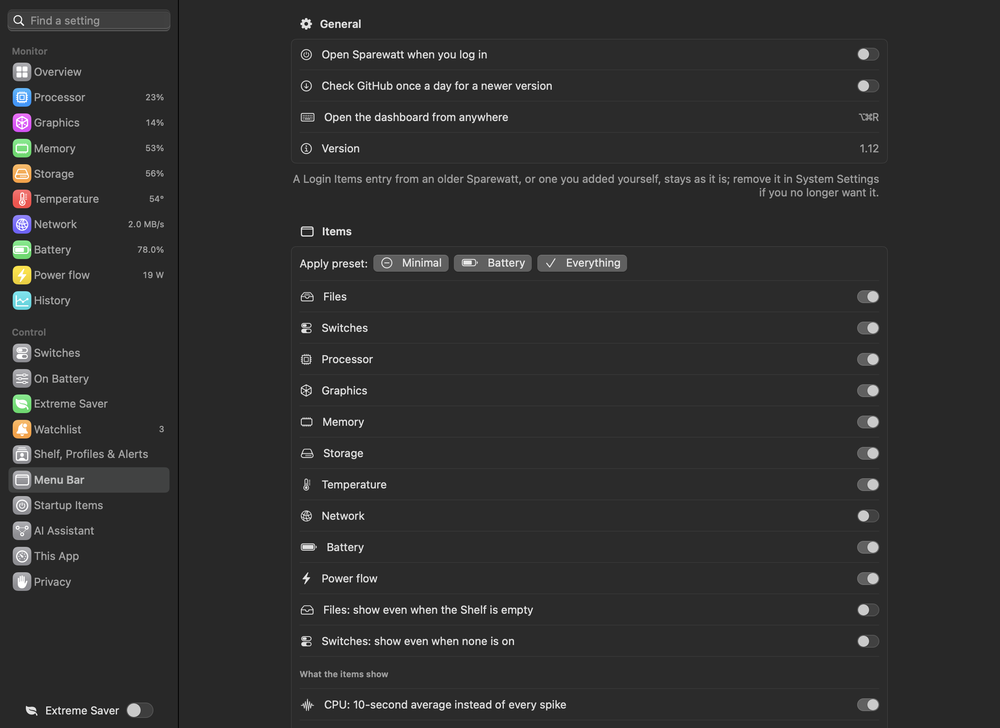

# Menu bar

The menu bar is where Sparewatt lives. Everything else — panels, dashboard, alerts — starts from here.

---

## Live readings

 <em>The menu bar item. SWITCH — services on / your switches · CPU · GPU · RAM · STORAGE FREE · TEMP · NET ↓ download ↑ upload · battery state and real fill · ADAPTER — watts the Mac draws.</em>

**Purpose.** See how hard the Mac is working without opening anything.

**What it does.** Shows up to ten readings, each as a small caption over a value:

| Part | Shows | Notes |
|---|---|---|
| FILES | how many files are on the Shelf | opens Latest File, the Shelf and the clipboard; hide it to have them in the Storage panel; steps aside while the Shelf is empty |
| SWITCH | how many of your Switches are on, e.g. `2/5` | only when you have Switches; `…` while one is changing; steps aside while none is on, changing or failed |
| CPU | processor load | a 10-second average by default, so short spikes don't make it jump |
| GPU | graphics load | optionally the memory the graphics chip holds (100 MB and up) |
| RAM | memory used (apps + system + compressed) | |
| STORAGE | storage used, or free space, or read/write speed during big copies | read/write appears after 3 s above 20 MB/s, returns after 10 s below 5 MB/s |
| TEMP | processor temperature | `n/a` when the Mac has no such sensor |
| NET | download and upload speed | **hidden by default** |
| BATT | the battery's state (ON BATTERY, ⚡︎ CHARGING, ⏸︎ ON HOLD, ⇥ AT LIMIT, ✓ FULL, CHARGER LOW) over its real fill to 0.1% | a leaf while Extreme Saver is on; with the Power part hidden it also shows the time left or to full, and the battery's watts |
| Power | the time and the flow that go with it: `3:01 LEFT ↓8W` on battery, `5:02 TO FULL ↑13W` while charging, `MAC USES 37W` when the battery rests | glows red when plugged in but the battery still drains (the charger is too small); the two parts read as one pair, nothing said twice |

**Use cases.**
- Glance up during a video call to see whether the processor or memory is why things feel slow.
- Watch the battery part while unplugged to see the time left move as you open and close apps.
- Notice a big file copy running (STORAGE switches to read/write speed).

**Benefits.**
- One glance answers "is my Mac busy, and with what kind of work?".
- Battery readings are the battery's own numbers (real fill to 0.1%, true charge state), not the rounded percentage macOS shows.
- Items keep a steady width while only a digit or so changes (for up to 30 seconds), so neighbouring menu bar icons
  don't jump around; a short burst of a wide value (say during a big copy) doesn't leave a wide gap behind.

**Where.** The menu bar. Choose which parts appear on Dashboard → **Menu Bar** → *Items*.

**On a Mac with no battery** (Mac mini, Mac Studio, iMac, Mac Pro) the battery part steps aside and the power part reads
`MAC USES 22W`, the Mac's draw as its system management controller reports it; on a Mac that doesn't report it, the
power part steps aside too. See [Macs without a battery](05%20Battery.md#macs-without-a-battery).

---

## FILES and SWITCH step aside

**Purpose.** Don't spend menu bar room on a part that would only say 0.

**What it does.** FILES hides while the Shelf is empty, and SWITCH while no switch is on, changing or failed. Each comes
back by itself as soon as there is something to show: a file on the Shelf, a switch turned on, starting or failing.
Dropping files on the menu bar, or ⌥⌘V, still opens the Files panel while FILES is hidden.

**Settings.** Dashboard → **Menu Bar** → *Items*: *Files: show even when the Shelf is empty* and
*Switches: show even when none is on* (both off).

---

## Presets and open at login

**Purpose.** Set up the menu bar in one click, and have Sparewatt there after every restart.

**What it does.** Dashboard → **Menu Bar** starts with **Open Sparewatt when you log in**. It uses macOS's own
login-item service: Sparewatt is listed in System Settings → General → Login Items, and macOS may first ask for your
OK there (the switch says so, with *Open Login Items…*). A login item from an older Sparewatt, or one you added
yourself, stays as it is and the switch doesn't see it; remove it in Login Items if you no longer want it.

Under *Items*, **Apply preset** sets the item switches:

| Preset | Shows |
|---|---|
| Minimal | CPU, RAM, battery |
| Battery | battery, power, temperature |
| Everything | every item Sparewatt comes with (NET stays off until you switch it on; FILES and SWITCH show only while in use) |

The preset that matches your switches is ticked. A preset changes only which items show; grouping, icons, colours and
text size stay as they are. New installs choose one in the
[welcome window](../guide/01%20Getting%20started.md#the-welcome-window), with a live preview.

---

## Steadier figures

**Purpose.** A menu bar that changes only when something really changes, and costs less to draw.

**What it does.** A shown figure moves only when the reading changes by enough, or after 10 seconds:

| Part | Moves on |
|---|---|
| CPU, GPU, RAM | 2 points |
| TEMP | 2° |
| Watts (Mac and battery) | 2 W; a switch between charging and draining shows at once |
| NET | 30% of the speed |

Red warnings still look at the exact readings. The grouped item is drawn once per change, from the parts already drawn.
While the screen is asleep or locked, readings drop to every 30 seconds and the menu bar isn't drawn at all; waking or
unlocking refreshes it at once.

**At most every 4 seconds.** When only figures changed, a new reading redraws the menu bar at most every 4 seconds,
whatever the update speed; the panels still follow the update speed. A change of state redraws it at once: the charger
going in or out, charging, a warning, Extreme Saver. Changes to settings, the Shelf and Switches redraw it at once too.

**Benefits.** Fewer redraws mean less processor time: with no panel open, Sparewatt uses about 0.77% of one core
(measured with Instruments over 30 seconds).

---

## One grouped item

**Purpose.** Save menu bar space, especially on MacBooks with a camera notch.

**What it does.** Draws every reading inside **one** menu bar item, side by side with small gaps, instead of one item per
reading. Hovering still opens the right panel for the part under the pointer. VoiceOver reads it as one sentence
("cpu 12%, ram 54%…").

**Use cases.** A crowded menu bar where macOS hides items behind the notch.

**Benefits.** Takes less room than separate items; nothing gets pushed off-screen.

**Outline and shade.** The grouped item sits inside a thin rounded outline with a soft shade behind it, so it reads as one
unit and stands apart from other menu bar icons. The letters are centred about 2 pt clear of the line, and the colours
follow a light or dark menu bar.

**Settings.** *Group all items into one (saves space)* — **on** by default. Turn it off to get separate items you can
⌘-drag. *Outline and shade behind the grouped item* — **on** by default.

---

## Hover panels

**Purpose.** Details for one reading without opening a window.

**What it does.** Pointing at a part opens its panel (330 pt wide); moving away closes it. Clicking opens it too and
keeps it until you click again. Panels taller than the screen scroll inside. What you open or tick in a panel (a row, a
sensor group, a folder) is remembered while Sparewatt runs. Each panel header has a button to open the dashboard.

| Part | Opens |
|---|---|
| CPU / GPU | Processor / Graphics |
| RAM | Memory |
| STORAGE | Storage |
| TEMP | Temperature |
| NET | Network |
| BATT | Battery |
| Power | Power |
| SWITCH | Switches |
| FILES | Files (Latest File, Shelf, clipboard) |

**Benefits.** Answers the follow-up question ("which app?") in one move of the mouse.

**Settings.** *Pop up an item's panel when the mouse is over it* — on by default.

---

## The Menu Bar settings page

Dashboard → **Menu Bar** has six sections, each one kind of setting:

| Section | Holds |
|---|---|
| General | *Open Sparewatt when you log in*, the daily update check, the ⌥⌘R shortcut, the version |
| Items | *Apply preset*, which items show, and what each item shows (CPU average, graphics memory, free space, trend line…) |
| Look | grouping, the outline, words or icons, text size, update speed |
| Colours | drain colours, colours by value, and storage turning orange when memory spills to the SSD |
| Alerts | the red glow and its limits, and the *Still high* and *Unusual background activity* notifications |
| Panels | hover to open, live diagrams (still pictures when macOS's Reduce Motion is on), the clipboard, Latest File and where it looks |

Looking for one setting? Type a word or two into *Find a setting* at the top of the dashboard sidebar
([more](11%20Dashboard%2C%20history%20and%20this%20app.md#find-a-setting)).

---

## Words or icons, size and speed

 <em>Dashboard → Menu Bar. Which items show, words or icons, grouping, colours, warnings and refresh speed.</em>

**Purpose.** Make the readings fit your menu bar and your battery.

**Settings** (Dashboard → Menu Bar → *Items* and *Look*):

| Setting | Default | Options |
|---|---|---|
| Small icons instead of words (CPU, RAM…) | off | |
| Text size | Normal | Compact, Normal, Large |
| Update speed | every 2 seconds | 1, 2, 5, 10 seconds (Extreme Saver can slow it to 30 s; always 30 s while the screen is asleep or locked) |
| CPU: 10-second average instead of every spike | on | |
| CPU: two tiny bars — performance and efficiency cores | off | Apple silicon only |
| GPU: memory it holds | off | |
| Storage: show free space instead of % used | off | |
| Storage: show read/write speed during big copies | off | |
| Last-minute trend line on | none | Processor, Graphics, Temperature, Network, Power flow |

**Benefits.** Slower updates use a little less battery; the page shows what Sparewatt itself uses right now.

---

## Colours by value

**Purpose.** See at a glance how heavy the load is, without reading numbers.

**What it does.** Colours an item in five bands — green, lime, yellow, orange, red — by its value. Each item has its own
four limits (memory follows macOS's memory pressure instead, because how full memory is says little on macOS, which
keeps it full on purpose). The colour goes by the same figure the item shows, and a figure sitting on a limit keeps its
colour until it is clearly past it. Colours are adjusted so they stay readable on both light and dark menu bars.

| Item | Default limits (green ends → red starts) |
|---|---|
| Processor | 30 / 50 / 70 / 85 % |
| Graphics | 30 / 50 / 70 / 85 % |
| Memory | follows macOS's memory pressure: green at ease, orange when it warns, red when critical |
| Storage | 50 / 70 / 85 / 95 % |
| Temperature | 50 / 65 / 80 / 90 °C |

**Use cases.** You want a calm green bar most of the time and a colour change only when something is unusual.

**Settings.** Dashboard → Menu Bar → *Colours*: one switch per item (off by default), its four limits, and
*Reset to defaults*.

---

## Red warnings

**Purpose.** Make an item impossible to miss when it needs attention.

**What it does.** Puts a soft red glow behind an item's text when:

| Item | Glows red when | Default |
|---|---|---|
| Processor | above a limit | 85% |
| Memory | above a limit | 85% |
| Storage | above a limit | 90% used |
| Temperature | above a limit | 90 °C |
| Battery | below a limit while on battery, or when the battery state doesn't add up | 20% |
| SWITCH | a switch failed | |

The text keeps the menu bar's own colour on the glow, so it stays readable; a warning wins over any colour band.

**Settings.** Dashboard → Menu Bar → *Alerts*: *Glow red behind an item when it needs attention* (on), and each limit.

---

## How hard the battery is working

 <em>Five colour bands by value, a red warning, then battery drain from heavy to light: the glow fades and the line shortens. (Sample values.)</em>

**Purpose.** Show how fast the battery is being used, in a way that means something: hours.

**What it does.** Works out how long a **full** battery would last at the last minute's drain and shows it on the
battery and power parts, in two ways:

- **A glow** in that band's colour: red under 1 h, orange under 2 h, yellow under 3.5 h, lime under 5 h. It is strongest
  for heavy drain and fades as the drain gets lighter; from 5 h there is no glow at all, so a colour means something.
  Even heavy drain stays quieter than a red warning.
- **A thin line** along the bottom, as long as the watts: a drain that would empty a full battery within the heaviest
  band fills it. You can read it by its length, without the colour.

With the parts grouped, Battery and Power share one glow and one line. One spike doesn't change anything, and a figure
sitting on a limit keeps its colour until it is clearly past it. The line works on the charger too: green, and as long
as the charging is fast, with no glow. A charger too small for the Mac counts as draining and is at least orange.

**Use cases.** You want to know whether what you are doing right now is "a 10-hour workload" or "a 2-hour workload".

**Settings.** Dashboard → Menu Bar → *Colours*: *Battery and power: a glow and a line* — **off** by default; the four
limits are adjustable (0.1–24 h).

---

## Busy-app name

**Purpose.** Know who is behind a busy processor or graphics chip without opening a panel.

**What it does.** When the processor stays above 80% (or graphics above 50%) for 30 seconds, the app using it most is
named in the menu bar item's tooltip: "CPU busy: Xcode · GPU busy: Safari".

**Settings.** *Name the app behind a busy CPU (80%+) or GPU (50%+) in the item's tooltip* — off by default.

**Limits.** Only in the tooltip — of the grouped item, or of the CPU and GPU items when grouping is off; the labels
themselves stay CPU and GPU.

---

## Hidden-item check

**Purpose.** macOS can hide menu bar items silently — behind the notch, off-screen, or switched off in System Settings.
Then the app seems to have vanished.

**What it does.** Ten seconds after launch and every minute after, Sparewatt checks that its item is really visible. If
not, it shows one alert per run: *Sparewatt is running, but hidden*, with the reason (behind the camera notch, off every
screen, or not shown by macOS) and a button that opens System Settings → Menu Bar.

**Benefits.** You find out why, instead of reinstalling.

**Settings.** The alert has a *Don't show again* box.

---

## Right-click menu

**What it has.**
- *Update available…* (only when an update was found)
- *Open Dashboard (⌥⌘R)*
- *Settings…* (opens the dashboard on **On Battery**)
- *Turn Extreme Saver On / Off*
- your **Switches** with a tick when on, and *Manage switches…*
- *Quit Sparewatt*

---

## Drop files on the menu bar

Drop files on any part of the menu bar item: they go onto the **Shelf** and the Files panel opens. See
[Files and storage](09%20Files%20and%20storage.md).
