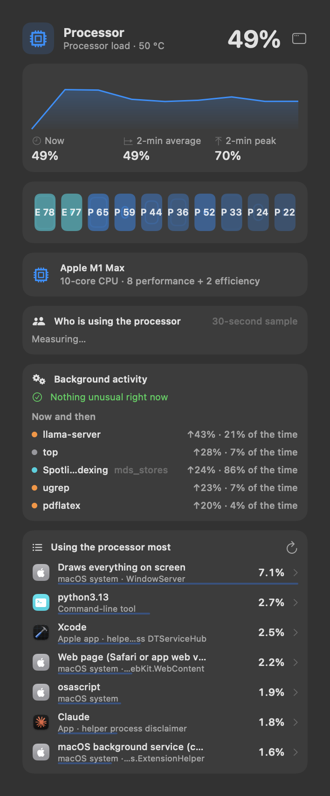
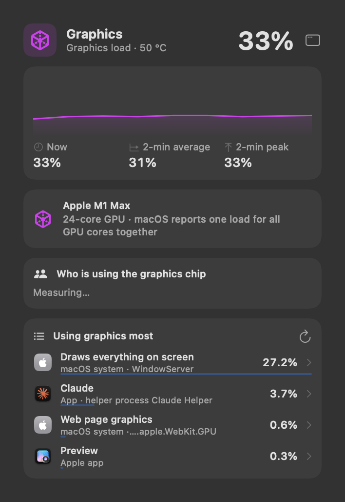
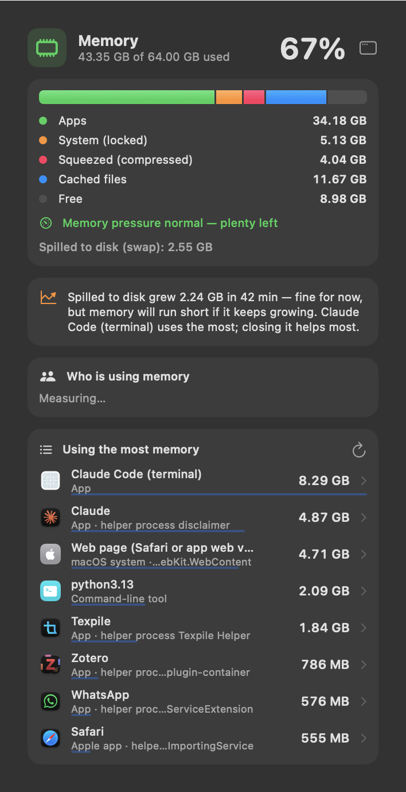

# Processor, graphics and memory

---

## Processor panel

 <em>Processor panel, top to bottom: load and temperature · 2-minute graph (now, average, peak) · one bar per core (E efficiency, P performance) · the chip · who is using it · background activity · apps using the processor most.</em>

**Purpose.** Tell whether the processor is the reason the Mac feels slow or warm, and who is using it.

**What it does.**
- **Header:** processor load in % and, when the Mac has a sensor, its temperature.
- **Load card:** a sparkline of the last 60 readings (two minutes at the default update speed) with *Now*, *2-min
  average* and *2-min peak*.
- **Cores:** each core's load — efficiency cores (teal) first, then performance cores (blue) — as live tiles, or as bars
  when live diagrams are off.
- **Chip card:** "10-core CPU · 8 performance + 2 efficiency".
- **Background activity** (see [Who is using it](04%20Who%20is%20using%20it.md)) and *Who is using the processor*.
- **Using the processor most:** the apps and processes with the highest share, as a share of the **whole** processor.
- **Dashboard only:** the processor's load over 24 hours and the full background-processes table.

**Use cases.**
- The fan spins up during a quiet moment: open the panel and see which app is busy.
- Check whether a long export or compile is using every core or just one.
- See whether slowness is the processor at all — if it is low, look at memory or storage instead.

**Benefits.**
- Load is averaged over 10 seconds by default, so you see real work, not every spike.
- Apps and their helper processes are folded together under the app's name, so "Google Chrome" is one row, not twenty.

**Where.** CPU part of the menu bar; Dashboard → **Processor**.

**Limits.** Performance/efficiency split is Apple silicon only.

---

## Graphics panel

 <em>Graphics panel: load and temperature · 2-minute graph · the graphics chip · apps using it most.</em>

**Purpose.** See how busy the graphics chip is and which app is drawing with it.

**What it does.** The same layout as the processor: header, load card, chip card ("32-core GPU · macOS reports one load
for all GPU cores together"), *Who is using the graphics* and *Using the graphics most* — measured from the graphics
time each app used over one second.

**Use cases.** A video, game, 3D view or a local AI model makes the Mac hot — check which one holds the graphics chip.

**Benefits.** Activity Monitor doesn't show graphics per app by default; this does.

**Where.** GPU part of the menu bar; Dashboard → **Graphics**.

**Settings.** *GPU: memory it holds (shared with RAM)* adds the graphics chip's memory to the menu bar (off by default).

**Limits.** Only apps actually drawing with the graphics chip are listed; the core count is reported on Apple silicon
only.

---

## Memory panel

 <em>Memory panel: used of total · bar of apps, system, compressed, cached and free · memory pressure and swap · swap forecast · apps using the most memory.</em>

**Purpose.** Understand whether memory is the bottleneck — and what to close if it is.

**What it does.**
- **Header:** memory used, "X of Y used" (apps + system + compressed).
- **Breakdown bar:** *Apps*, *System (locked)*, *Squeezed* (compressed), *Cached files* (macOS reuses these freely),
  *Free*.
- **Memory pressure:** normal ("plenty left"), medium ("apps may slow down") or high ("quit something") — macOS's own
  judgement, more useful than the percentage.
- **Swap:** "Spilled to disk (swap): X", orange when over 1 GB under raised pressure.
- **Memory forecast:** when swap grew by more than 500 MB within the last hour, a card warns that memory will run short
  and names the app using the most.
- **Using the most memory:** apps by memory held.

**Use cases.**
- Many browser tabs and the Mac stutters: check pressure and swap, then close the biggest app.
- Before starting something memory-hungry (a virtual machine, a large dataset), check how much is really free.

**Benefits.**
- "Used memory" alone is misleading on a Mac (cached files count as used). Pressure and swap tell you whether it
  matters.
- The forecast warns before the Mac slows down, not after.

**Where.** RAM part of the menu bar; Dashboard → **Memory**.

**Settings.** *Storage turns orange when memory spills to the SSD above N GB* (off, 1 GB) — Dashboard → Menu Bar →
*Details*.
