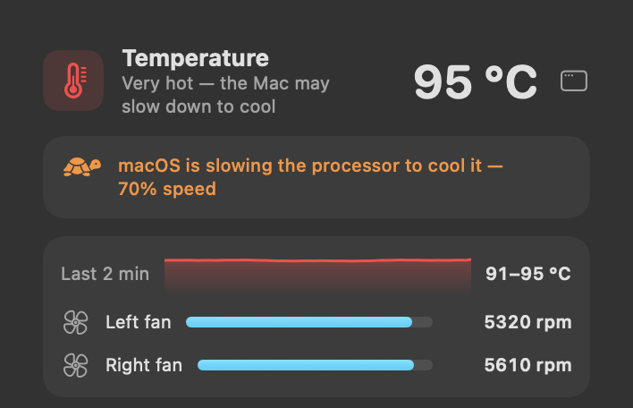
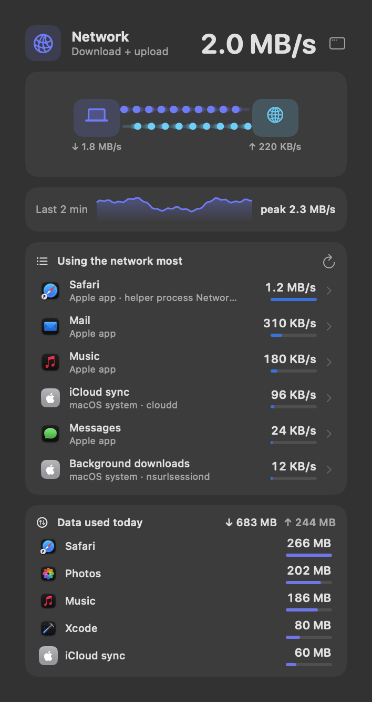
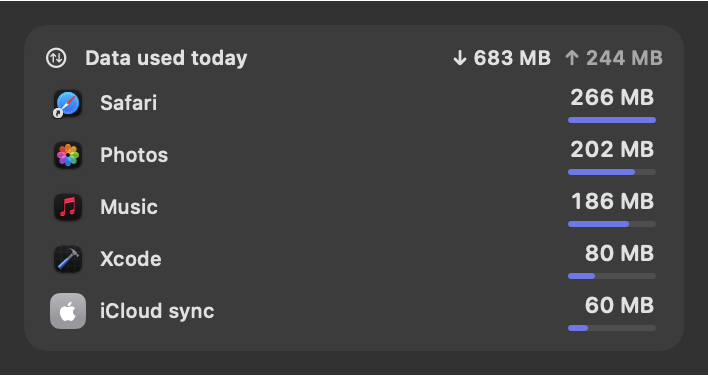
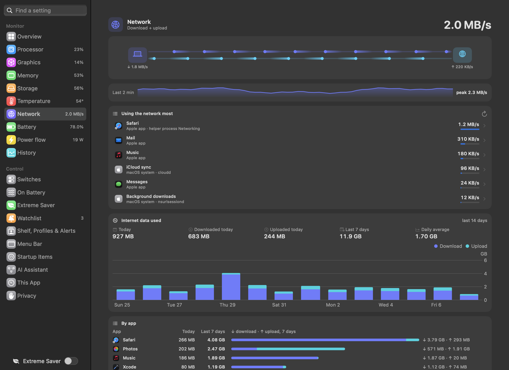

# Temperature, network and storage space

---

## Temperature and fans

 <em>Temperature panel: overall state · temperature graph · each fan's speed · processor, graphics, chip, SSD and battery tiles · every sensor, grouped.</em>

**Purpose.** Know whether the Mac is hot, how hot each part is, and how hard the fans are working.

**What it does.**
- **Header:** processor temperature with a plain verdict — *Cool* (under 45 °C), *Normal* (under 75), *Hot — fans
  working harder* (under 90), *Very hot — the Mac may slow down to cool*. Under 75 °C it names the part: "Processor ·
  Normal".
- **Slowing down to cool:** a line under the header, only while macOS is cooling the Mac: *Warm: macOS has started
  cooling the Mac*, *macOS is slowing the processor to cool it — 70% speed*, or *…slowing the processor hard…* when
  it is critical. The speed is macOS's own limit (from `pmset`), shown when it records one. When the slow-down starts,
  one notification per episode (*Mac is slowing down to cool*) and a *Needs action* finding on the Overview's
  [Mac health](11%20Dashboard%2C%20history%20and%20this%20app.md#overview-and-mac-health); warm for 10 minutes is
  *worth a look*.
- **Fans card:** a thin *Last 2 min* strip of the processor temperature with its range ("41–58 °C", or "steady"), then
  each fan's speed in rpm against its maximum (up to four), or "No fans — this Mac is fanless". With live diagrams off,
  the graphics, storage and battery temperatures are in this card too.
- **Chip heat map:** processor, graphics, chip, storage and battery zones that glow as they heat up.
- **All sensors:** folded to one line with the number of sensors and the hottest one. Click it for every temperature
  sensor the Mac reports, grouped (Processor, Graphics, Chip, Chip area, Storage, Battery, Other) with range and
  average; click a group to open it.
- **Dashboard only:** processor temperature over 24 hours.

 <em>Slowing down to cool: one line under the header while macOS slows the processor, with its speed limit. (Sample values.)</em>

**Use cases.**
- The Mac feels hot on your lap: check whether it is the processor, graphics or battery.
- A long render slows down: see whether the chip is near the point where macOS slows it to cool.
- A fanless MacBook Air: see how close it is to throttling.

**Benefits.**
- Plain words instead of raw numbers.
- A missing sensor shows *n/a*, never a made-up 0 — readings differ by chip.

**Where.** TEMP part of the menu bar; Dashboard → **Temperature**.

**Settings.** Red above 90 °C by default (Dashboard → Menu Bar → *Alerts*); optional colour bands.

---

## Network

 <em>Network panel: total speed · download and upload flow · 2-minute peak · apps using the network most · data used today.</em>

**Purpose.** See how much the Mac is downloading and uploading, and which app is doing it.

**What it does.** Total download + upload speed; the live diagram as the main picture, with a thin *Last 2 min* strip
and the two-minute peak under it (with live diagrams off: a sparkline with download, upload and the peak); and *Using
the network most* (per app, measured over one second; this list includes traffic inside the Mac, between local apps).

**Use cases.**
- A video call stutters: check whether something else (a sync, a backup, an update) is uploading.
- Check that a large upload is actually moving.
- On a metered hotspot, catch an app downloading in the background.

**Where.** NET part of the menu bar (hidden by default — switch it on under Dashboard → Menu Bar →
*Items*); Dashboard → **Network**.

---

## Data used per app

 <em>Data used today: download and upload so far today, and the five apps that used the most.</em>

**Purpose.** On a phone hotspot or a capped plan: how much internet data you used today and this week, and which app
used it.

**What it does.**
- **Network panel:** a *Data used today* card with download and upload so far today, and the five apps that used the
  most.
- **Dashboard → Network:** today (down and up), the last 7 days and the daily average; each app's figure for today and
  the last 7 days, split into download and upload; and a chart of each day's total for 14 days.

 <em>Dashboard → Network: today, the last 7 days and the daily average, each day's total for 14 days, and each app's figures.</em>

Sparewatt runs one `nettop` for as long as it runs and reads it once a minute. A download that opens and closes between
two readings still counts, which a short reading now and then would miss. Helpers count toward their app. Only internet
traffic counts (Wi-Fi, Ethernet, hotspot), not apps talking to each other inside the Mac.

**Use cases.**
- Tethered to a phone: see that a cloud sync used 3 GB before the plan runs out.
- Check what a video call or an update really cost.

**Where.** Network panel; Dashboard → **Network**. Counting runs whether or not NET is shown in the menu bar.

**Settings.** *Notify when today's internet data passes* — off, or 1, 2, 3, 5, 10, 20 or 50 GB a day (Dashboard →
Shelf, Profiles & Alerts → *More alerts*). One notification the first time each day, naming the app that used the most.

**Limits.** Counting starts when Sparewatt first runs and only while it runs. Kept 14 days, on this Mac only, in
`data-usage.json` ([Where Sparewatt keeps its data](../reference/Data%20files.md)).

---

## Storage space

 <em>Storage: free of total and the SSD temperature · the used space by home folders, macOS &amp; System Data and purgeable · drive health and the last backup.</em>

**Purpose.** Know how full the disk is and where the space went — including the parts Finder doesn't explain.

**What it does.**
- **Header:** % used, and "146 GB free of 926 GB · 33 °C" (the storage chip's temperature). Free counts space macOS
  can free on demand.
- **Usage card:** one bar of the used space, "781 GB used" beside it, split into your **biggest home folders** and
  **macOS, apps & System Data** (the rest; its tooltip says how many local Time Machine snapshots are inside), with
  **purgeable** space (macOS frees it when needed) drawn lightly next to free, because the free figure already counts it. Below 10% free: "Getting full — macOS slows down below ~10% free".
- **Drive health and Time Machine:** two lines in the usage card.
  - *Drive health* is the drive's own self-check (SMART), read every 6 hours: *Verified*, *Failing — back up now* (in
    red, and a *Needs action* finding on the Overview), or *not reported* when the drive doesn't give one.
  - *Last backup* reads "yesterday 22:10" (or *Backing up… 40%* while one runs), checked every 30 minutes and when the
    panel opens. Orange, and *worth a look* on the Overview, after 7 days without a backup. With no backup disk set up:
    *not set up*. macOS shows the backup dates only to apps with Full Disk Access, or through `tmutil` while the backup
    disk is connected; with neither, it says *needs Full Disk Access*, with a button to that setting.
- **Read and write:** a short live diagram of the storage traffic (read and write speed as figures with live diagrams
  off).
- **Biggest folders in your home:** the top 8, with growth since an earlier count leading each subtitle, in colour
  ("▲2.1 GB · ~/Projects"); click one to look inside (up to 12 sub-folders at each level), *Back*, *Show in Finder*.

**Use cases.**
- macOS says the disk is almost full but Finder's folders don't add up: see purgeable space and System Data.
- Find which project folder grew by 20 GB this week.
- Before a big download or OS update, check you have room.

**Benefits.**
- Folders that haven't changed aren't counted again (Sparewatt watches macOS's file-change journal), so the list is fast
  and light after the first count.
- Never opens the folders macOS protects (Library, Desktop, Documents, Downloads, Pictures, Movies, Music), so no
  permission prompts appear.

**Where.** STORAGE part of the menu bar; Dashboard → **Storage**. The rest of the Storage panel — app caches and Downloads
tidy-up, two rows of one card — and the Files panel (Latest File, the Shelf, the clipboard) are described in
[Files and storage](09%20Files%20and%20storage.md).

**Settings.** Red above 90% used (Dashboard → Menu Bar → *Alerts*); *Storage: show free space instead of % used*;
*show read/write speed during big copies* (Dashboard → Menu Bar → *Items*).

**Limits.** A folder that takes more than 15 seconds to count is shown with "> " — the size is at least that much. The
list refreshes at most every 10 minutes.
