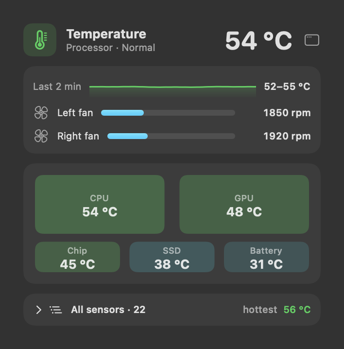
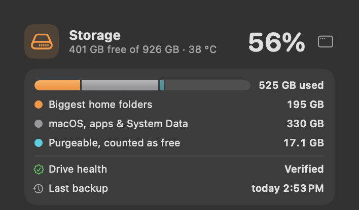

# Temperature, network and storage space

---

## Temperature and fans

 <em>Temperature panel: overall state · temperature graph · each fan's speed · processor, graphics, chip, SSD and battery tiles · every sensor, grouped.</em>

**Purpose.** Know whether the Mac is hot, how hot each part is, and how hard the fans are working.

**What it does.**
- **Header:** processor temperature with a plain verdict — *Cool* (under 45 °C), *Normal* (under 75), *Hot — fans
  working harder* (under 90), *Very hot — the Mac may slow down to cool*. Under 75 °C it names the part: "Processor ·
  Normal".
- **Fans card:** a thin *Last 2 min* strip of the processor temperature with its range ("41–58 °C", or "steady"), then
  each fan's speed in rpm against its maximum (up to four), or "No fans — this Mac is fanless". With live diagrams off,
  the graphics, storage and battery temperatures are in this card too.
- **Chip heat map:** processor, graphics, chip, storage and battery zones that glow as they heat up.
- **All sensors:** folded to one line with the number of sensors and the hottest one. Click it for every temperature
  sensor the Mac reports, grouped (Processor, Graphics, Chip, Chip area, Storage, Battery, Other) with range and
  average; click a group to open it.
- **Dashboard only:** processor temperature over 24 hours.

**Use cases.**
- The Mac feels hot on your lap: check whether it is the processor, graphics or battery.
- A long render slows down: see whether the chip is near the point where macOS slows it to cool.
- A fanless MacBook Air: see how close it is to throttling.

**Benefits.**
- Plain words instead of raw numbers.
- A missing sensor shows *n/a*, never a made-up 0 — readings differ by chip.

**Where.** TEMP part of the menu bar; Dashboard → **Temperature**.

**Settings.** Red above 90 °C by default (Dashboard → Menu Bar → *Warnings*); optional colour bands.

---

## Network

 <em>Network panel: total speed · download and upload flow · 2-minute peak · apps using the network most.</em>

**Purpose.** See how much the Mac is downloading and uploading, and which app is doing it.

**What it does.** Total download + upload speed; the live diagram as the main picture, with a thin *Last 2 min* strip
and the two-minute peak under it (with live diagrams off: a sparkline with download, upload and the peak); and *Using
the network most* (per app, measured over one second; this list includes traffic inside the Mac, between local apps).

**Use cases.**
- A video call stutters: check whether something else (a sync, a backup, an update) is uploading.
- Check that a large upload is actually moving.
- On a metered hotspot, catch an app downloading in the background.

**Where.** NET part of the menu bar (hidden by default — switch it on under Dashboard → Menu Bar → *Show in the menu
bar*); Dashboard → **Network**.

---

## Storage space

 <em>Storage space: used, free and total, with the SSD temperature.</em>

**Purpose.** Know how full the disk is and where the space went — including the parts Finder doesn't explain.

**What it does.**
- **Header:** % used, and "146 GB free of 926 GB · 33 °C" (the storage chip's temperature). Free counts space macOS
  can free on demand.
- **Usage card:** one bar of the used space, "781 GB used" beside it, split into your **biggest home folders** and
  **macOS, apps & System Data** (the rest; its tooltip says how many local Time Machine snapshots are inside), with
  **purgeable** space (macOS frees it when needed) drawn lightly next to free, because the free figure already counts it. Below 10% free: "Getting full — macOS slows down below ~10% free".
- **Read and write:** a short live diagram of the storage traffic (read and write speed as figures with live diagrams
  off).
- **Biggest folders in your home:** the top 8, with growth since an earlier count leading each subtitle, in colour
  ("▲2.1 GB · ~/Projects"); click one to look inside (up to 12 sub-folders at each level), *Back*, *Show in Finder*.

**Use cases.**
- macOS says the disk is almost full but Finder's folders don't add up: see purgeable space and System Data.
- Find which project folder grew by 20 GB this week.
- Before a big download or OS update, check you have room.

**Benefits.**
- Folders that haven't changed aren't counted again (Sparewatt watches macOS's file-change journal), so the list is fast
  and light after the first count.
- Never opens the folders macOS protects (Library, Desktop, Documents, Downloads, Pictures, Movies, Music), so no
  permission prompts appear.

**Where.** STORAGE part of the menu bar; Dashboard → **Storage**. The rest of the Storage panel — app caches and Downloads
tidy-up, two rows of one card — and the Files panel (Latest File, the Shelf, the clipboard) are described in
[Files and storage](09%20Files%20and%20storage.md).

**Settings.** Red above 90% used; *Storage: show free space instead of % used*; *show read/write speed during big
copies* (Dashboard → Menu Bar).

**Limits.** A folder that takes more than 15 seconds to count is shown with "> " — the size is at least that much. The
list refreshes at most every 10 minutes.
