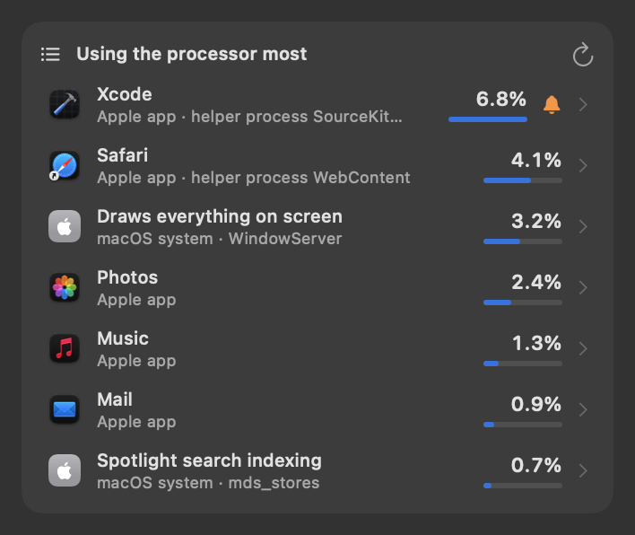
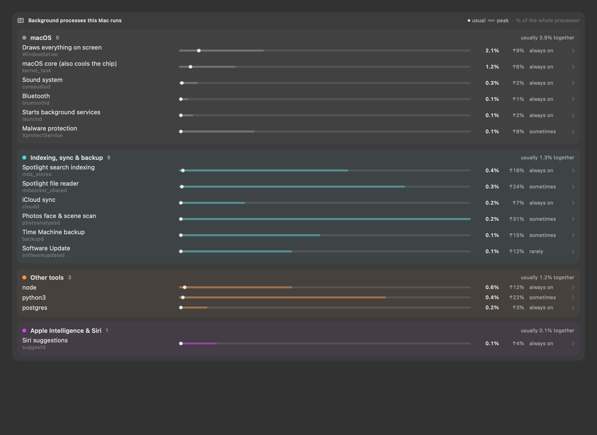
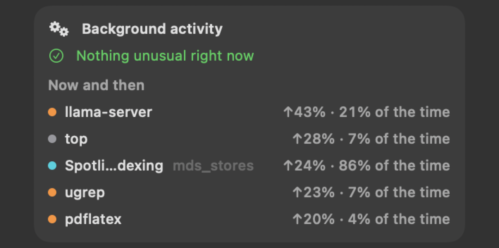
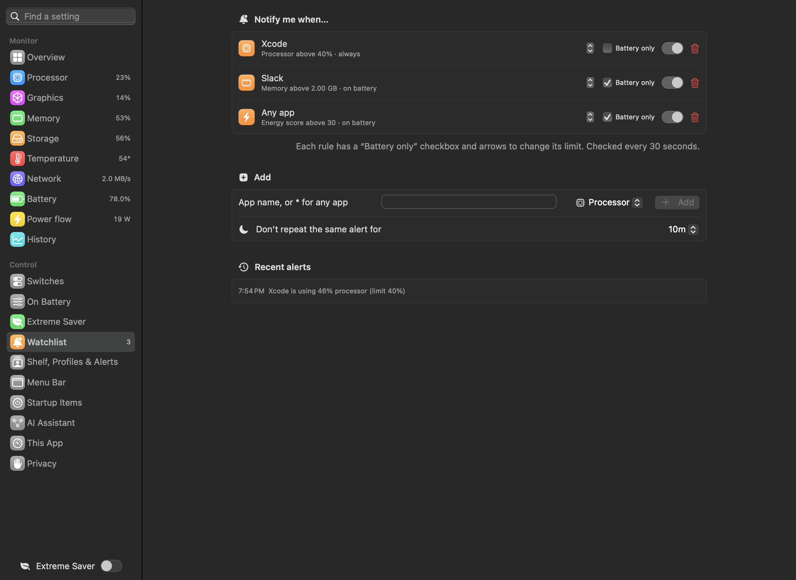

# Who is using it

Numbers are only useful when you know who is behind them. These features name the apps and processes, explain them in
plain words, learn what is normal, and let you stop what you don't need.

---

## "Using the most" lists

 <em>Using the most: each row names the app or macOS part in plain words, says what kind it is (app, macOS system, command-line tool) and its share; › opens a closer look.</em>

**Purpose.** Answer "which app?" for each resource.

**What it does.** Every panel ends with the top 8 users of that resource: processor (share of the whole processor),
graphics, memory, energy (Activity Monitor's *energy impact*, in points), network and storage folders.

Each row says **where it comes from**:

| Badge | Means | Example name |
|---|---|---|
| App | an app you installed (helpers folded in) | Google Chrome |
| Apple app | an app from Apple | Safari |
| macOS system | a part of macOS, in plain words | "Spotlight search indexing" instead of `mds_stores` |
| Command-line tool | a program run from Terminal or a script | python3, "Claude Code (terminal)" |
| Folder | a folder (storage list) | Projects |

Sparewatt knows plain-words names for about 90 macOS background processes; unknown ones are labelled "macOS background
service (name)".

Under each value, a small meter shows its share against the top row. Subtitles are short: ~ for the home folder,
"WebContent" rather than "com.apple.WebKit.WebContent". A folder's growth since the last count leads its subtitle, in
colour ("▲3.82 GB · ~/Projects"). The memory list counts each process's own footprint, as Activity Monitor does, and
shows the iOS Simulator's processes as one *iOS Simulator* row. Sizes from 1000 MB show in GB (0.99 GB, not 1010 MB).

**Use cases.** You see `WindowServer`, `mds_stores` or `kernel_task` high in Activity Monitor and don't know what they
are — here they read "Draws everything on screen", "Spotlight search indexing".

**Benefits.**
- No guessing what a cryptic process is, or whether it is safe to stop.
- One measurement is shared by every panel, the dashboard and the Watchlist, so opening several views costs no extra.

**Where.** Near the end of every panel and monitor page. Hover a row for the 🔔 (Watchlist) and ⋯ (Quit) buttons; click
it to look closer.

---

## Look closer, then Quit or Force Quit

**Purpose.** Go from "this app uses a lot" to "and here is the process, stop it" in one place.

**What it does.** Clicking a row (or a power-chart slice) opens its processes: full name, process ID, owner, energy,
processor and memory, up to 12 rows.
- **Quit app** asks the app to close normally — it can ask you to save.
- **Force Quit** stops it at once; unsaved work is lost. Both ask first.
- Each of **your own** processes can be stopped on its own; processes owned by macOS show a lock ("macOS runs it; it
  can't be stopped from here").
- An explanation of energy vs processor, *Refresh* and *Open Activity Monitor*.

**Use cases.** A browser helper process is stuck at 100%: stop that one process instead of the whole browser.

**Benefits.** Safer than Activity Monitor: system processes can't be stopped by accident, and every stop is confirmed.

---

## Who is using … (by kind)

 <em>Who is using … by kind: macOS, Apple Intelligence & Siri, indexing and sync, your apps, other tools — with each process's usual level.</em>

**Purpose.** See, at a glance, whether macOS, AI features, background sync or your own apps are using the Mac.

**What it does.** A stacked bar for processor, graphics, memory and energy, split into **macOS**, **Apple Intelligence
& Siri**, **Indexing, sync & backup** (Spotlight, Time Machine, iCloud, Photos analysis), **Your apps** and **Other
tools**. Updated every 30 seconds (graphics and energy about every 5 minutes).

**Use cases.**
- The Mac is busy right after an update: confirm it is indexing and photo analysis, not a problem.
- See how much of the battery drain is Apple Intelligence.

**Benefits.** Tells you whether to wait it out (macOS housekeeping) or act (your app).

**Where.** Dashboard → **Processor**, **Graphics**, **Memory** and **Power flow** (no longer in the menu bar panels).

---

## Background activity and what is normal

 <em>Background activity: "Nothing unusual right now", or what is above its normal; *Now and then* lists processes that come and go, with how often.</em>

**Purpose.** Background processes come and go; a number only means something against what is **usual for this Mac**.

**What it does.** Sparewatt samples every background process every 30 seconds and learns, for each, its usual processor
use, spread and peak. It then lists:
- **Always on** — seen in at least 90% of samples;
- **Now and then** — seen less often, but peaking at 5% of a core or more;
- **Unusual** (in orange) — far above its own normal: at least 15% of a core, more than 4 spreads above its average and
  more than three times its usual level.

In the Processor panel the card folds to one line with its status — "Nothing unusual" or "2 unusual" — and lists any
unusual process under it; click the line for the rest. The dashboard's Processor page has the full **Background
processes** table, grouped by kind, with usual and peak on one scale and how often each runs (always on / often /
sometimes / rarely). Quiet processes are folded away.

**Use cases.**
- Something drains the battery overnight: find the process that is suddenly ten times its usual level.
- After installing a tool, see whether it added an always-on background helper.

**Benefits.** Flags real anomalies instead of everything that happens to be high. It gets sharper over days.

**Notification.** *Unusual background activity* — "photoanalysisd (Indexing, sync & backup) is using 34% of the
processor — usually 0.8%." On battery only by default; once per episode.

**Settings.** Dashboard → Menu Bar → *Alerts*: *Notify on battery when a background process uses far more than it
usually does* (on); *…also when plugged in* (off).

---

## Busy with no window on screen

 <em>Busy with no window on screen: apps working hard while hidden, with their load and for how long.</em>

**Purpose.** Catch apps that work hard while hidden — no window, so you'd never notice.

**What it does.** Every minute, apps that are hidden or have no window on screen and use 10% or more of the processor are
listed with how long they have been busy; after 10 minutes, a notification: *Busy in the background* — "Word has used
about 18% of the processor for 10 minutes with no window on screen."

**Use cases.** A closed document window left an app spinning; a chat app keeps the processor busy in the background.

**Where.** Power panel (shown only when something qualifies).

**Settings** (Dashboard → **Shelf, Profiles & Alerts** → *More alerts*): the notification — on; *busy means above* —
10% of the processor (2–80%).

**Limits.** Counts the app's main process only, not its helpers.

---

## Watchlist

 <em>Dashboard → Watchlist: your rules (app, resource, limit, on battery only) and the latest alerts.</em>

**Purpose.** Be told when a particular app uses too much — instead of watching for it.

**What it does.** A rule says "notify me if *app* uses more than *limit* of *resource*". Resources: processor,
graphics, memory, energy, network. A rule can cover **any app** (`*`) and can be battery-only. Rules are checked every 30
seconds; the same alert doesn't repeat within a quiet period.

| Resource | Default limit for a new rule |
|---|---|
| Processor | 30% |
| Graphics | 20% |
| Memory | 2 GB |
| Energy | 20 points |
| Network | 5 MB/s |

**Use cases.**
- A browser sometimes runs away with the processor on battery: watch it.
- Make sure a local AI model doesn't hold more than 16 GB of memory.
- "Any app above 50% processor on battery" as a general guard.

**Benefits.** Precise and quiet: only the apps and limits you chose, by default only when it matters (on battery).

**Where.** Click the 🔔 on any list row, or Dashboard → **Watchlist** (rules, limits, *Battery only*, on/off, delete,
*Recent alerts*).

The arrows beside a rule change its limit by 5% (processor, graphics), 500 MB (memory), 5 points (energy) or 0.5 MB/s
(network). An energy alert reads "Safari has an energy score of 25 (limit 20)".

**Settings.** *Don't repeat the same alert for* 5 / **10** / 30 / 60 minutes.

**Limits.** A rule only fires for apps in that resource's top-8 list.
