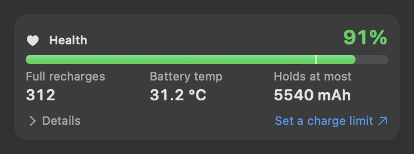
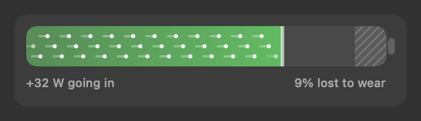
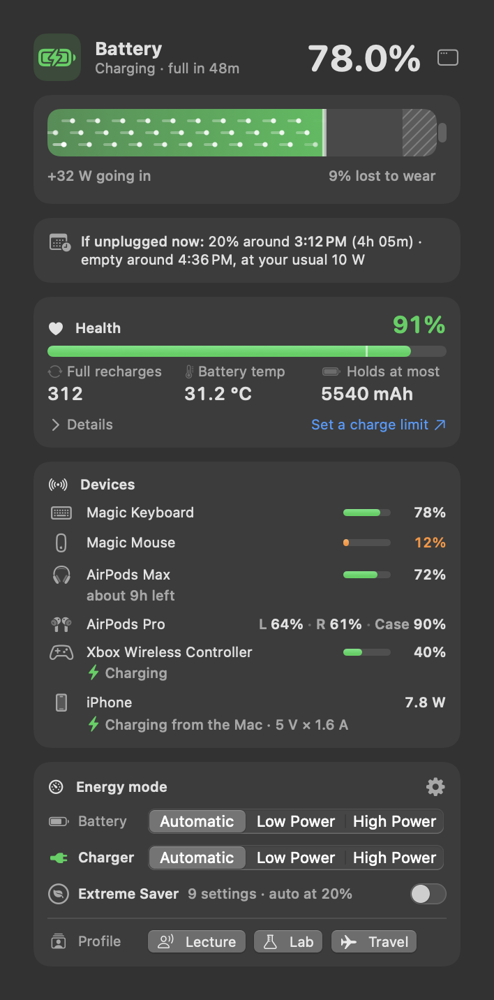
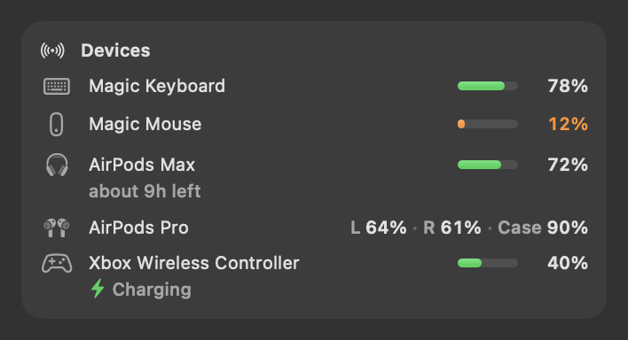
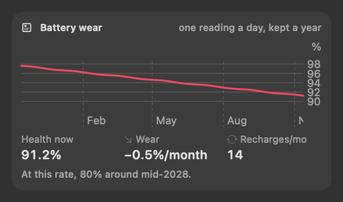
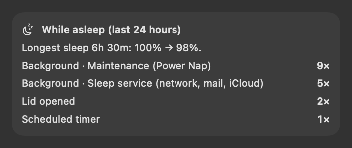
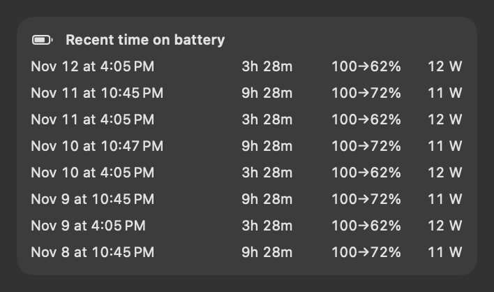

# Battery

---

## Real battery readings and charge state

 <em>Battery readings: real fill to 0.1% and state · health · charge now, holds at most and held when new (mAh) · recharges · temperature.</em>

**Purpose.** Know exactly how much charge is in the battery and what it is really doing — not a rounded percentage and
an icon that can be wrong.

**What it does.** Reads the battery controller directly (every 2 seconds by default, and at once when you plug in or
unplug):
- the **real fill** to 0.1% (charge now ÷ what the battery holds when full);
- watt-hours left, voltage, the current in and out;
- the Mac's **total draw** — from the battery on battery, from charger power minus what goes into the battery when
  plugged in;
- one shared **charge state**, decided from the current actually flowing:

| State | When |
|---|---|
| On battery | unplugged |
| Charging / Topping up | plugged in and at least 0.5 W going into the battery (Topping up when already at 100%) |
| On hold · Optimized Charging | plugged in, not charging, macOS holding the charge to protect the battery |
| At charge limit | plugged in, held at the limit you set in System Settings |
| Full · battery idle / Not charging | plugged in, nothing flowing |

**In the menu bar** the battery part shows `4:58 LEFT` on battery, or ⚡︎ CHARGING, ⚡︎ TOPPING UP, ⏸︎ ON HOLD, ⇥ AT LIMIT,
✓ FULL, over the fill.

**Use cases.**
- Before leaving for a meeting: is it really 81%, and is it actually charging or just "on hold"?
- macOS shows 100% but the battery isn't full: see the real fill (macOS rounds up near full).

**Benefits.** One consistent wording everywhere (menu bar, panels, dashboard), based on measured current — the true
state, not a guess.

**Where.** Battery part of the menu bar; Battery panel; Dashboard → **Battery**.

---

## The battery, to scale

 <em>The battery cell: the charge, the part lost to wear, and which way the energy is going. (Sample values.)</em>

**Purpose.** See at a glance how full the battery is, how much of it is gone for good, and whether it is filling or
draining.

**What it does.** The first card of the Battery panel draws the battery to scale. The whole cell is what it held when
new; the hatched part at the far end is lost to wear ("9% lost to wear"). The charge fills from the left. Dots run
toward its edge while it charges and away from it while it drains, faster the more watts flow, on the same scale as the
Power flow, with the figure under it ("+32 W going in", "−11 W going out"). Resting, the dots stop. While macOS holds
the charge (a charge limit, Optimized Charging) a line marks where.

## Health card

 <em>Battery panel: header · if you unplug now · Health card · Devices (keyboard, mouse, AirPods) · energy mode, Extreme Saver and profiles.</em>

**What it shows.** The panel's header gives the fill and the state with its one time figure: "Charging · full in 4h 09m"
or "On battery · 4h 58m left". The **Health** card below it shows health % (what the battery holds now vs when new —
green from 80%) with a bar marked at 80%, *Full recharges*, *Battery temp* and *Holds at most* (mAh). *Details* opens
*Charge now* and *Held when new* (mAh), and the panel remembers whether you opened it; the dashboard always shows them.
Good or Worn is in the health figure's tooltip.

**Use cases.** Check whether a battery is worn enough to replace (Apple counts below 80% as worn); compare recharges
with the age of the Mac.

---

## "Battery state doesn't add up"

**Purpose.** Catch the moments when the reported state and the actual current disagree — a charge limiter that isn't
holding, a weak charger, a bad cable.

**What it does.** Raises a warning when one of these lasts a full minute:
- macOS says *not charging*, yet more than 1 W flows into the battery (a charge limiter may not be holding);
- plugged in, but the battery drains by more than 1 W (charger too weak for this load, or cable/port not delivering);
- charging should be *on hold*, yet the battery gained at least 1% in 5 minutes or more.

**Where.** An orange card at the top of the Battery panel; a *Needs action* item on the dashboard's Overview; the
battery part glows red; and one notification per episode: *Battery state doesn't add up*.

**Benefits.** Problems that otherwise go unnoticed for weeks (a battery kept at 100% against your limit, a laptop
draining on a too-small charger) are caught in a minute.

---

## Charge plan

 <em>Charge plan (If you unplug now): when you'd reach 20% and empty, at your usual drain.</em>

**Purpose.** Plan the day: when will the battery reach 20%, and when will it run out?

**What it does.** One line of clock times: "20% around **4:40 PM** (2h 10m) · empty around 6:05 PM". On battery it uses
the same [time left](06%20Power.md#time-left) as the menu bar and the panels, so the times always agree with them. Below
20%: "Below 20% · empty around 6:05 PM". On the charger, the line starts **If unplugged now:** and uses your usual draw
on battery (your last 30 minutes on battery, or your last few battery stretches): "…, at your usual 14 W".

**Use cases.**
- A long lab day: know whether you need the charger before the afternoon session.
- Before unplugging for a lecture: will it last?

**Benefits.** Based on **your** use, so it doesn't swing with every momentary spike the way macOS's time estimate does.

**Where.** Battery panel.

---

## Charge limit shortcut

A small *Set a charge limit ↗* link in the Health card opens macOS's own **Charge Limit** (System Settings → Battery),
which protects the battery without extra software. Sparewatt itself never sets a limit.

---

## Device batteries

 <em>Devices card: a keyboard, a mouse at 12% (orange from 20%) and AirPods with left, right and case.</em>

**Purpose.** Know when the keyboard, mouse, headphones or game controller are about to run out, before they do in the
middle of a call.

**What it does.** A **Devices** card lists each connected accessory that reports its battery:

- **Magic Keyboard, Magic Mouse, Magic Trackpad** (and other devices that report a level the same way): one figure with
  a small meter, and *Charging* under the name while it charges over its cable. Read from macOS's device registry every
  minute (about 1 ms).
- **AirPods, Beats and other Bluetooth headphones:** left, right and case, as "L 64% · R 61% · Case 90%", or one
  figure with the right picture for headphones with one battery, such as AirPods Max. macOS keeps these levels only in
  `system_profiler`, which starts a process, so they are read every 5 minutes and when the Battery panel opens (at
  most every 30 seconds). The row's tooltip has the firmware (and the case's, for earbuds) and the signal: "Firmware
  9A348 · case 9A348 · signal strong (−54 dBm)". macOS doesn't say whether they are charging, so no charging state is
  shown for them.
- **Game controllers** (Xbox, PlayStation and others): the level, and *Charging* while one charges. Read when a
  controller connects or disconnects, every minute and when the panel opens.
- **Devices getting power from the Mac's own ports** (0.3 W or more), such as an iPhone charging: the watts the port
  measures, with *Charging from the Mac · 5 V × 1.6 A* under the name, or *Powered by the Mac* for a drive. The device
  is named when that is certain, otherwise it is a *USB device*. Its own battery level isn't shared with the Mac, so
  none is shown (the tooltip says so). The same power is on the [power flow](06%20Power.md#power-going-out-to-usb-devices).

A figure turns **orange at 20%** or less and **red at 10%** or less. A device found both ways is listed once.

**Time left.** A device's row can show how long it has left on a small second line: "about 9h left" (or "under 1h
left", or "about 3 days left"). It is a straight line through how fast the device has drained since its last charge,
so a device used harder today shows today's pace. It shows once the device has dropped at least 5 points over at least
an hour since it last charged, never while it charges, and not when it is more than two weeks away. VoiceOver reads
the row as "AirPods Max, 72 percent, about 9 hours left".

**Alert.** One notification per discharge when a device drops to **15%** or less and isn't charging: "Magic Mouse is at
12%". Earbuds say which bud is low and to put them in their case. It comes again only after the device has charged
above 30%. During quiet hours it waits, and comes afterwards if the device is still low. Clicking it opens the Battery
panel.

**Where.** Battery panel and Dashboard → **Battery**. The card is hidden when there is nothing to show.

**Settings.** *Alert when a device's battery is low* — Dashboard → **On Battery** → *Keyboards, mice and headphones*
(on by default).

**Kept.** For the time left, each device's level is noted when it changes (and every 30 minutes while it doesn't) and
kept for 30 days in `devices.json`, on this Mac only ([Data files](../reference/Data%20files.md)).

**Limits.** Only connected devices that report a level are shown. Headphone levels can be up to 5 minutes old while the
panel is closed. A device that has just been charged, or drains very slowly, shows no time left yet.

---

## Macs without a battery

**Purpose.** Use Sparewatt on a Mac mini, Mac Studio, iMac or Mac Pro, which run straight from the wall.

**What it does.** Sparewatt sees that the Mac has no battery and leaves out what doesn't apply:

- **Menu bar:** the battery part steps aside; the power part reads `MAC USES 22W`, the Mac's draw as its system
  management controller reports it. On a Mac that doesn't report it, the power part steps aside too and the Power panel
  shows "—", not a made-up 0 W.
- **Battery panel:** *This Mac has no battery*, with what still applies: the batteries in your keyboard, mouse and
  headphones (the Devices card), the energy mode as one *Wall* row, and *Mac is using* when the Mac reports its draw.
- **Power panel:** a *From the wall* card with the draw and its last 2 minutes, in place of the flow, battery time and
  charger cards.
- **No Extreme Saver** (it changes battery settings): not in the sidebar, the right-click menu, ⌥⌘E or the AI
  Assistant. The **On Battery** page keeps only the device low-battery alert.
- **History** has no charge chart and no stretches on battery; *Mac power use* shows when the Mac reports its draw.
- **Share cards:** "My Mac today" leads with time awake today; its curve is the day's draw (or the processor's load
  when the Mac reports no draw), and its tiles show the average power use, the processor's average load and the hottest
  it got. "My Mac this week" shows time awake and a bar for each day awake,
  and the Monday summary counts hours awake.
- *Unusual background activity* notifications are set for "on battery" by default, which a desktop Mac never is: turn
  on *…also when plugged in* (Dashboard → Menu Bar → *Alerts*) to get them.

---

## Battery wear

 <em>Battery wear: health over months, loss per month, recharges per month, and when it reaches 80%. (Sample values.)</em>

**Purpose.** See how fast the battery is aging and when it will count as worn.

**What it does.** Records health and recharge count once a day, keeps a year, and shows the line, **health now**,
**points lost per month** and **recharges per month**, with a line like "At this rate, 80% around mid-2028" (a month
and year when it is under a year away).

**An honest trend.** macOS's health figure wobbles by about a point from one day to the next, while real wear is a few
tenths of a point a month, so two readings close together say nothing. Sparewatt waits:

- **Enough readings first:** at least 14 daily readings spread over at least three weeks (21 days). Until then the card
  says "Needs about N more days of readings for a wear trend". A Mac that is off some days gets there a little later.
- **The best-fit line through every reading**, not the first and the last, so one odd day can't swing it.
- **Steady** when health moves less than its own wobble: a loss shows only when it is at least 0.05 points a month and
  more than twice its uncertainty. A rising line counts as steady too.
- At or below 80% it says so; more than 15 years away is "more than 15 years away".

**Use cases.** Decide whether charging habits (always at 100%, hot desk) are wearing the battery; plan a battery service.

**Where.** Dashboard → **Battery**.

**Limits.** No trend in the first three weeks; a projection is only as good as the habits behind it staying the same.

---

## While asleep (last 24 hours)

 <em>While asleep: the longest sleep and what it lost, and why the Mac woke. (Sample values.)</em>

**Purpose.** Find out why the battery dropped overnight.

**What it does.** Reads macOS's power log and counts what woke the Mac in the last day, in plain words: *Lid opened*,
*You (keyboard, mouse)*, *Scheduled timer*, *Maintenance (Power Nap)*, *Sleep service (network, mail, iCloud)*,
*Wi-Fi / network*, *USB device*, *Charger / power events*… Background wakes (screen stays off) are marked. It also shows
the **longest sleep** and how much charge it cost, flagged when it lost more than 3 points.

**Use cases.** The MacBook loses 15% in a night with the lid closed: see whether Power Nap or network wakes are the
cause, then switch them off on the **On Battery** page.

**Limits.** The list can be up to an hour old. Sparewatt reads the power log (`pmset -g log`) only while this card is
shown, at most once an hour, at background priority on the efficiency cores: one read costs about 10 seconds of
processor time, because macOS prints its whole power log. The AI Assistant's insights also ask for a read; it is ready
on the next call.

**Where.** Dashboard → **Battery**.

---

## Battery history and stretches on battery

 <em>Recent time on battery: when, how long, charge from → to, and average watts.</em>

**Purpose.** Look back at how the battery was used.

**What it does.** One reading a minute (charge, the Mac's draw, processor, temperature, health), kept 30 days, and a
log of **every stretch on battery**: when, how long, from what % to what %, average watts, and the apps that used the
most power. See [Dashboard, history and this app](11%20Dashboard%2C%20history%20and%20this%20app.md) for the charts and
CSV export.

**Use cases.** "Yesterday's 4-hour session cost 60% — which apps?"
