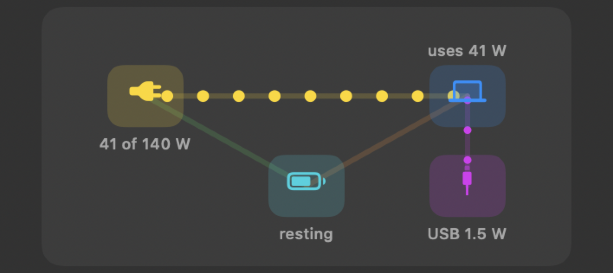
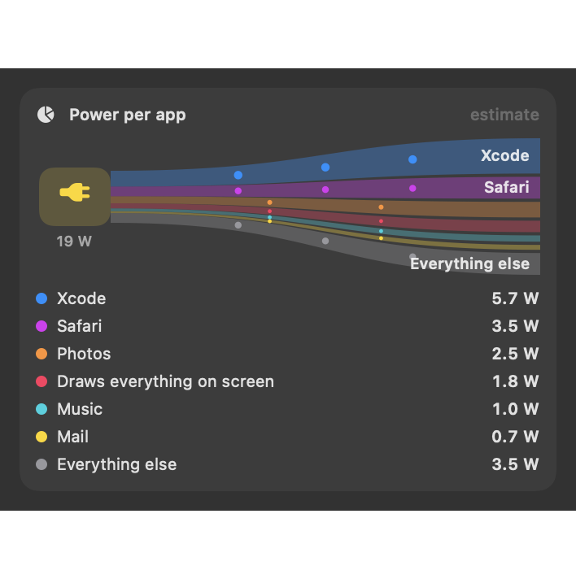
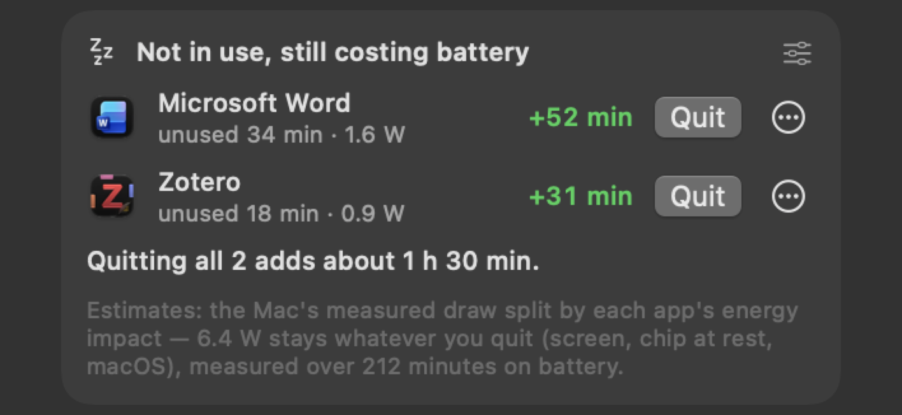

# Power

---

## Time left

 <em>Time left: on the charger it shows how long the battery would last if you unplugged now.</em>

**Purpose.** Answer "how long will the battery last if I keep doing this?" — with one figure, the same everywhere.

**What it does.** On battery it reads *left*: macOS's own estimate, worked out from the battery's averaged draw, so it
follows what you do within a minute or two without jumping at every spike (just after unplugging, while macOS is still
working it out, it is battery energy ÷ the current draw). The menu bar, the Battery panel, the charge plan, Mac health
and the AI Assistant all show this same figure. On the charger it reads *if unplugged now*: battery energy ÷ your usual
draw on battery (your last 30 minutes on battery, or your last few battery stretches). On a charger too small for the
load, where the battery drains even while plugged in, it reads *left, draining*: battery energy ÷ the battery's average
drain over the last minute, counted only since the charger went in. macOS's own estimate lags behind there: it showed
3 h left at an 8 W drain from 37 Wh, where 37 Wh ÷ 8 W is about 4 h 37 min.

**Use cases.** Decide whether to close the video call's camera, or the second monitor, to make it to the end of the
session.

**Where.** Power panel (top card); Dashboard → **Power flow**.

---

## Power flow

 <em>Power flow: charger (41 of 140 W) → Mac (uses 41 W), the battery resting, and 1.5 W out to a USB device.</em>

**Purpose.** See where the energy goes: charger → Mac, charger → battery, battery → Mac.

**What it does.** A live diagram whose moving dots follow the real watts (scaled to 60 W), or — with live diagrams off —
a card with the battery's flow in watts, "Filling up at 45 W · full in 1h 05m" or "Running on battery, using 12 W ·
about 3h 40m left", how much of the charger's capacity is in use (slow / moderate / fast charging), and a bar chart of the
last minute or two.

**Use cases.** Is the 30 W travel charger enough for this workload? Is the battery charging or just holding?

**Where.** Power panel; Dashboard → **Power flow**.

---

## Power going out to USB devices

**Purpose.** When the Mac charges a phone or powers a drive, see how much of its power goes out through its ports.

**What it does.** The Mac's port controller measures the power it delivers on each of its own ports. When a device takes
at least 0.3 W, the power-flow diagram gains a **USB node** with a purple lane from the Mac — "iPhone 5.6 W" — and the
Power card adds *iPhone gets 5.6 W*. The device is named when exactly one device asks for charging power; otherwise it
reads *USB* or *2 USB devices*. Hover for each port's watts, volts and amps, and the most the port offered the device
(e.g. "Port 1: 5.6 W (5.22 V × 1.07 A) · up to 15 W offered").

**Use cases.**
- Charging an iPhone from the MacBook on battery: see what it costs you.
- A bus-powered drive or hub: check how much it draws.
- The Mac is plugged in but charges slowly: see how much a connected device takes.

**Benefits.** A measured number, not the port's allowance — macOS's System Information shows only what is allocated
(e.g. 12 W), not what actually flows.

**Good to know.** This power is part of what the Mac uses ("uses 49 W" includes the iPhone's 5.6 W): the Mac draws it,
then passes it on. On battery, it comes out of your battery.

---

## Charger check

 <em>Charger check: says when the charger is too small and the battery drains while plugged in. (Sample values.)</em>

**Purpose.** Catch a charger that can't keep up.

**What it does.** Plugged in and the battery still drains → red: "The 30 W charger isn't enough: the Mac uses 41 W, so the
battery is draining 11 W even while plugged in. Use a bigger charger or a shorter, better cable." Close to the charger's
limit → orange: charging will be slow while the Mac is busy.

**Use cases.** A hotel USB-C port, a phone charger, or a long thin cable on a 16" MacBook Pro.

**Where.** Power panel, only when there is something to say.

---

## Charger details

**Purpose.** Know exactly what is plugged in: how much it can give, how it talks to the Mac, and what it is giving now.

**What it does.** While a charger is connected, the Power panel shows:

| Row | Example | Where it comes from |
|---|---|---|
| Most it can give | 65 W max | the charger's rating, as macOS reads it |
| Kind and port | USB Power Delivery 3.x · on the USB-C port 1 | macOS's charger family and the USB-C port's Power Delivery partner; also *USB-C, no Power Delivery*, *USB charging port*, *MagSafe 3*, *wireless* |
| Agreed | 20 V × 3.25 A = 65 W | the voltage and current the charger and the Mac settled on |
| Coming in now | 63.5 W at 20.1 V · 3.16 A | measured at the Mac's power input |
| Voltage levels it offers | 5 V × 3 A, 9 V × 3 A, 12 V × 3 A, 15 V × 3 A, **20 V × 3.25 A** | every level a Power Delivery charger advertises; the one in use is highlighted |
| Name, maker, serial, firmware | Apple 96W USB-C Power Adapter · serial … · firmware … | only Apple chargers report these; others show "not reported" |

**Use cases.** Check that a "100 W" charger really offers 20 V × 5 A; see that a hotel charger only gives 5 V (no Power
Delivery); find which port the charger is on.

**When it updates.** When a charger is plugged in, pulled out or swapped, or agrees a new voltage with the Mac, macOS
tells Sparewatt. It then reads the charger's fixed details (rating, kind, voltage levels, name and serial) and looks up
its port and Power Delivery version once, in the background, and once more 5 seconds later in case the two were still
agreeing. The battery's drain average also starts afresh. The regular update every 2 seconds reads only what comes in
now (watts, volts, amps).

**Limits.** A port is named only when it is clear which one brings power in (with a display on another USB-C port that
also speaks Power Delivery, the port is left out). The cable's own rating isn't shown: macOS doesn't report it. The
Power Delivery version shows as *3.x*: macOS reports revision 3 without telling 3.0, 3.1 and 3.2 apart (revisions 1 and
2 show as 1.0 and 2.0).

**Where.** Power panel and Dashboard → **Power flow**, while plugged in. The AI Assistant's `get_battery` includes it.

---

## Power per app (share of battery drain)

 <em>Share of power use: a pie of watts per app, the biggest users named in a tip; click a slice to see its processes.</em>

**Purpose.** Know which apps cost the most power right now — and how much battery time each takes.

**What it does.** Every 10 seconds while the panel is open, the Mac's measured draw is split between apps by their
share of *energy impact* over **every** process. A pie shows the top 6 and *Everything else*; a tip names the top two
("“Safari” and “Zoom” use 53% of your battery drain right now").
- **On the charger:** watts per app.
- **On battery:** each app's share of the drain and **how much battery time it takes** (−42m) — the time you'd get back
  by quitting it, counting only the draw above what the screen and macOS use anyway.

Click a slice or a name to see its processes and quit or force quit them (with confirmation).

**Use cases.**
- On battery and the time left keeps falling: find the app eating it.
- Compare two browsers, two video apps, or a local AI model on vs off.

**Benefits.** macOS doesn't show power per app in watts or battery time at all; this does, with an honest method
([How the estimates work](../guide/07%20How%20the%20estimates%20work.md)).

**Where.** Power panel; Dashboard → **Power flow** (with *Every app's energy score* and *Who is using energy*).

---

## Idle apps on battery

 <em>Not in use, still costing battery: idle apps, minutes unused, their watts and the battery time quitting each would give.</em>

**Purpose.** Apps you left open and forgot can quietly cost you battery time. Sparewatt notices and suggests quitting
them — only when it is worth it.

**What it does.** On battery, once a minute, an app is suggested when **all** of these hold:
1. it hasn't been the front app for at least **10 minutes** (your limit);
2. quitting it would give back at least **30 minutes** of battery (your limit), from its average draw over the idle
   minutes — never a one-off spike;
3. it isn't playing sound or video, isn't Finder, isn't on your never list, and you didn't say *Not now* this battery
   stretch.

The card **Not in use, still costing battery** lists each such app — "unused 34 min · 1.6 W", **+52 min** — with
**Quit** (a normal quit; the app can ask to save), **Not now** (until you plug in) and **Never suggest**. With several
apps, it adds "Quitting all 2 adds about 1 h 30 min."

**Notification.** Once per app each time you unplug, only while you are at the Mac:
*Quit Zotero? About +35 min of battery* — "Not used for 23 min, but it still takes about 1.4 W."

**Use cases.**
- Writing in one app all afternoon while a chat app, a PDF reader and a reference manager sit open in the background.
- A conference day on battery: get the hour that the forgotten apps were costing.
- A heavy app (an IDE, a virtual machine, Docker) left running after you finished with it.

**Benefits.**
- No guesswork: it only speaks up when the gain passes your limit, so it doesn't nag about apps that cost nothing.
- It never closes anything by itself.
- Its battery estimate calibrates itself to your Mac over your first half hour on battery.

**Where.** Battery and Power panels (hidden when there is nothing to suggest).

**Settings** (Dashboard → **On Battery** → *Apps you aren't using*; save at once, no password):

| Setting | Default | Range |
|---|---|---|
| Suggest quitting apps you aren't using | on | |
| Not used for at least | 10 min | 1–120 min |
| Quitting it would add at least | 30 min | 5–240 min |
| Also notify me (once per app each time I unplug) | on | |
| Never suggest … | none | any app |

**Limits.** "Used" means "was the front app"; a document you read on a second screen without clicking it counts as
unused — add that app to the never list. At a high draw (25 W and up) few apps reach 30 minutes; that is correct, not a
fault.

---

## Battery used per app, last 7 days

**Purpose.** See which apps cost the most battery over the week, not just right now.

**What it does.** Each minute on battery, the measured draw is split among the top apps by energy impact and added up per
day (kept 14 days). The card shows the week's top 8 in watt-hours and as a share of a full charge.

**Use cases.** Decide which app to replace, or which to quit before unplugging, based on a week of real use.

**Where.** Dashboard → **Power flow**.

**Limits.** This card splits the whole draw (screen included) among the top apps, so its numbers are larger than the
pie's battery-time figures.
