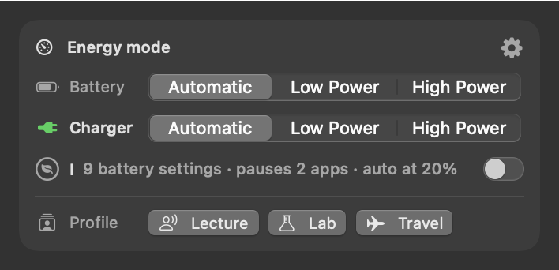
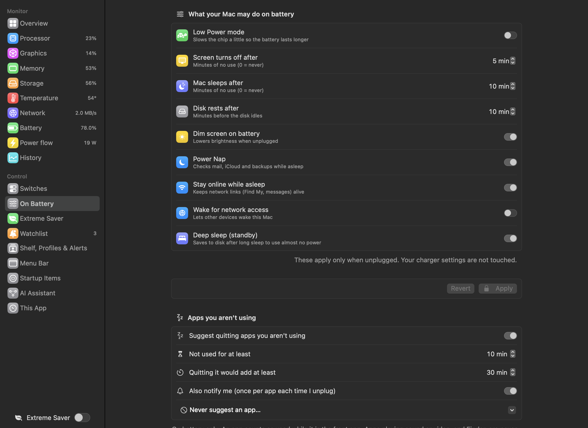
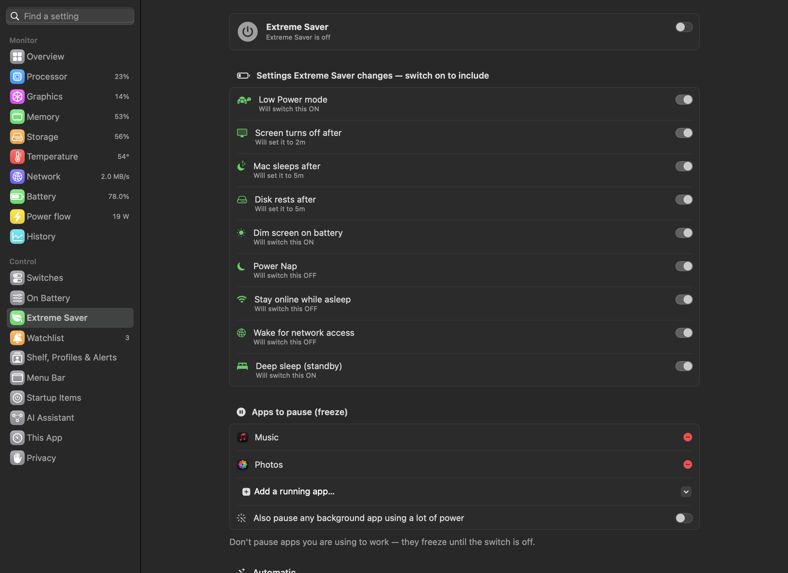
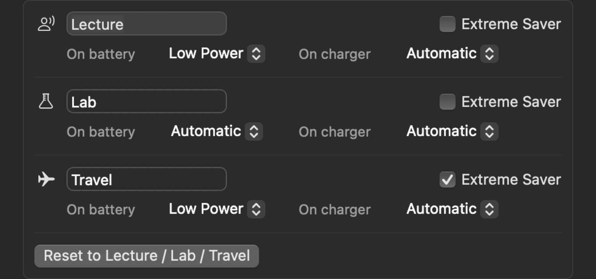

# Power controls

These change how the Mac itself behaves. They use macOS's own `pmset`, so macOS asks for your administrator password
each time — Sparewatt never stores it.

---

## Energy mode

 <em>Energy mode: Automatic, Low Power or High Power, separately on battery and on charger, plus the Extreme Saver switch.</em>

**Purpose.** Switch between saving battery and full speed without digging through System Settings.

**What it does.** Three modes, set **separately for battery and charger**:

| Mode | Means |
|---|---|
| Automatic | macOS decides |
| Low Power | slower, the battery lasts longer |
| High Power | fastest; uses more power and fan (Macs that support it) |

Two compact pickers, one for battery and one for charger; the one for the power source you're on now is marked green.
What each mode means, and that a change asks for your password, are in the tooltips.

**Use cases.** Low Power on battery all the time, High Power on the charger for renders and builds.

**Where.** Battery panel → *Energy mode* card, with Extreme Saver on one line and the profiles row below. The gear opens
the On Battery page. On a Mac with no battery the card has one row, *Wall*, and no Extreme Saver.

---

## On Battery settings

 <em>Dashboard → On Battery: what the Mac may do unplugged.</em>

**Purpose.** Decide what the Mac may do when unplugged — the settings that matter most for battery life and overnight
drain, in one place.

**What it does.** Edits macOS's battery-only power settings (your charger settings are not touched). Change values, then
**Apply** (one password prompt for all changes) or **Revert**.

| Setting | What it means | Extreme Saver sets it to |
|---|---|---|
| Low Power mode | slows the chip a little so the battery lasts longer | on |
| Screen turns off after | minutes of no use (0 = never) | 2 min |
| Mac sleeps after | minutes of no use (0 = never) | 5 min |
| Disk rests after | minutes before the disk idles | 5 min |
| Dim screen on battery | lowers brightness when unplugged | on |
| Power Nap | checks mail, iCloud and backups while asleep | off |
| Stay online while asleep | keeps network links (Find My, messages) alive | off |
| Wake for network access | lets other devices wake this Mac | off |
| Deep sleep (standby) | saves to disk after long sleep to use almost no power | on |

If the Mac would sleep before its screen turns off, the page warns you.

**Use cases.**
- The MacBook loses charge overnight: turn off Power Nap, *Stay online while asleep* and *Wake for network access*;
  turn on deep sleep.
- Presentations: keep the screen on longer on battery.

**Benefits.** These settings are spread across several places in System Settings — or only available in Terminal.

**Where.** Dashboard → **On Battery**. (The same page also holds the idle-app suggestion settings.)

**Limits.** Locked while Extreme Saver is on.

---

## Extreme Saver

 <em>Dashboard → Extreme Saver: the settings it applies and the apps it pauses.</em>

**Purpose.** One switch for when every minute of battery counts.

**What it does.**
- **Turning on:** saves your current battery settings, applies the saver values of the settings you ticked (table
  above), and **pauses (freezes) chosen apps** — they stay open with all their windows and data, but use no power until
  you switch off. Optionally it also pauses **any background app above an energy score** (20 points by default). The app
  you're using is never paused, nor is Sparewatt.
- **Turning off:** unfreezes the apps and restores your saved settings.
- **Sparewatt quitting** (the Quit button, or being stopped with `kill`) unfreezes the apps too, and a launch after a
  crash unfreezes any still frozen — unless Extreme Saver is still on then; turning it off does.
- **Automatic:** turn on by itself at a battery level (never / 10 / 15 / 20 / 30 / 40 / 50%), once per unplug; turn off
  when plugged in (on by default).
- **Slower checks:** Sparewatt itself updates only every 30 seconds while it's on (on by default).
- While on, the battery part of the menu bar shows a leaf.

**Use cases.**
- A long flight or field day: one switch, everything that can save power does.
- Keep a heavy app open (unsaved work, loaded dataset) but frozen until you're back on power.
- Let it kick in by itself at 20% so you never hit empty.

**Benefits.** Pausing keeps your work exactly where it was — unlike quitting.

**Where.** Battery panel (*Energy mode* card), the dashboard sidebar, Dashboard → **Extreme Saver**, the right-click
menu, and **⌥⌘E** from anywhere.

**Settings** (Dashboard → Extreme Saver):

| Setting | Default |
|---|---|
| Which battery settings it changes | all nine |
| Apps to pause | none |
| Also pause any background app using a lot of power | off (above 20 points) |
| Turn on by itself | never |
| Turn off when plugged in | on |
| This app checks only every 30 s | on |

**Limits.** Not on a Mac with no battery (Mac mini, Mac Studio, iMac, Mac Pro): there it is left out of the sidebar, the
right-click menu, ⌥⌘E and the AI Assistant, and the **On Battery** page keeps only the device low-battery alert.
Don't pause apps you're working in — they freeze until Extreme Saver is off. Turning on by itself still asks
for your password once. If Sparewatt quits while Extreme Saver is on, it stays on at the next launch but the apps are no
longer paused; turn it off and on to pause them again.

---

### The moment it turns on

 <em>What Extreme Saver paused, and about how much battery time that gives back. (Sample values.)</em>

When Extreme Saver turns on, the apps it pauses dim one by one under its switch while the battery time pausing them
gives back counts up ("Paused 3 apps · about +48m"). The time is an estimate from their share of the power, the same
sum as *Power per app*, and is left out on the charger. The row stays while Extreme Saver is on.

## Profiles

 <em>Profiles: Lecture, Lab, Travel — energy mode on battery and on charger, and Extreme Saver, per profile.</em>

**Purpose.** Set the energy modes and Extreme Saver for a situation in one click.

**What it does.**

| Profile | On battery | On charger | Extreme Saver |
|---|---|---|---|
| Lecture | Low Power | Automatic | off |
| Lab | Automatic | Automatic | off |
| Travel | Low Power | Automatic | on |

Clicking a profile turns Extreme Saver on or off first, then sets the two energy modes, one change at a time and only
where needed. The current profile is highlighted — only once every change went through: cancelling a password prompt
stops there, and if something had already changed, no profile is highlighted. Hovering a button shows what it sets.
Names, icons (picked from a searchable grid) and choices are edited on Dashboard → Shelf, Profiles & Alerts.

**Use cases.** Walking into a lecture, back to the lab bench, off to the airport.

**Where.** The bottom of the Battery panel's *Energy mode* card; edit names and choices on Dashboard → **Shelf, Profiles
& Alerts**.

**Limits.** Each change (energy mode or Extreme Saver) asks for the password.
