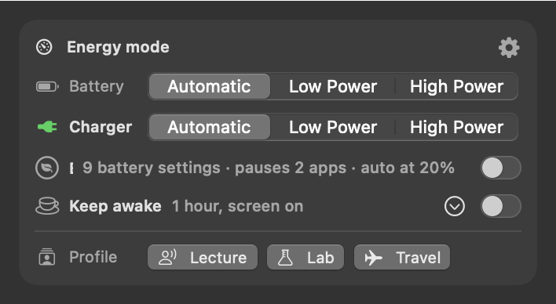
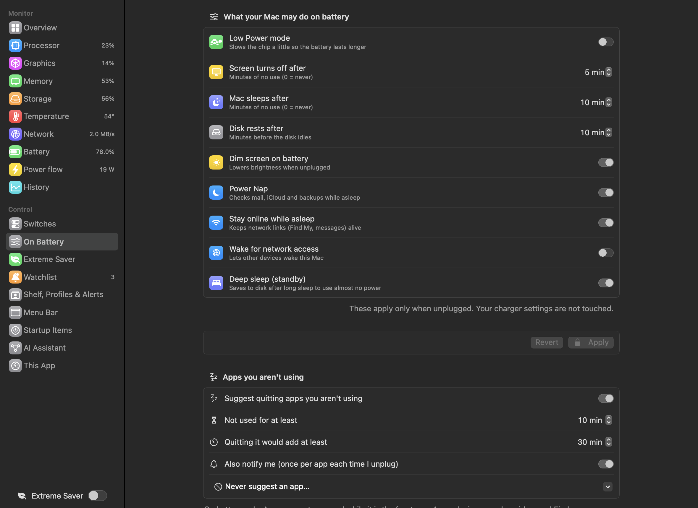
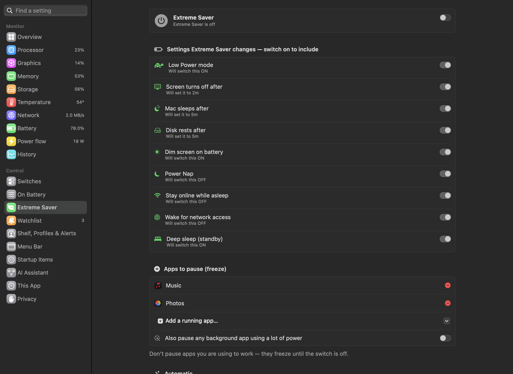
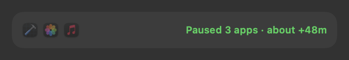
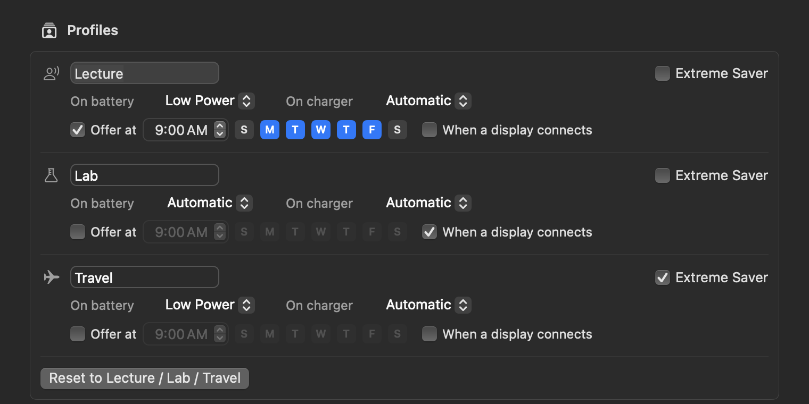

# Power controls

These change how the Mac itself behaves. They use macOS's own `pmset`, so macOS asks for your administrator password
each time — Sparewatt never stores it.

---

## Energy mode

 <em>Energy mode: Automatic, Low Power or High Power, separately on battery and on charger, plus the Extreme Saver switch.</em>

**Purpose.** Switch between saving battery and full speed without digging through System Settings.

**What it does.** Three modes, set **separately for battery and charger**:

| Mode | Means |
|---|---|
| Automatic | macOS decides |
| Low Power | slower, the battery lasts longer |
| High Power | fastest; uses more power and fan (Macs that support it) |

Two compact pickers, one for battery and one for charger; the one for the power source you're on now is marked green.
What each mode means, and that a change asks for your password, are in the tooltips.

**Use cases.** Low Power on battery all the time, High Power on the charger for renders and builds.

**Where.** Battery panel → *Energy mode* card, with Extreme Saver on one line and the profiles row below. The gear opens
the On Battery page. On a Mac with no battery the card has one row, *Wall*, and no Extreme Saver.

---

## On Battery settings

 <em>Dashboard → On Battery: what the Mac may do unplugged.</em>

**Purpose.** Decide what the Mac may do when unplugged — the settings that matter most for battery life and overnight
drain, in one place.

**What it does.** Edits macOS's battery-only power settings (your charger settings are not touched). Change values, then
**Apply** (one password prompt for all changes) or **Revert**.

| Setting | What it means | Extreme Saver sets it to |
|---|---|---|
| Low Power mode | slows the chip a little so the battery lasts longer | on |
| Screen turns off after | minutes of no use (0 = never) | 2 min |
| Mac sleeps after | minutes of no use (0 = never) | 5 min |
| Disk rests after | minutes before the disk idles | 5 min |
| Dim screen on battery | lowers brightness when unplugged | on |
| Power Nap | checks mail, iCloud and backups while asleep | off |
| Stay online while asleep | keeps network links (Find My, messages) alive | off |
| Wake for network access | lets other devices wake this Mac | off |
| Deep sleep (standby) | saves to disk after long sleep to use almost no power | on |

If the Mac would sleep before its screen turns off, the page warns you.

**Use cases.**
- The MacBook loses charge overnight: turn off Power Nap, *Stay online while asleep* and *Wake for network access*;
  turn on deep sleep.
- Presentations: keep the screen on longer on battery.

**Benefits.** These settings are spread across several places in System Settings — or only available in Terminal.

**Where.** Dashboard → **On Battery**. (The same page also holds the idle-app suggestion settings and the
[*What keeps your Mac awake*](05%20Battery.md#keeping-your-mac-awake) notification.)

**Limits.** Locked while Extreme Saver is on.

---

## Extreme Saver

 <em>Dashboard → Extreme Saver: the settings it applies and the apps it pauses.</em>

**Purpose.** One switch for when every minute of battery counts.

**What it does.**
- **Turning on:** saves your current battery settings, applies the saver values of the settings you ticked (table
  above), and **pauses (freezes) chosen apps** — they stay open with all their windows and data, but use no power until
  you switch off. Optionally it also pauses **any background app above an energy score** (20 points by default). The app
  you're using is never paused, nor is Sparewatt.
- **Turning off:** unfreezes the apps and restores your saved settings.
- **Sparewatt quitting** (the Quit button, or being stopped with `kill`) unfreezes the apps too, and a launch after a
  crash unfreezes any still frozen — unless Extreme Saver is still on then; turning it off does.
- **Automatic:** turn on by itself at a battery level (never / 10 / 15 / 20 / 30 / 40 / 50%), once per unplug; turn off
  when plugged in (on by default).
- **Slower checks:** Sparewatt itself updates only every 30 seconds while it's on (on by default).
- While on, the battery part of the menu bar shows a leaf.

**Use cases.**
- A long flight or field day: one switch, everything that can save power does.
- Keep a heavy app open (unsaved work, loaded dataset) but frozen until you're back on power.
- Let it kick in by itself at 20% so you never hit empty.

**Benefits.** Pausing keeps your work exactly where it was — unlike quitting.

**Where.** Battery panel (*Energy mode* card), the dashboard sidebar, Dashboard → **Extreme Saver**, the right-click
menu, and **⌥⌘E** from anywhere.

**Settings** (Dashboard → Extreme Saver):

| Setting | Default |
|---|---|
| Which battery settings it changes | all nine |
| Apps to pause | none |
| Also pause any background app using a lot of power | off (above 20 points) |
| Turn on by itself | never |
| Turn off when plugged in | on |
| This app checks only every 30 s | on |

**Limits.** Not on a Mac with no battery (Mac mini, Mac Studio, iMac, Mac Pro): there it is left out of the sidebar, the
right-click menu, ⌥⌘E and the AI Assistant, and the **On Battery** page keeps only the device low-battery alert.
Don't pause apps you're working in — they freeze until Extreme Saver is off. Turning on by itself still asks
for your password once. If Sparewatt quits while Extreme Saver is on, it stays on at the next launch but the apps are no
longer paused; turn it off and on to pause them again.

---

### The moment it turns on

 <em>What Extreme Saver paused, and about how much battery time that gives back. (Sample values.)</em>

When Extreme Saver turns on, the apps it pauses dim one by one under its switch while the battery time pausing them
gives back counts up ("Paused 3 apps · about +48m"). The time is an estimate from their share of the power, the same
sum as *Power per app*, and is left out on the charger. The row stays while Extreme Saver is on.

---

## Keep awake

**Purpose.** Stop the Mac going to sleep, or the screen turning off, while you need it: a download, a long build, a
presentation, a video call on a stand.

**What it does.** Keeps the screen on, or with *Keep the screen on too* unticked only the Mac, for as long as you choose:
- **for** 15 minutes, 30 minutes, 1, 2, 4 or 8 hours;
- **until** a clock time (the next six whole hours are offered; a link can set any time);
- **while an app runs** (it ends when that app quits);
- **until you turn it off**.

The switch in the *Energy mode* card starts it with the last length you chose (1 hour at first); the chevron beside it
has every choice. While it is on, the card says until when and how long is left, the battery part of the menu bar
starts with **☕︎** (or the power part, on a Mac with no battery), and *Keeping your Mac awake* lists Sparewatt with a
**Turn off** button.

It uses the same macOS mechanism as the `caffeinate` command. No password, and no tool is started.

**It ends by itself** at its time, when its app quits, when Sparewatt quits, and on battery when the charge falls below
10% (with a notification, "Keep awake is off"). If you started it below 10%, it waits until the charge falls further.

**Use cases.**
- A large download or upload: *While an app runs* → your browser, then walk away.
- A presentation on battery: *For 1 hour*, screen on.
- A render overnight on the charger: *Until I turn it off*, screen off.

**Where.** Battery panel and page (*Energy mode* card), the right-click menu (*Keep Awake*), and links
(`sparewatt://keep-awake/…`, see [Links](../reference/Links%20for%20Shortcuts%20and%20scripts.md)).

**Limits.** Like `caffeinate`, it only stops the Mac going to sleep by itself: closing the lid or choosing Sleep still
puts it to sleep. It is not kept across a restart of Sparewatt. The "away" notification under
[Keeping your Mac awake](05%20Battery.md#keeping-your-mac-awake) leaves it out, since you asked for it.

## Profiles

 <em>Profiles: Lecture, Lab, Travel — energy mode on battery and on charger, Extreme Saver, and when each is offered by itself (Lecture at 9:00 on weekdays, Lab when a display connects).</em>

**Purpose.** Set the energy modes and Extreme Saver for a situation in one click.

**What it does.**

| Profile | On battery | On charger | Extreme Saver |
|---|---|---|---|
| Lecture | Low Power | Automatic | off |
| Lab | Automatic | Automatic | off |
| Travel | Low Power | Automatic | on |

Clicking a profile turns Extreme Saver on or off first, then sets the two energy modes, one change at a time and only
where needed. The current profile is highlighted — only once every change went through: cancelling a password prompt
stops there, and if something had already changed, no profile is highlighted. Hovering a button shows what it sets.
Names, icons (picked from a searchable grid) and choices are edited on Dashboard → Shelf, Profiles & Alerts.

**Switching by itself.** Each profile can also be offered:
- **at a time** you set, on the days you pick (none picked: every day), for example Lecture at 9:00 on weekdays;
- **when an external display connects**, for example Lab when you dock at your desk.

At that moment a notification asks **"Switch to Lecture?"**, with a **Switch** button. Click it, and macOS asks for your
password as usual; ignore it, and nothing changes. A profile that is already the current one isn't offered again. Set
both on Dashboard → **Shelf, Profiles & Alerts**, on the row under each profile.

**Wi-Fi networks and Focus.** Sparewatt doesn't read the Wi-Fi network's name (macOS gives it only to apps allowed to
use Location) or which Focus is on. Instead, make a Shortcuts automation (*When I join a Wi-Fi network*, *When a Focus
turns on*) that opens `sparewatt://profile/Lecture`; see [Links](../reference/Links%20for%20Shortcuts%20and%20scripts.md).
Turn on *Links (sparewatt://) may change things without asking* (Dashboard → Menu Bar → *General*) so the automation doesn't wait for
Sparewatt's own question first.

**Use cases.** Walking into a lecture, back to the lab bench, off to the airport.

**Where.** The bottom of the Battery panel's *Energy mode* card; edit names, choices and when each is offered on
Dashboard → **Shelf, Profiles & Alerts**.

**Limits.** Each change (energy mode or Extreme Saver) asks for the password, so nothing switches without you. A time
is offered only if the Mac is awake in that minute, and an offer needs Sparewatt's notifications on (quiet hours skip
it). Where macOS doesn't take Sparewatt's notifications, the offer comes as a plain banner with no button, and it says
to click the profile in the Battery panel's *Energy mode* card instead.
