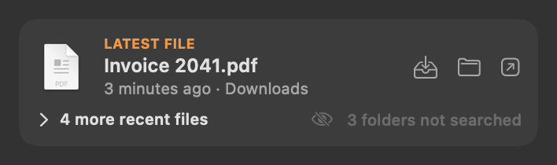
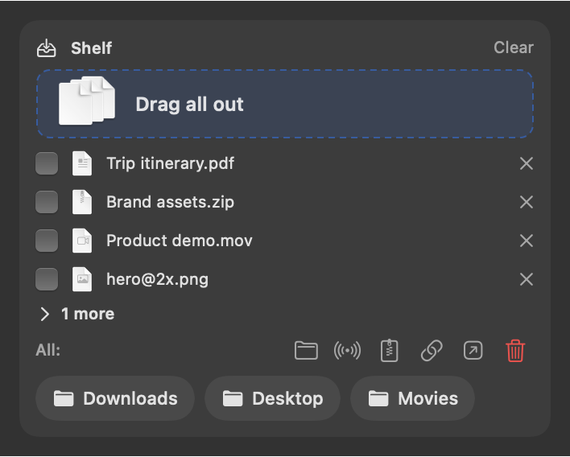
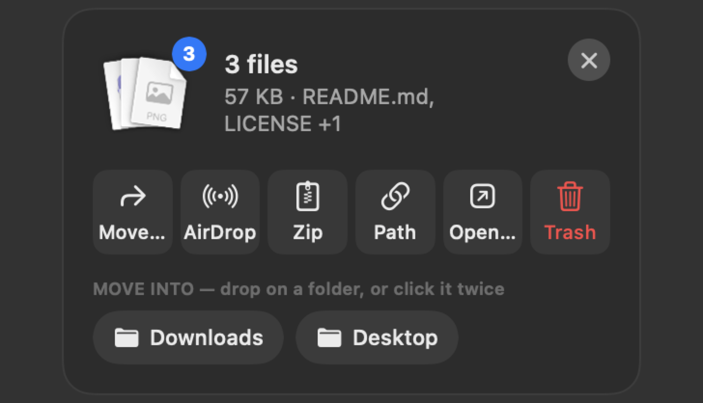
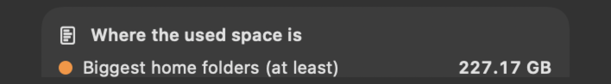

# Files and storage

Latest File, the Shelf and the clipboard live in the **Files** panel — hover the FILES part of the menu bar, or press
**⌥⌘V** from any app (if you hide the FILES part, they move back into the Storage panel). App caches and Downloads
tidy-up are in the **Storage** panel — hover the STORAGE part.

---

## Latest File

 <em>Latest File: the newest file, ready to drag; buttons to share, show in Finder or open.</em>

**Purpose.** The file you just saved or downloaded, ready to drag into a mail, a chat, an upload box or another app —
without hunting for it in Finder.

**What it does.** Finds, through Spotlight, the newest files you created or changed — in the last hour, else the last
day, else the last 7 days — skipping `~/Library` and hidden folders. Downloads is read directly instead, once Downloads
tidy-up has been allowed to read it (see Limits). Shows the newest one (name, when, folder) with
**Put on the Shelf**, **Show in Finder** and **Open**; the whole row can be dragged. Under it, in the same card, *N more
recent files* opens the next four, each draggable, and "3 folders not searched" names how many of your chosen folders
the search can't see (its tooltip says which, and why).

**Use cases.**
- Export a figure, then drag it straight into a chat or slide.
- Download a form, then drag it into an upload page.
- Collect several recent files on the Shelf and send them together.

**Benefits.** No Finder window, no Downloads digging. It never makes macOS ask for a folder: it reads Downloads only
after you have allowed that for Downloads tidy-up.

**Settings** (Dashboard → Menu Bar): *Latest File* on/off (on); **where to look** — chosen folders (everything inside
them counts) and file types (`pdf docx png`…); *Use suggested* fills in Desktop, Downloads, Documents and Vault, and
the types pdf, docx, xlsx, pptx, png, jpg, heic, md, csv and tex. With no folders chosen, the whole home folder is searched.

**Limits.** Nothing older than 7 days; files Spotlight hasn't indexed are missed. **Desktop and Documents are not
seen:** macOS leaves them out of Spotlight results for Sparewatt, and Sparewatt doesn't ask for them. Downloads is seen
only after a *Look* in Downloads tidy-up has read it in this copy of the app (a newly built copy needs a new *Look*);
allowing Downloads alone doesn't bring it back into Spotlight results. The card shows how many chosen folders it can't
see ("Downloads not searched" when it is one); the tooltip names them.

---

## The Shelf

 <em>Shelf: collected files, tick to act on some; move, AirDrop, zip, copy path, open or Trash; drop into Downloads or Desktop.</em>

**Purpose.** A holding place for files on their way somewhere else — collect from several folders, then move, send or
drag them together.

**What it does.**
- **Add files:** drop them on the menu bar item, on the Shelf card, or on the trailing drop zone (below); or use *Put on
  the Shelf* from Latest File. Only references are kept — nothing is copied. An empty Shelf is a one-line drop zone:
  "Drop files here to hold them" (or "Drop files here, or shake while dragging" with shake to open on).
- **The count** shows once: in the Files panel's header (and on the FILES part of the menu bar), not again in the card.
- **Take them out:** drag all, or tick some and drag those, into any app. After a successful drop they come off the
  Shelf.
- **Actions** (on ticked files, or all): **Move to…** (moves on the same disk, copies to another; name clashes become
  "name 2"), **AirDrop**, **Zip** (one zip next to the files, added to the Shelf), **Copy path**, **Open with…**,
  **Move to Trash** (red; a second click within 3 seconds confirms, as in the floating Shelf).
- **Folder chips** (Downloads and Desktop by default): drop files on a chip to move them there; hold ⌥ to copy.
- **×** takes a file off the Shelf (the file stays where it is); **Clear** empties the Shelf.
- The Shelf remembers its files across restarts and drops ones that no longer exist.

**Use cases.**
- Gather a figure from one folder, data from another and a draft from a third, then attach all three at once.
- Tidy: drop scattered downloads on the Shelf, then *Move to…* the project folder.
- Send several files to an iPhone with AirDrop in one go.

**Benefits.** No juggling of Finder windows; drag once instead of three times.

**Limits.** In the panel the card shows 4 files, with the rest behind *N more* (up to 50). Actions still cover all of
them.

---

## Floating Shelf and the trailing drop zone

 <em>Floating Shelf: opened by shaking the pointer while dragging; the same actions in a small window.</em>

**Purpose.** Park files without dragging all the way to the menu bar.

**What it does.**
- **Trailing drop zone:** as soon as you start dragging files anywhere, a small *Drop on Shelf* target follows a little
  behind the pointer. Turn back and release on it — the files go on the Shelf and a **floating Shelf** opens at the
  pointer. On by default.
- **Floating Shelf:** a small panel above all windows (on every Space and over full-screen apps) with the files as a
  fanned stack (drag it to take them all), the total size, and buttons Move… / AirDrop / Zip / Path / Open… / Trash.
  Trash needs **two clicks** within 3 seconds. Folder chips need two clicks too, so a stray click never moves files. It
  hides itself when empty.
- **Shake to open:** shaking the pointer while dragging files opens the floating Shelf at the pointer. Off by default.
- **Right-click the stack** for *Show in Finder*, *Quick Look* (the system preview; ← → step through the files) and
  *Empty the Shelf*.

**Use cases.** Dragging a file from one full-screen app to another, or across Spaces.

**Settings** (Dashboard → **Shelf, Profiles & Alerts** → *Shelf*): the trailing drop zone (on), shake to open (off), take
files off once dragged out (on), and the folder chips, one folder per line (Downloads and Desktop).

---

## Where the space went

 <em>Where the used space is: the biggest home folders (at least).</em>

See [Storage space](03%20Temperature%2C%20network%20and%20storage%20space.md#storage-space): biggest home folders with
growth, purgeable space, System Data, local Time Machine snapshots, and a click-through folder browser.

---

## App caches

**Purpose.** Find the apps whose caches have grown large, and clear them safely.

**What it does.** Lists the folders in `~/Library/Caches` (named after their app when it can tell), biggest first, top 25,
with the total. Tick some and **Clear N selected** — after a confirmation, their contents go to the **Trash**. Apps
rebuild their caches; quit an app before clearing its cache.

**Size limits:** set a limit on a cache (⋯ → *Set a size limit…*, default 500 MB). Every hour, a cache over its limit is
**emptied automatically** — these files are deleted, not trashed — and you get a *Caches cleared* notification.

**Use cases.**
- A browser, Xcode or a design app has a 10 GB cache: clear it before a big download.
- Keep a messaging app's cache below 1 GB permanently.

**Benefits.** Only ever touches `~/Library/Caches`; manual clears are reversible (Trash).

**Where.** Storage panel → *App caches*, a row of the card it shares with Downloads tidy-up (click it to open; open on
the dashboard).

**Limits.** A cache that takes over 15 seconds to count shows what was counted by then, marked ">" (or *too big to count
in 15 s* if nothing finished); size limits act only on caches counted in full.

---

## Downloads tidy-up

**Purpose.** Clear out what piles up in Downloads: old installers and duplicate downloads.

**What it does.** Click **Look**: Sparewatt reads `~/Downloads` and its sub-folders (the first time, macOS asks whether
it may) and finds
- **old installers** — `.dmg`, `.pkg`, `.iso` over a week old;
- **duplicates** — "report (2).pdf" / "report-1.pdf" next to a file with the same name and size (the original is never
  flagged).

Listed biggest first with the reason and date, up to 30 ("Showing the 30 largest of N" when there are more; the rest
move up as you clear these). Tick and **Move N to Trash** — Sparewatt asks first, naming the files and the total.
*Select all* ticks only the listed findings.

**Use cases.** Free several GB of installers you already installed months ago.

**Benefits.** Everything goes to the Trash, so it can be put back.

**Limits.** Needs Downloads access. If it was refused, the card says so, with a button to Privacy & Security; a newly
built copy of the app may be asked again.

---

## Clipboard

 <em>Clipboard: recent copies (pinned ones kept), Make plain, Clear history; click to copy as plain text.</em>

**Purpose.** Get back something you copied a few minutes ago, and paste it without stray fonts and colours.

**What it does.**
- Keeps your recent text copies (15 by default, 5–50) with when and from which app.
- **Click** an entry: it's back on the clipboard as **plain text**. **Drag** it into any app.
- **Make plain:** strips fonts, colours and links from whatever is on the clipboard now.
- **Pin** entries you reuse (an address, a reference, a code snippet) — pinned entries stay first and survive restarts.
- **Clear history** keeps pinned entries.
- Passwords and other content apps mark as secret (password managers, 1Password) are **skipped**.

**Use cases.** Pasting a reference from a PDF into a manuscript without its formatting; reusing a long ID or email
address all day.

**Benefits.** History is kept in memory only and vanishes when Sparewatt quits; only what you pin is saved.

**Settings.** Dashboard → Menu Bar → *Details*: *Clipboard: keep recent copies* (on) and how many.

**Limits.** Text only — images aren't kept. Pinned entries are saved in Sparewatt's settings as plain text, so don't pin
secrets.

---

## Storage almost full

A notification when free space falls below 20 GB: "Only 18 GB free (your limit is 20 GB). Big copies, updates and
exports may fail." Once per episode.
