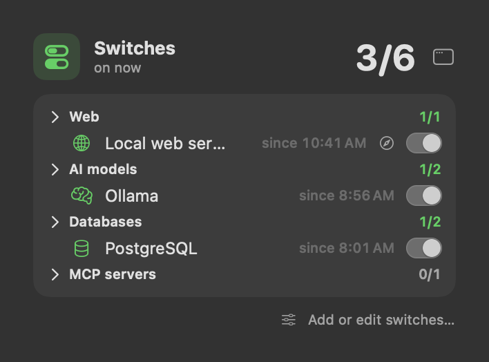
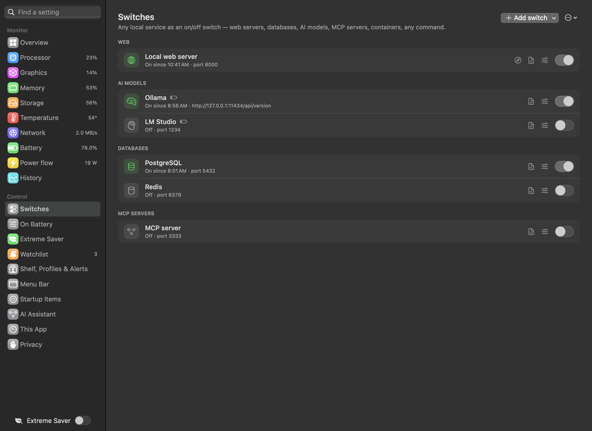

# Switches

**Purpose.** Turn local services — web servers, databases, AI model servers, MCP servers, containers, background agents,
any command — on and off with one switch, see at a glance which are running, and stop the heavy ones on battery.

---

## What a switch is

 <em>Switches panel: services on of total, grouped (AI models, Servers, Jobs, Backups…), one switch each.</em>

Each switch has:

| Field | Meaning |
|---|---|
| Name, group, icon | how it is shown; switches are grouped under headings (Web, AI models, Databases…); the icon is picked from a searchable grid of symbols |
| Start command | run in your login shell (`zsh -l`), so Homebrew, pyenv and nvm paths work |
| Stop command | optional; empty = stop what the start command launched |
| Run in folder | where the commands run (home if empty) |
| Running when | how Sparewatt knows it is on (below) |
| Open in browser | optional address, e.g. `http://127.0.0.1:8000/` |
| Stop on battery | stopped when you unplug, started again on the charger |
| Start when Sparewatt starts | turned on at launch |

**Running checks** (every 10 seconds while a panel or the dashboard is open, otherwise once a minute; opening the
Switches panel checks at once):

| Check | On when |
|---|---|
| A port answers | something listens on that port on this Mac |
| A web address answers | the address replies (any status below 500) |
| A process is running | a process matching the text exists |
| A command succeeds | the command exits with 0 within 4 seconds |
| Started by this app | the process Sparewatt started is still running |

Output of every start and stop is added to a log, `~/Library/Logs/Sparewatt/<name>.log`; earlier starts and stops stay
in it. A log that grows past 5 MB is set aside as `<name>.old.log` and a new one begins.

---

## Presets

 <em>Dashboard → Switches: add from a preset or edit each switch's start, stop and running check.</em>

*Add switch* offers ready-made switches; fill in your own paths:

| Preset | Starts / stops | Running when | Stops on battery |
|---|---|---|---|
| Django dev server | `manage.py runserver 8000` in your project | port 8000 | |
| Apache (Homebrew) | `brew services start/stop httpd` | port 8080 | |
| nginx (Homebrew) | `brew services start/stop nginx` | port 8080 | |
| Ollama | `ollama serve` / stop | Ollama's address answers | yes |
| LM Studio server | `lms server start/stop` | port 1234 | yes |
| llama.cpp server | `llama-server -m model.gguf --port 8081` | port 8081 | yes |
| MCP server (HTTP / SSE) | your server's command | port 3333 | |
| Docker container | `docker start/stop NAME` | the container is running | |
| PostgreSQL (Homebrew) | `brew services start/stop postgresql@16` | port 5432 | |
| Redis (Homebrew) | `brew services start/stop redis` | port 6379 | |
| launchd agent | `launchctl bootstrap/bootout` | the agent is loaded | |
| Any command | your own | your choice | |

---

## Where to use them

- **Menu bar SWITCH part** — "2/5" (how many are on), "…" while one is changing, red when one failed. Hover or click for
  a panel of toggles by group, with *On since 09:12*, an *open in browser* button, and *Add or edit switches…*.
- **Right-click menu** — every switch with a tick when on; click to flip it.
- **Dashboard → Switches** — the full list with errors, *Open its log*, *Edit*, *Add switch*, and the editor: *Test* tells
  you whether the running check sees it on right now.

When a switch doesn't come up within 30 seconds: "Didn't come up — see its log" (a start command that is still running,
such as a slow server loading, gets 60 seconds). When it doesn't stop: "Still running — check the stop command".
Sparewatt keeps checking, so a switch that gets there later turns on (or off) and the message goes away.

---

## Use cases

- **Local AI:** Ollama, LM Studio or llama.cpp hold gigabytes of memory and the graphics chip. Switch them on when you
  need them; let *Stop on battery* switch them off when you unplug and back on at your desk.
- **Web development:** Django, nginx, PostgreSQL and Redis for one project, in one group; on when you work on it, off
  when you don't.
- **MCP servers** for AI tools, on only when used.
- **Containers:** start and stop Docker containers without the Docker app's window.
- **Background agents:** load and unload a launchd agent without Terminal.

## Benefits

- One place, one click, no Terminal, no remembering commands and ports.
- You always see what is running — background servers no longer hide and drain the battery.
- *Stop on battery* makes heavy servers battery-friendly by default.

## Good to know

- Commands run as you, exactly as typed.
- *Delete* in the editor removes the switch at once (no confirmation).
- Switches are saved in `~/Library/Application Support/Sparewatt/switches.json`; you can edit it by hand and use
  *Reload from file*. A field you leave out takes its usual default; an entry that isn't a switch at all is left out.
  If the file can't be read in full, the Switches page says so, and the file as it was is kept as `switches.json.bak`
  before anything is saved over it.
- A switch that checks a web address makes a request to that address — the only network use besides the update check.
