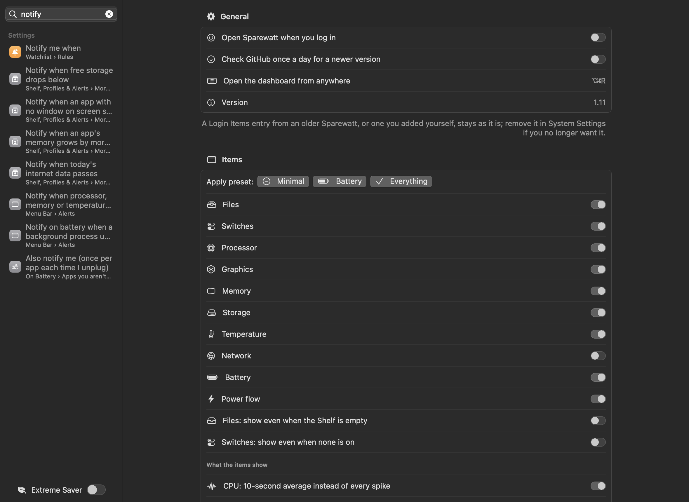
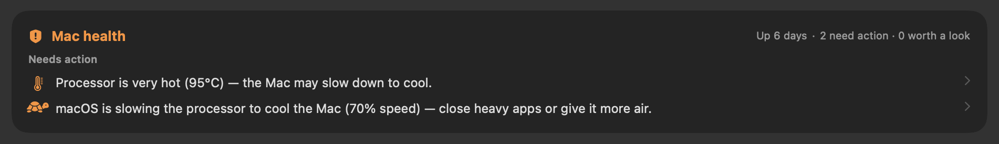
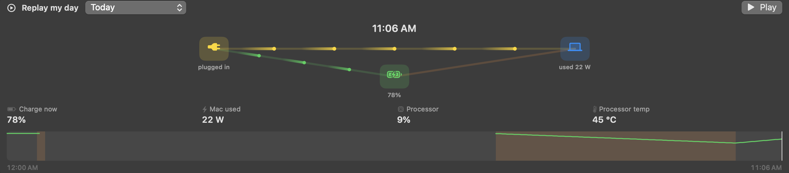
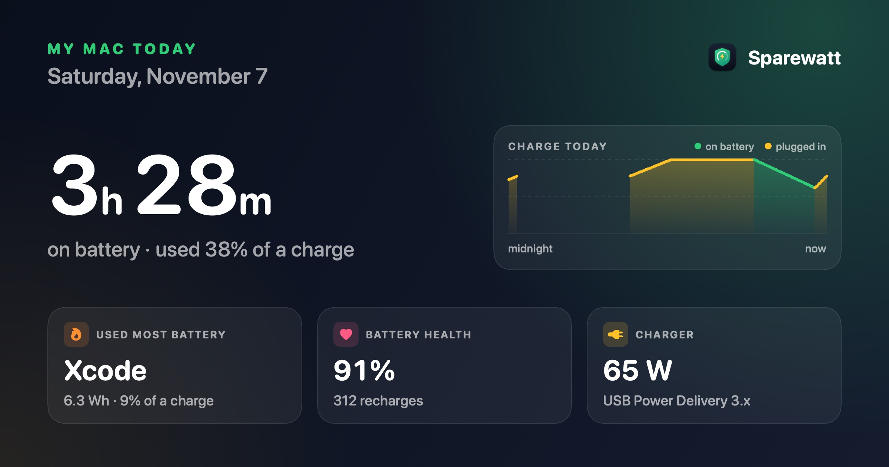
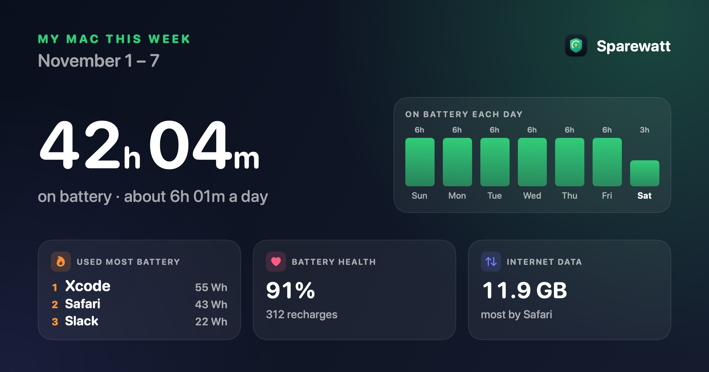
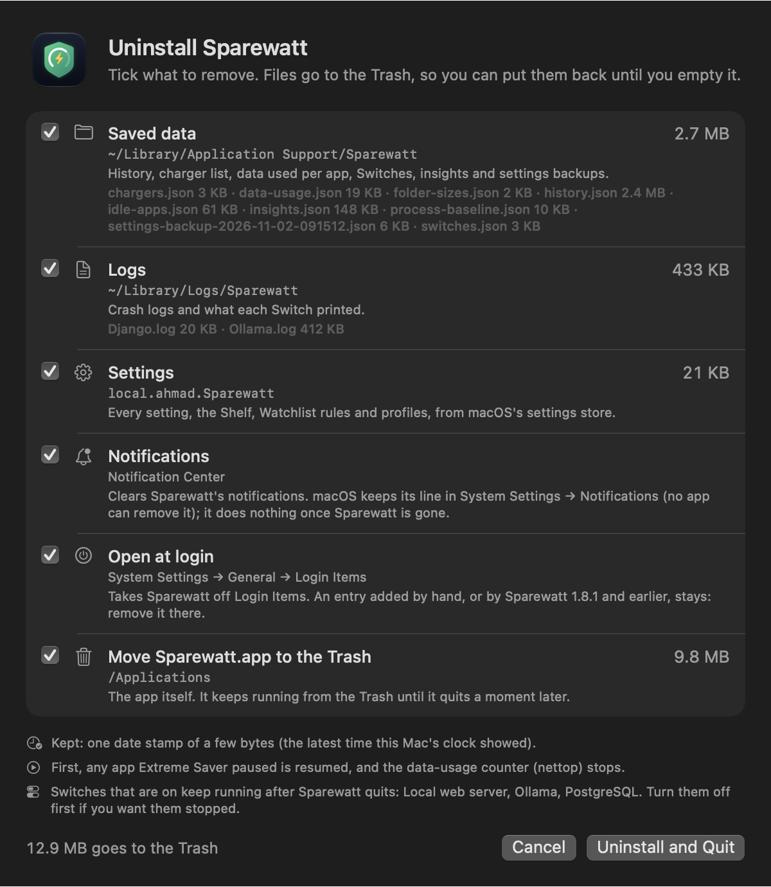
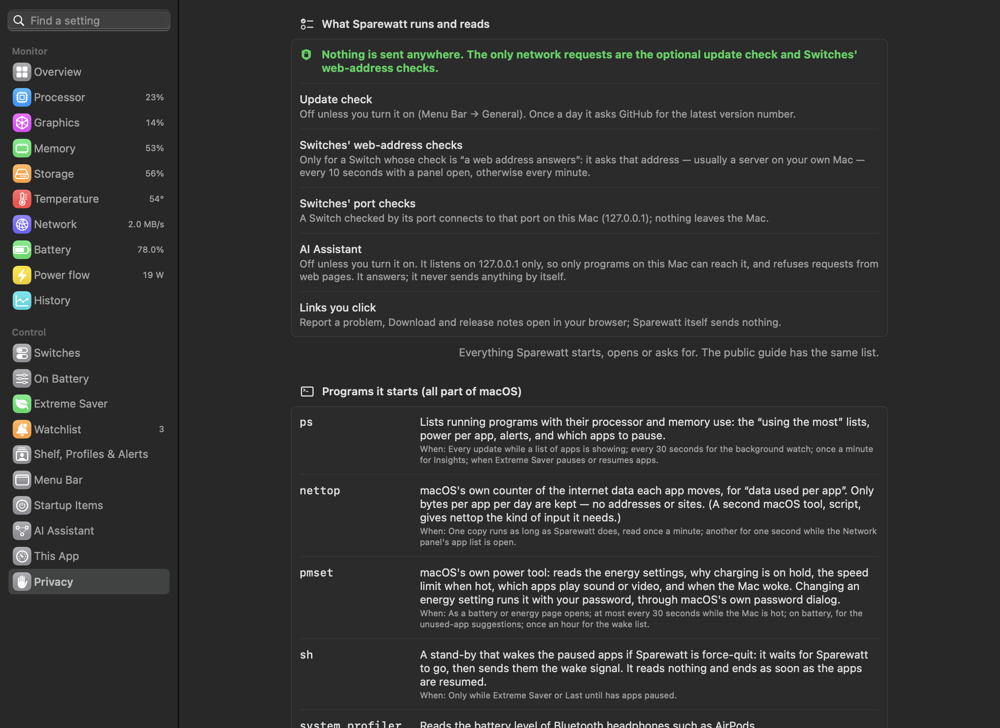

# Dashboard, history and this app

---

## Dashboard window

 <em>Dashboard window: Monitor and Control pages in the sidebar, each with its current value.</em>

**Purpose.** Everything in one window — larger than the menu bar panels, with history and every setting.

**What it does.** **⌥⌘R** from any app (or the button in any panel header, or the right-click menu). A sidebar:

- **Monitor:** Overview, Processor, Graphics, Memory, Storage, Temperature, Network, Battery, Power flow, History — each
  with its current value beside it.
- **Control:** Switches, On Battery, Extreme Saver, Watchlist, Shelf, Profiles & Alerts, Menu Bar, Startup Items,
  [AI Assistant](12%20AI%20Assistant.md), This App, [Privacy](#privacy-what-sparewatt-runs-and-reads).

At the top: [*Find a setting*](#find-a-setting). At the bottom: the Extreme Saver switch and, when there is one,
*Version X is available*. While the window is open, Sparewatt appears in the Dock and ⌘-Tab. On a Mac with no battery,
Extreme Saver is left out ([Macs without a battery](05%20Battery.md#macs-without-a-battery)).

Monitor pages show the same cards as the panels plus dashboard-only ones: 24-hour trends, battery wear, the wake log, the
background-processes table, battery use per app this week.

---

## Find a setting

 <em>Find a setting: "notify" lists each matching setting with its page and section. (Sample values.)</em>

**Purpose.** Get to a setting without knowing which page it is on.

**What it does.** A search field at the top of the dashboard sidebar. Type a word or two ("login", "clipboard",
"airpods") and the sidebar lists every matching setting with where it is, such as *Menu Bar › General* or *On Battery ›
Keyboards, mice and headphones*. Click one to open its page; the search clears. It finds a setting by its own words and
by other words you might use for it, so "login" finds *Open Sparewatt when you log in*. With no match it says so.

**Where.** Every page under **Control** is searched: Switches, On Battery, Extreme Saver, Watchlist, Shelf, Profiles &
Alerts, Menu Bar, Startup Items, AI Assistant, This App and Privacy.

---

## Overview and Mac health

 <em>Overview: Mac health at the top, then every monitor side by side.</em>

**Purpose.** One look to know whether anything needs your attention.

**What it does.** The Overview starts with a health card — *All good*, or *1 needs action · 2 worth a look*, after the
time since the last restart ("Up 18 days") — then eight tiles (Processor, Graphics, Memory, Storage, Battery, Power
flow, Temperature, Network), each with *Open*.

| Finding | Level |
|---|---|
| Battery state doesn't add up | needs action |
| A background process far above its normal | needs action |
| Storage under 10% free | needs action |
| Storage under 15% free and under 50 GB | worth a look |
| Memory pressure critical / raised | needs action / worth a look |
| More than 4 GB spilled to disk (swap) | worth a look |
| Processor above 95 °C / above 85 °C | needs action / worth a look |
| macOS slowing the processor to cool the Mac / warm for 10 minutes | needs action / worth a look |
| The drive's own health check (SMART) says *Failing* | needs action |
| No Time Machine backup for more than 7 days | worth a look |
| *Restarting would help*: up more than 14 days, and more than 4 GB in swap or memory pressure raised for 10 minutes of the last hour | worth a look |
| An app's memory grew by more than 2 GB in the last hour | worth a look |
| Battery health under 80% | worth a look |
| On battery with under an hour left | needs action |

Click a finding to open its page.

 <em>Mac health while the Mac is hot: two findings that need action, each a click away from its page. (Sample values.)</em>

**Use cases.** A morning check; or "the Mac feels off — is it anything?"

**Benefits.** Only lists what is actually unusual; *All good* means you can stop looking.

---

## History

 <em>History: charge, power, processor and temperature over an hour to a month, every stretch on battery, Export CSV.</em>

**Purpose.** See how the Mac behaved over hours and days.

**What it does.** One reading a minute, kept 30 days. Charts of **battery charge**, **Mac power use**, **processor** and
**processor temperature** over 1 hour, 24 hours, 7 days or 30 days (lines break across sleep), battery health over the
period, and **Times on battery**: each stretch with start, length, from–to %, average watts and the apps that used the
most power.

### Replay my day

 <em>Replay my day: the saved readings played back through the power flow, with the whole day as a strip to drag through. (Sample values.)</em>

The card at the top of History plays a day back in 30 seconds: plugged in or not, the charge, what the Mac drew, the
processor and its temperature, minute by minute, from the readings Sparewatt saved. **Play** runs it; drag the strip
to any moment. Stretches on battery are shaded. Pick another day from the menu. Where there is no reading it says so:
the Mac was asleep or Sparewatt wasn't running. A charge lane is drawn when the saved percentage was climbing.

**Export CSV…** saves everything stored (not just the chosen range): the minute readings, then the stretches on battery
with their top apps.

**Use cases.**
- "Why did the battery last only 3 hours yesterday?" — find the stretch and its top apps.
- Compare power use before and after a macOS update or a new app.
- Keep data for a battery-life comparison, or a support request.

**Where.** Dashboard → **History**; shorter trends on the Battery and Power flow pages.

---

## "My Mac today" share card

 <em>"My Mac today": time on battery, today's charge, the app that used most battery, battery health and the charger. (Sample values.)</em>

**Purpose.** Show someone how your Mac's day went in one picture, without giving away anything personal.

**What it does.** Makes a 1200 × 630 picture (the shape social sites use for link cards), dark or light as your Mac is
set:

- **time on battery today** and how much of a charge it used ("3h 42m on battery · used 58% of a charge"), or
  *Plugged in* when the battery wasn't used;
- a **curve of today's charge** from midnight to now, green on battery and yellow plugged in;
- up to three tiles: the **app that used most battery** (watt-hours and share of a charge), **battery health** with
  recharges, and the **charger** in use (or the Mac's average draw).

It holds only today's figures, app names and the charger type: no file paths, user or folder names, Mac name or serial
numbers. An app name is cut to its last part if it looks like a path.

**Where.** *Share my day* at the top of the dashboard's **Overview**, and the icon next to *Export CSV…* on
**History**. A preview opens with *Share…* (the macOS share menu), *Copy image* and *Save…* (a PNG named
"My Mac today" with the date).

**Limits.** Figures come from what Sparewatt keeps (the minute history and stretches on battery), so the card fills in
over the day; a Mac just set up has little to show.

---

## "My Mac this week" card

 <em>"My Mac this week": time on battery and a bar per day, the three apps that used most battery, battery health and internet data. (Sample values.)</em>

**What it does.** The weekly sister of the day card, the same size and made from the same kept figures, for the last 7
days (today and the 6 days before):

- **time on battery** over the week and about how much a day ("18h 20m on battery · about 2h 37m a day"), or
  *Plugged in* when no battery was used;
- a **bar for each day's time on battery**;
- up to three tiles: the **three apps that used the most battery** (watt-hours), **battery health** with recharges,
  and the **internet data used** with the app that used the most (or how much of a charge was used, when no data was
  counted).

The same rules as the day card: no file paths, user or folder names, Mac name or serial numbers.

**Where.** The share sheet's *Day / Week* switch (*Share my day* on the Overview, or the icon on History). *Save…* names
the PNG "My Mac this week" with the date. `sparewatt://share/week` opens it
([Links for Shortcuts and scripts](../reference/Links%20for%20Shortcuts%20and%20scripts.md)).

**Monday summary.** Optional, off by default: one notification on Monday, the first time the Mac is awake after 9:00,
such as "Last week: 18h on battery · top drain Xcode · 4.2 GB used". Clicking it opens the share sheet on the week card.
Turn it on in Dashboard → **Shelf, Profiles & Alerts** → *More alerts*.

---

## Startup Items

 <em>Startup Items: everything set to start by itself and whether it runs now.</em>

**Purpose.** See everything that starts on its own, and what it usually costs.

**What it does.** Lists launch agents and daemons — yours, for all users, and system-wide — with whether each is loaded
now, tags (*at login*, *restarts itself*, *disabled*), its usual processor use (learned by Sparewatt) and a Finder button.
Read-only; *Open Login Items settings* takes you to where macOS lets you turn them off.

**Use cases.** A new Mac feels slower after installing a few tools: find the background helpers they added.

---

## This App

 <em>This App: Sparewatt's own processor and memory use · export, import and the welcome window · use by feature.</em>

**Purpose.** A monitor should not itself cost much. This page shows exactly what Sparewatt uses.

**What it does.** *Sparewatt itself*, *Your settings* (see [below](#your-settings-export-import-welcome-again)),
*By feature*, *Problems* (see [below](#crash-log-and-report-a-problem)) and *Trust*: *What Sparewatt runs and reads*
opens the [Privacy](#privacy-what-sparewatt-runs-and-reads) page, and [*Uninstall Sparewatt…*](#uninstall-sparewatt)
removes it.

**Sparewatt itself**

| Row | What it tells you |
|---|---|
| Right now | Sparewatt's processor use this moment, as % of **one** core, and its memory (e.g. *3.1% of one core · 102 MB*) |
| Average since launch | processor time used since Sparewatt started, as % of one core; it counts the helper tools features start (`ps`, `du`, `pmset`), so it can sit far above *Right now* after a panel or a folder count has been busy |
| macOS energy impact | the same score Activity Monitor shows for Sparewatt (on current macOS, its processor use as % of one core) |
| Update speed | how often readings refresh (every 1–30 s). Energy follows processor time: the slower the update speed, the less Sparewatt uses |

**By feature (since launch)** — each feature's share of Sparewatt's processor time, the bar, the time as % of one core,
and **when it runs**:

| Feature | When it runs |
|---|---|
| Top apps lists | only while a panel or dashboard page with a "using the most" list is open |
| Temperature sensors | read in the background: every sensor at each update while a panel or the dashboard is open, otherwise the ~16 the menu bar uses, every third update |
| Folder sizes | the Storage panel's folder list; results are cached between runs |
| Processor & memory | every update |
| Background watch | every 30 s; its alerts are set in Menu Bar → *Alerts* |
| Drawing the menu bar | only when a value changes, at most every 4 s (at once when its state changes) |
| Battery & power | every update |
| Network & disk speed | every update |
| Fans | every update — slow the update speed to cut it |
| Graphics | every update |
| Switches | every 10 s while a panel or the dashboard is open, otherwise once a minute; only if you have switches |
| Latest File | only while the Files panel is open |
| Insights | once a minute (battery and per-app readings) |
| Mac health | Time Machine every 30 minutes, the drive check every 6 hours; the speed limit only while macOS cools the Mac |
| Device batteries | every minute (controllers also when one connects); headphones every 5 minutes |
| Data usage | one `nettop` that keeps running, read once a minute |

The list is sorted by cost, so the top rows are what to change first. Features are turned off in **Menu Bar** settings.

**Use cases.** Choose a slower update speed or turn off live diagrams if Sparewatt's own cost matters on battery.

### Your settings: export, import, welcome again

**Purpose.** Keep a copy of your settings, or move them to another Mac.

**What it does.**
- **Export settings…** saves one JSON file with your settings, your switches and your profiles. Only settings you
  changed from their defaults are in it. Not included: open at login (a macOS registration, not a setting) and
  Sparewatt's own state on this Mac, such as the files on the Shelf, pinned clipboard text, whether Extreme Saver is
  on, and window positions.
- **Import settings…** shows what the file holds first: "12 settings, 13 switches, 3 profiles — replace your current
  ones?", the Sparewatt version and date it came from, and a warning when it holds switches (they run their own
  commands, so import only a file you made or trust). *Replace* saves your current settings as
  `settings-backup-<date>.json` in `~/Library/Application Support/Sparewatt`, then replaces them: a setting not in the
  file goes back to its default. If the backup can't be written, nothing is changed. A file from a newer Sparewatt is
  refused.
- **Show welcome again** opens the [welcome window](../guide/01%20Getting%20started.md#the-welcome-window).

**Use cases.** A new Mac: export on the old one, import on the new one. Before trying other settings, export a copy.

### Crash log and Report a problem

**Purpose.** Report a problem with the details a fix needs, while you decide what is sent.

**What it does.** If Sparewatt ever crashes, it keeps a plain-text log on this Mac (app and macOS version, what went
wrong, the call stack). The next launch shows a card at the top of **This App**: *Sparewatt crashed on …*, with:

- **Report…** — opens a new GitHub issue in your browser with the start of that log, your name, the Mac's name and
  file paths removed. You read it there and send it, or not.
- **Show log** — shows the log file in Finder.
- **Dismiss** — hides the card until the next crash.

A **Report a problem…** button is always on the page: it opens a new issue with only the app and macOS versions filled
in, and you write the rest.

**Benefits.** Nothing is sent automatically; nothing is sent at all unless you press *Submit* on GitHub.

**Where.** Dashboard → **This App**. The logs are in `~/Library/Logs/Sparewatt/` (see
[Where Sparewatt keeps its data](../reference/Data%20files.md)).

### Uninstall Sparewatt

 <em>Uninstall Sparewatt: what it keeps on this Mac, with sizes; untick what you want to keep. (Sample values.)</em>

**Purpose.** Remove Sparewatt and what it keeps on this Mac, without hunting through Library folders.

**What it does.** *Uninstall Sparewatt…* (This App → *Trust*) opens a sheet listing what Sparewatt keeps here, with
sizes. Everything starts ticked; untick what you want to keep:

| Item | What removing it means |
|---|---|
| Saved data | every file in `~/Library/Application Support/Sparewatt`, listed by name: history, the charger list, data used per app, Switches, insights, device levels and settings backups |
| Logs | `~/Library/Logs/Sparewatt`: crash logs and what each Switch printed |
| Settings | every setting, the Shelf, Watchlist rules and profiles, cleared from macOS's settings store |
| Notifications | clears Sparewatt's notifications (macOS keeps its line in System Settings → Notifications; no app can remove it) |
| Open at login | takes Sparewatt off Login Items (only listed when it is on) |
| Move Sparewatt.app to the Trash | the app itself |

Files go to the Trash, so you can put them back until you empty it. Settings are cleared, not moved: use *Export
settings…* first to keep a copy. Before anything is removed, apps Extreme Saver paused are resumed and the data-usage
counter stops. Switches that are on keep running after Sparewatt quits; the sheet names them, so turn them off first if
you want them stopped. *Uninstall and Quit* removes what is ticked and quits Sparewatt. If something can't be removed,
it says what and why.

**Limits.** A Login Items entry you added by hand, or one from Sparewatt 1.8.1 or earlier, stays; remove it in System
Settings → General → Login Items.

---

## Privacy: what Sparewatt runs and reads

 <em>Dashboard → Privacy: its network use first, then each program it starts, when and why.</em>

**Purpose.** See exactly what Sparewatt does on your Mac, from the app itself.

**What it does.** Dashboard → **Privacy** (or This App → *What Sparewatt runs and reads* → *Show*) lists:

- its **network** use: "Nothing is sent anywhere. The only network requests are the optional update check and
  Switches' web-address checks.";
- the **12 programs it starts**, all part of macOS, each with when and why (`ps`, `nettop`, `pmset`,
  `system_profiler`, `du`, `tmutil`, `diskutil`, `launchctl`, `zsh`, `pkill`, `ditto`, `osascript`);
- every **place it reads or writes**, and how;
- the **permissions** it may ask for, when and why.

The guide page [What Sparewatt runs and reads](../guide/10%20What%20Sparewatt%20runs%20and%20reads.md) is made from the
same table, so the two agree, and the app's tests fail if the code starts a program the list doesn't name.

---

## Updates

*Check GitHub once a day for a newer version* (Dashboard → Menu Bar → *General*) — **off** by default. When a newer
release exists, the dashboard sidebar and the right-click menu say so; nothing is downloaded or installed automatically.

---

## Updating from Sparewatt 1.4

The first launch of a later version copies your 1.4 settings once; history, switches and logs stay where they are.
See [Getting started](../guide/01%20Getting%20started.md#updating-from-sparewatt-14).
