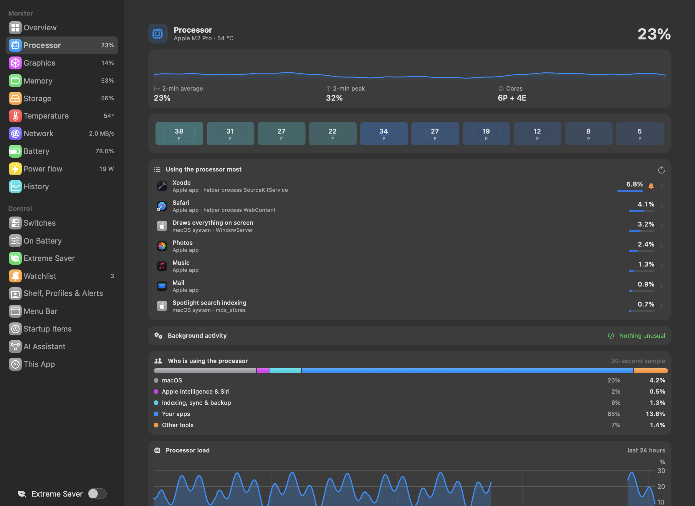
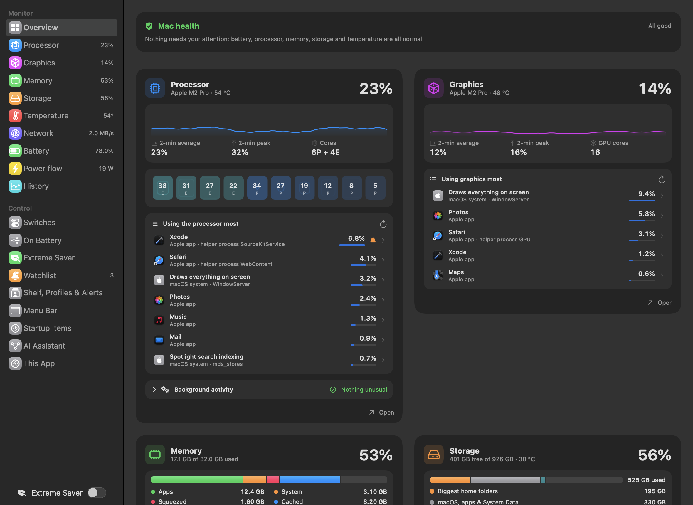
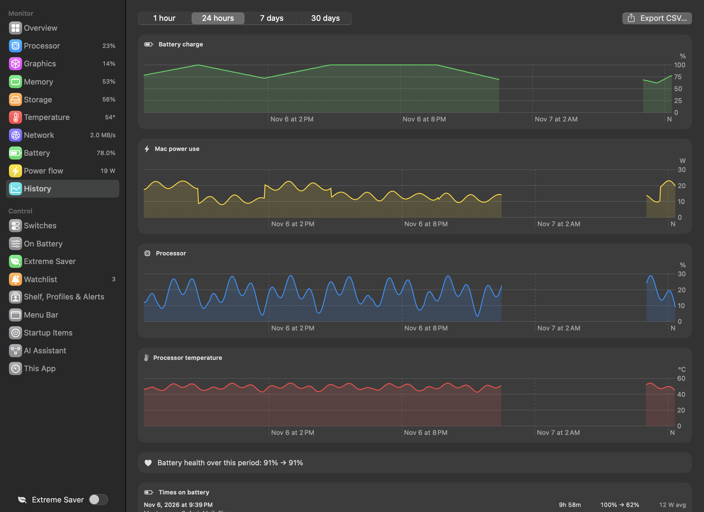
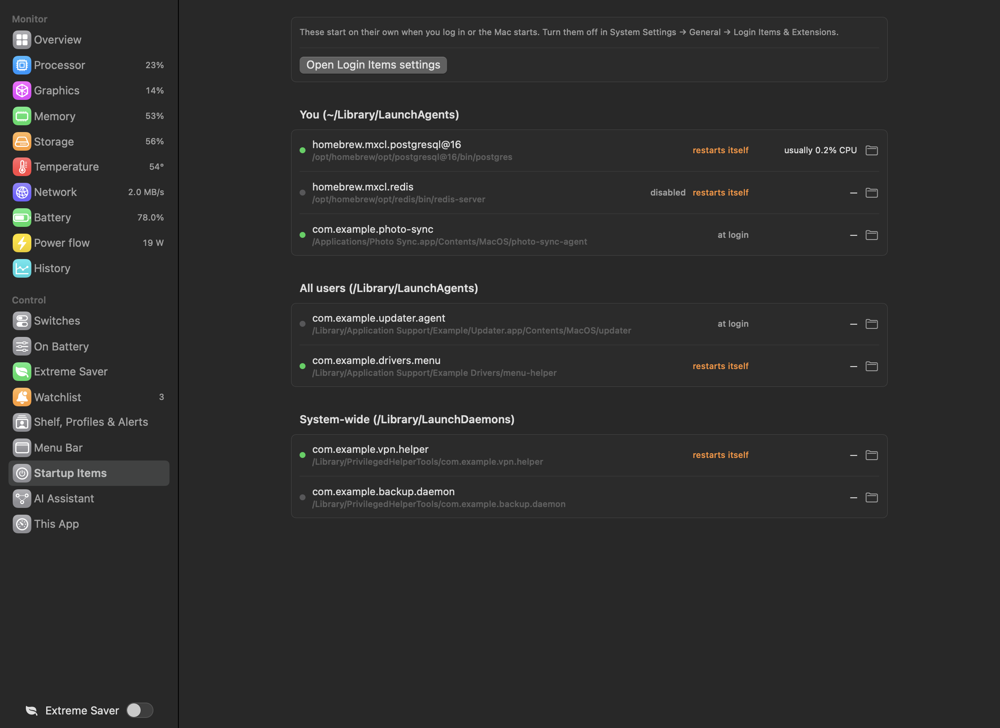
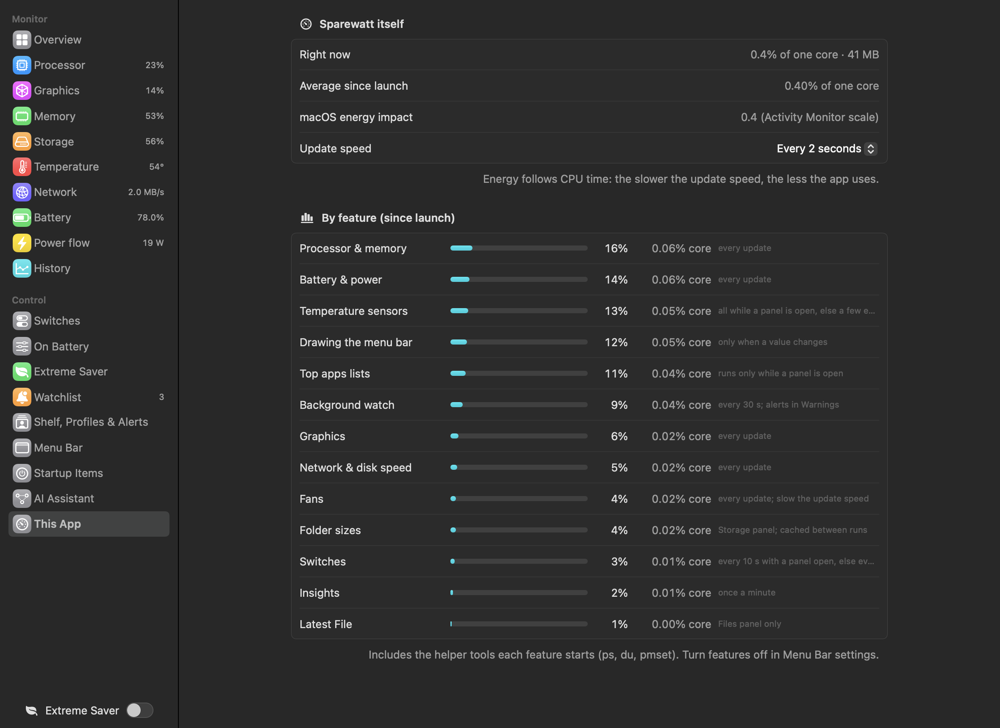

# Dashboard, history and this app

---

## Dashboard window

 <em>Dashboard window: Monitor and Control pages in the sidebar, each with its current value.</em>

**Purpose.** Everything in one window — larger than the menu bar panels, with history and every setting.

**What it does.** **⌥⌘R** from any app (or the button in any panel header, or the right-click menu). A sidebar:

- **Monitor:** Overview, Processor, Graphics, Memory, Storage, Temperature, Network, Battery, Power flow, History — each
  with its current value beside it.
- **Control:** Switches, On Battery, Extreme Saver, Watchlist, Shelf, Profiles & Alerts, Menu Bar, Startup Items,
  [AI Assistant](12%20AI%20Assistant.md), This App.

At the bottom: the Extreme Saver switch and, when there is one, *Version X is available*. While the window is open,
Sparewatt appears in the Dock and ⌘-Tab.

Monitor pages show the same cards as the panels plus dashboard-only ones: 24-hour trends, battery wear, the wake log, the
background-processes table, battery use per app this week.

---

## Overview and Mac health

 <em>Overview: Mac health at the top, then every monitor side by side.</em>

**Purpose.** One look to know whether anything needs your attention.

**What it does.** The Overview starts with a health card — *All good*, or *1 needs action · 2 worth a look* — then eight
tiles (Processor, Graphics, Memory, Storage, Battery, Power flow, Temperature, Network), each with *Open*.

| Finding | Level |
|---|---|
| Battery state doesn't add up | needs action |
| A background process far above its normal | needs action |
| Storage under 10% free | needs action |
| Storage under 20% free | worth a look |
| Memory pressure critical / raised | needs action / worth a look |
| More than 4 GB spilled to disk (swap) | worth a look |
| Processor above 95 °C / above 85 °C | needs action / worth a look |
| Battery health under 80% | worth a look |
| On battery with under an hour left | needs action |

Click a finding to open its page.

**Use cases.** A morning check; or "the Mac feels off — is it anything?"

**Benefits.** Only lists what is actually unusual; *All good* means you can stop looking.

---

## History

 <em>History: charge, power, processor and temperature over an hour to a month, every stretch on battery, Export CSV.</em>

**Purpose.** See how the Mac behaved over hours and days.

**What it does.** One reading a minute, kept 30 days. Charts of **battery charge**, **Mac power use**, **processor** and
**processor temperature** over 1 hour, 24 hours, 7 days or 30 days (lines break across sleep), battery health over the
period, and **Times on battery**: each stretch with start, length, from–to %, average watts and the apps that used the
most power.

**Export CSV…** saves everything stored (not just the chosen range): the minute readings, then the stretches on battery
with their top apps.

**Use cases.**
- "Why did the battery last only 3 hours yesterday?" — find the stretch and its top apps.
- Compare power use before and after a macOS update or a new app.
- Keep data for a battery-life comparison, or a support request.

**Where.** Dashboard → **History**; shorter trends on the Battery and Power flow pages.

---

## "My Mac today" share card

**Purpose.** Show someone how your Mac's day went in one picture, without giving away anything personal.

**What it does.** Makes a 1200 × 630 picture (the shape social sites use for link cards), dark or light as your Mac is
set:

- **time on battery today** and how much of a charge it used ("3h 42m on battery · used 58% of a charge"), or
  *Plugged in* when the battery wasn't used;
- a **curve of today's charge** from midnight to now, green on battery and yellow plugged in;
- up to three tiles: the **app that used most battery** (watt-hours and share of a charge), **battery health** with
  recharges, and the **charger** in use (or the Mac's average draw).

It holds only today's figures, app names and the charger type: no file paths, user or folder names, Mac name or serial
numbers. An app name is cut to its last part if it looks like a path.

**Where.** *Share my day* at the top of the dashboard's **Overview**, and the icon next to *Export CSV…* on
**History**. A preview opens with *Share…* (the macOS share menu), *Copy image* and *Save…* (a PNG named
"My Mac today" with the date).

**Limits.** Figures come from what Sparewatt keeps (the minute history and stretches on battery), so the card fills in
over the day; a Mac just set up has little to show.

---

## Startup Items

 <em>Startup Items: everything set to start by itself and whether it runs now.</em>

**Purpose.** See everything that starts on its own, and what it usually costs.

**What it does.** Lists launch agents and daemons — yours, for all users, and system-wide — with whether each is loaded
now, tags (*at login*, *restarts itself*, *disabled*), its usual processor use (learned by Sparewatt) and a Finder button.
Read-only; *Open Login Items settings* takes you to where macOS lets you turn them off.

**Use cases.** A new Mac feels slower after installing a few tools: find the background helpers they added.

---

## This App

 <em>This App: Sparewatt's own processor and memory use, by feature.</em>

**Purpose.** A monitor should not itself cost much. This page shows exactly what Sparewatt uses.

**What it does.** Two cards.

**Sparewatt itself**

| Row | What it tells you |
|---|---|
| Right now | Sparewatt's processor use this moment, as % of **one** core, and its memory (e.g. *3.1% of one core · 102 MB*) |
| Average since launch | processor time used since Sparewatt started, as % of one core; it counts the helper tools features start (`ps`, `du`, `pmset`), so it can sit far above *Right now* after a panel or a folder count has been busy |
| macOS energy impact | the same score Activity Monitor shows for Sparewatt (on current macOS, its processor use as % of one core) |
| Update speed | how often readings refresh (every 1–30 s). Energy follows processor time: the slower the update speed, the less Sparewatt uses |

**By feature (since launch)** — each feature's share of Sparewatt's processor time, the bar, the time as % of one core,
and **when it runs**:

| Feature | When it runs |
|---|---|
| Top apps lists | only while a panel or dashboard page with a "using the most" list is open |
| Temperature sensors | read in the background: every sensor at each update while a panel or the dashboard is open, otherwise the ~16 the menu bar uses, every third update |
| Folder sizes | the Storage panel's folder list; results are cached between runs |
| Processor & memory | every update |
| Background watch | every 30 s; its alerts are set in Warnings |
| Drawing the menu bar | only when a value changes |
| Battery & power | every update |
| Network & disk speed | every update |
| Fans | every update — slow the update speed to cut it |
| Graphics | every update |
| Switches | every 10 s while a panel or the dashboard is open, otherwise once a minute; only if you have switches |
| Latest File | only while the Files panel is open |
| Insights | once a minute (battery and per-app readings) |

The list is sorted by cost, so the top rows are what to change first. Features are turned off in **Menu Bar** settings.

**Use cases.** Choose a slower update speed or turn off live diagrams if Sparewatt's own cost matters on battery.

### Crash log and Report a problem

**Purpose.** Report a problem with the details a fix needs, while you decide what is sent.

**What it does.** If Sparewatt ever crashes, it keeps a plain-text log on this Mac (app and macOS version, what went
wrong, the call stack). The next launch shows a card at the top of **This App**: *Sparewatt crashed on …*, with:

- **Report…** — opens a new GitHub issue in your browser with the start of that log, your name, the Mac's name and
  file paths removed. You read it there and send it, or not.
- **Show log** — shows the log file in Finder.
- **Dismiss** — hides the card until the next crash.

A **Report a problem…** button is always on the page: it opens a new issue with only the app and macOS versions filled
in, and you write the rest.

**Benefits.** Nothing is sent automatically; nothing is sent at all unless you press *Submit* on GitHub.

**Where.** Dashboard → **This App**. The logs are in `~/Library/Logs/Sparewatt/` (see
[Where Sparewatt keeps its data](../reference/Data%20files.md)).

---

## Updates

*Check GitHub once a day for a newer version* (Dashboard → Menu Bar → *General*) — **off** by default. When a newer
release exists, the dashboard sidebar and the right-click menu say so; nothing is downloaded or installed automatically.

---

## Updating from Sparewatt 1.4

The first launch of a later version copies your 1.4 settings once; history, switches and logs stay where they are.
See [Getting started](../guide/01%20Getting%20started.md#updating-from-sparewatt-14).
