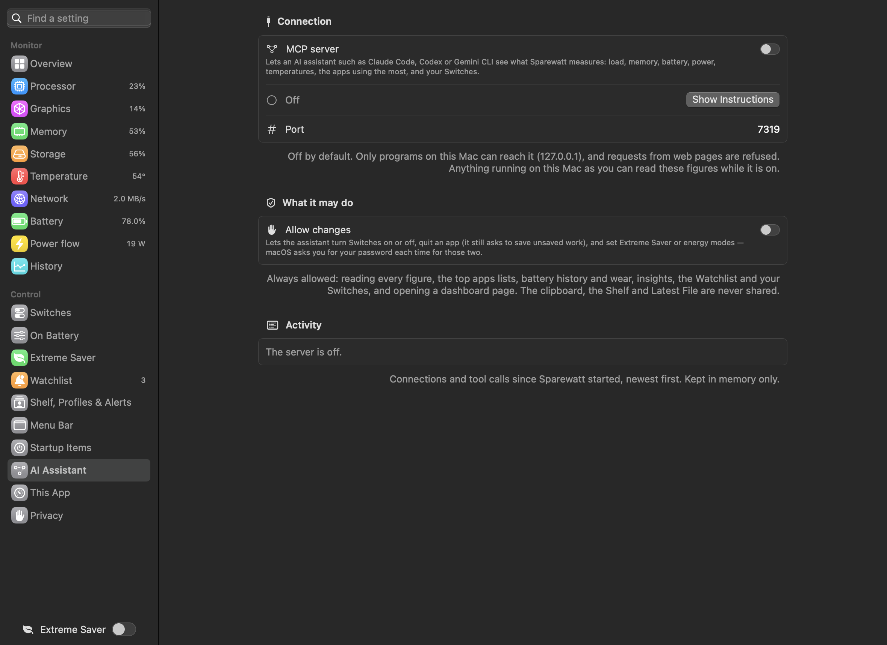
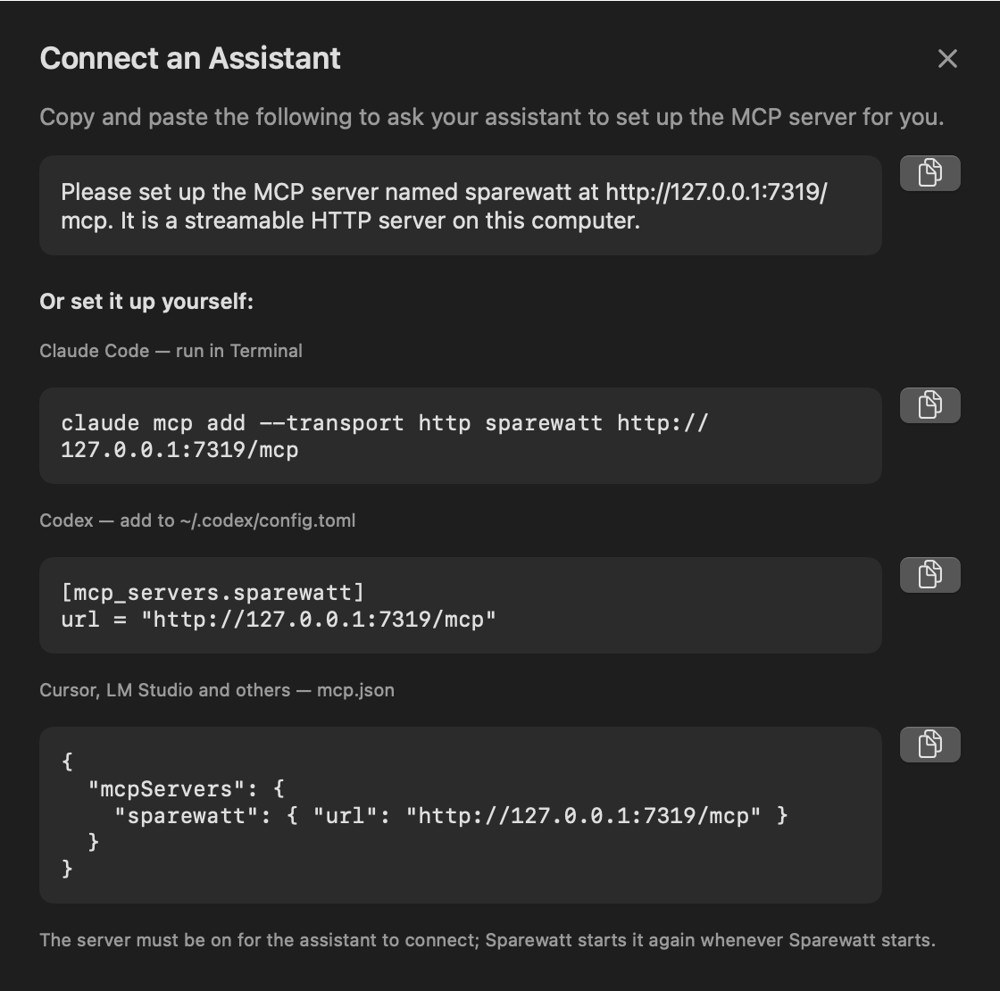

# AI Assistant

**Purpose.** Let an AI assistant on your Mac — Claude Code, Codex, Cursor, LM Studio or any other app that speaks
MCP (the Model Context Protocol) — see what Sparewatt measures, so you can ask it *"why is my battery draining?"* or
*"what is using all my memory?"* and get an answer from live readings instead of guesses.

---

## Turning it on

Dashboard (**⌥⌘R**) → **AI Assistant** → **MCP server**. It is **off** until you turn it on. Once on, the page says
*Listening on 127.0.0.1:7319*, and Sparewatt starts it again every time Sparewatt starts.

- **Port** — 7319 unless you change it (any number from 1024 to 65535). If another app already uses the port, the page
  says so; choose another and the server moves there.
- **Show Instructions** — what to give your assistant (below).

## Connecting an assistant

**Show Instructions** gives you one sentence to paste into any assistant, which then sets itself up:

> Please set up the MCP server named sparewatt at http://127.0.0.1:7319/mcp. It is a streamable HTTP server on this
> computer.

Or set it up yourself:

| Assistant | How |
|---|---|
| Claude Code | in Terminal: `claude mcp add --transport http sparewatt http://127.0.0.1:7319/mcp` |
| Codex | in `~/.codex/config.toml`: `[mcp_servers.sparewatt]` then `url = "http://127.0.0.1:7319/mcp"` |
| Cursor, LM Studio and others | in their `mcp.json`: `{"mcpServers": {"sparewatt": {"url": "http://127.0.0.1:7319/mcp"}}}` |

If you changed the port, use your port in place of 7319. Each copy button on the page already has the right port.

## What the assistant can do

**Always (reading only):**

| Tool | Gives |
|---|---|
| `get_overview` | everything at a glance: processor, graphics, memory with pressure and swap, storage, battery and charger, power draw, temperatures and fans, network and disk speed, Extreme Saver and energy modes, and the [Mac health](11%20Dashboard%2C%20history%20and%20this%20app.md#overview-and-mac-health) findings |
| `get_top_apps` | the [using the most](04%20Who%20is%20using%20it.md) list for processor, graphics, memory, energy, network or storage, each row explained in plain words |
| `get_app_processes` | every process behind one app (the app and its helpers) |
| `get_battery` | battery now, plus [wear](05%20Battery.md#battery-wear) per day, each stretch on battery and the [battery used per app](06%20Power.md#battery-used-per-app-last-7-days), for up to 30 days |
| `get_history` | the per-minute [History](11%20Dashboard%2C%20history%20and%20this%20app.md#history) (charge, watts, processor, temperature), up to 30 days |
| `get_insights` | unusual background processes, apps busy with no window, swap growth, what woke the Mac, [idle apps](06%20Power.md#idle-apps-on-battery) worth quitting, and your [Watchlist](04%20Who%20is%20using%20it.md#watchlist) with its recent alerts |
| `list_switches` | your [Switches](10%20Switches.md) and whether each is on |
| `open_dashboard` | opens a dashboard page on your screen, to show you something |

**Only with *Allow changes* on** (off until you turn it on):

| Tool | Does |
|---|---|
| `set_switch` | turns one of your Switches on or off |
| `quit_app` | quits an app as if you chose Quit — it can still ask you to save; macOS parts and Sparewatt itself can't be quit |
| `set_extreme_saver` | turns [Extreme Saver](07%20Power%20controls.md#extreme-saver) on or off — macOS asks you for your password (not on a Mac with no battery) |
| `set_energy_mode` | sets the [energy mode](07%20Power%20controls.md) for battery or charger (only the charger, wall power, on a Mac with no battery) — macOS asks you for your password |

With *Allow changes* off, these tools answer that changes are off, and the assistant can tell you where to allow them.

## Activity

The page lists each assistant that connected and every tool it called since Sparewatt started, newest first, with a
mark for anything refused. Kept in memory only.

## Benefits

- Ask questions in plain words and get answers from real readings: *"Which app cost the most battery this week?"*,
  *"Is my Mac hot because of the GPU?"*, *"Did anything wake the Mac overnight?"*
- Works with whichever assistant you use; nothing is tied to one AI company.
- The assistant sees the same explanations you see, so it doesn't misread cryptic process names.

## Good to know

- **This Mac only.** The server listens on 127.0.0.1, so other computers can't reach it. Requests from web pages are
  refused, so a website can't read it through your browser.
- **No password.** While the server is on, any program running on this Mac as you can read these figures. Turn it off
  when you don't need it.
- **Never shared:** the clipboard, the Shelf and Latest File.
- Where the reading goes after that is up to your assistant: a cloud AI sends what it reads to its company like
  anything else you ask it.
- The server uses MCP's streamable HTTP transport. Old clients that only speak the earlier HTTP+SSE transport need a
  bridge such as `mcp-remote`.
