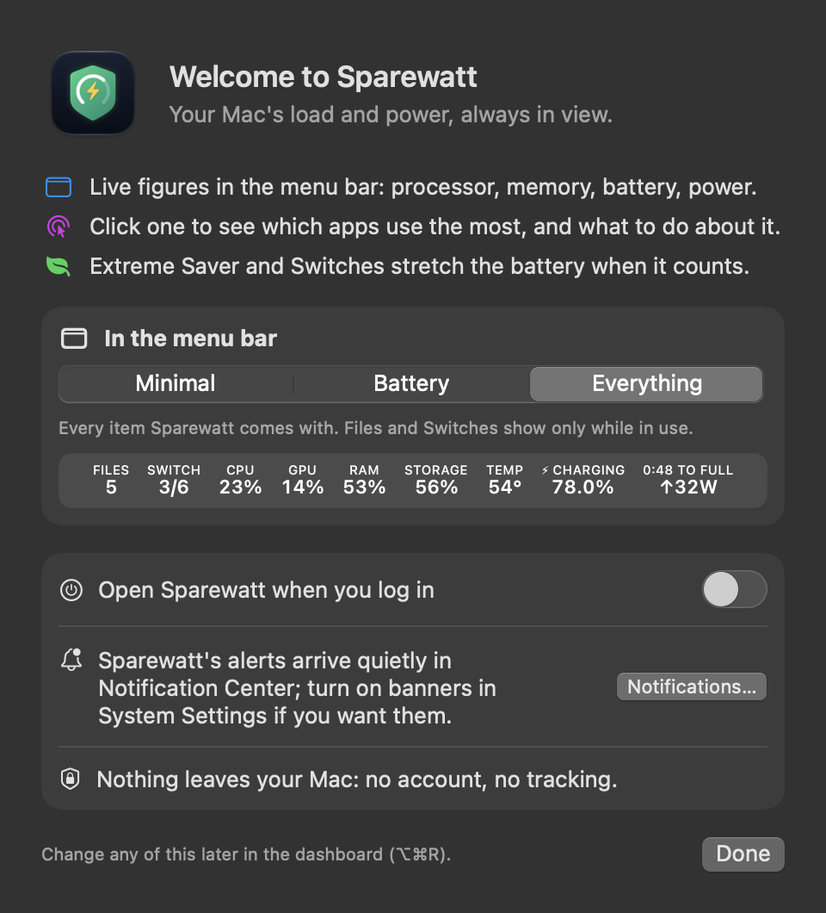

# Getting started

## Install

1. Download **Sparewatt.dmg** from the app's latest release.
2. Open it and drag **Sparewatt** onto **Applications**.
3. Open Sparewatt. It lives in the menu bar only — no Dock icon, no window — until you open the dashboard.

A `.zip` of the app is in each release too, if you prefer.

**Needs** macOS 14 (Sonoma) or later, on Apple silicon or Intel. It works on MacBooks and on desktop Macs with no
battery (Mac mini, Mac Studio, iMac, Mac Pro); on those, the battery readings and Extreme Saver are left out (see
[Macs without a battery](../features/05%20Battery.md#macs-without-a-battery)).

## "macOS cannot verify the developer"

Sparewatt is not signed with an Apple Developer ID, so the first launch shows this warning. Either:

- right-click the app → **Open** → **Open**, or
- remove the download flag in Terminal:

```bash
xattr -dr com.apple.quarantine /Applications/Sparewatt.app
```

You only do this once.

## The welcome window

The first launch of a new install opens one small window (if you used Sparewatt before, you don't see it):

<p align="center"><br><em>The welcome window: what Sparewatt does, a menu bar preset with a live preview, open at login, notifications.</em></p>

- three lines on what Sparewatt does;
- **In the menu bar:** *Minimal* (processor, memory, battery), *Battery* (battery, power, temperature) or *Everything*,
  with a live preview. The menu bar changes as soon as you pick one;
- **Open Sparewatt when you log in** (see [Start at login](#start-at-login));
- a note that alerts arrive quietly in Notification Center, with a *Notifications…* button to turn on banners;
- "Nothing leaves your Mac: no account, no tracking."

Everything in it can be changed later in the dashboard. Dashboard → **This App** → *Show welcome again* opens it again.

## First look

- The menu bar shows **one compact item** with live readings (processor, graphics, memory, storage, temperature, battery, power).
- **Hover** over any part of it to open that part's panel. Click to keep it open.
- **⌥⌘R** opens the dashboard window from anywhere: every monitor on the left under *Monitor*, every setting under *Control*.
  Type a word or two into *Find a setting* at the top of its sidebar to jump to any setting.
- Right-click the menu bar item for the dashboard, settings, Extreme Saver and Quit.

## VoiceOver

Every panel, chart, diagram, meter and icon button reads as words, with units spelt out. The menu bar item reads as one
sentence ("cpu 12%, ram 54%…"); the power flow says "the 65-watt charger gives 44 watts to the Mac and 17 watts to the
battery"; a graph says its latest reading, average and peak; list rows read like "Xcode, App, 4.2%, button", with
Notify and Quit as actions.

## Start at login

Dashboard → **Menu Bar** → **Open Sparewatt when you log in** (also in the welcome window). It uses macOS's own
login-item service, so Sparewatt shows up in System Settings → General → Login Items. If macOS wants your OK first, the
switch says so; click *Open Login Items…* and switch Sparewatt on there.

A login item from Sparewatt 1.8.1 or earlier, or one you added yourself, stays as it is: the switch doesn't see it.
Remove it in Login Items if you no longer want it.

## Menu bar presets

Dashboard → **Menu Bar** → *Apply preset*: *Minimal*, *Battery* or *Everything* sets which items show in one click.
See [Presets and open at login](../features/01%20Menu%20bar.md#presets-and-open-at-login).

## Moving to another Mac

Dashboard → **This App** → *Export settings…* saves your settings, switches and profiles in one file; *Import
settings…* on the other Mac reads it. See
[Your settings](../features/11%20Dashboard%2C%20history%20and%20this%20app.md#your-settings-export-import-welcome-again).

## Updating from Sparewatt 1.4

Later versions use the bundle ID `local.ahmad.Sparewatt` (1.4 used `app.sparewatt.Sparewatt`). The first launch
copies your 1.4 settings once; history, switches and logs stay where they are, in folders named Sparewatt. macOS
asks again, once, for Downloads access.

## Updates

The update check is **off** by default. Turn it on in Dashboard → Menu Bar → General → *Check GitHub once a day for a
newer version*.

## Uninstalling

Dashboard → **This App** → *Uninstall Sparewatt…* lists what Sparewatt keeps on this Mac (saved data, logs, settings,
notifications, the login item and the app itself), with sizes. Untick what you want to keep, then *Uninstall and
Quit*. Files go to the Trash, so you can put them back until you empty it; settings are cleared, so export them first
if you may want them again. See
[Uninstall Sparewatt](../features/11%20Dashboard%2C%20history%20and%20this%20app.md#uninstall-sparewatt).
