[Home](index.md) · [Getting started](Getting-started.md) · [Features](Features.md) · [Switches](Switches.md) · [Developer guide](Developer-guide.md) · [Troubleshooting](Troubleshooting.md) · [Changelog](Changelog.md) · [Download](https://github.com/MShirazAhmad/Sparewatt-docs/releases/latest)

---

<h1 align="center">Sparewatt documentation</h1>

How to use Sparewatt, the macOS menu bar app that shows what your Mac's processor, graphics, memory, storage, battery and power are doing — and helps you keep battery time for the things you actually use.

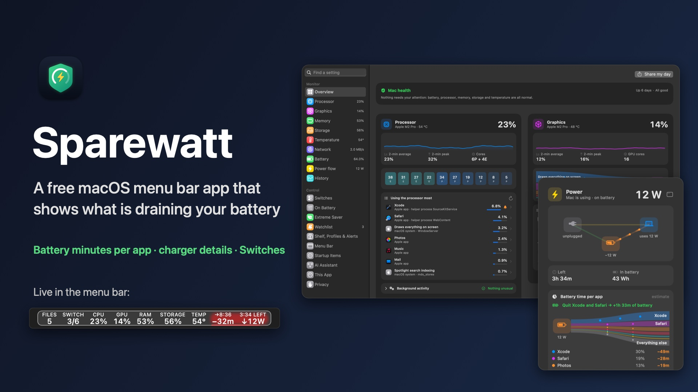

These pages are also a website: **[mshirazahmad.github.io/Sparewatt-docs](https://mshirazahmad.github.io/Sparewatt-docs/)**.

**Runs on** macOS 14 (Sonoma) or later, on Apple silicon and Intel Macs: MacBooks, and desktop Macs with no battery
(Mac mini, Mac Studio, iMac, Mac Pro). See [Getting started](Getting-started.md).

## Why I built Sparewatt

I am a physicist. Programming and tech are my hobby, and Sparewatt is my hobby project.

I used to pay for several small Mac apps, each for a feature or two: one for clipboard history, one for drag and
drop, another for power management. My 16-inch MacBook Pro (2021) has an M1 Max chip and 64 GB of memory, and I work it hard.
As soon as I unplugged it, the battery ran out in about an hour — even though its battery health was above 90%.

My hobby is playing with offline AI models (LLMs) and MCP connections, so whenever my Mac is idle I keep its graphics
chip running at 100%. Over time I found that many of these services stay running in the background, keeping ports
busy. When I wanted to use the laptop on battery for a long stretch, it still drained very fast, and I had no way of
finding out why. So I put everything I needed into the menu bar:

- **Switch** — turn any background service on or off with one click, to save battery when I need to. ([Switches](Switches.md))
- **GPU / CPU** — see and track whether some unknown service is wasting the graphics chip or processor.
- **RAM** — quickly check whether an LLM model is loaded in memory.
- **Storage free** — the free space itself, not the percentage full.
- **Net** — internet traffic, up and down.
- **Battery status** — true tracking from the battery's measured charge (mAh), not just a rounded percentage.
- **Adapter** — clearly shows where the power comes from and which part is taking it. ([Power](Power.md))

**Before.** The same Mac with more services on (4 of 12 switched on) and something keeping the processor at 100%:
it draws about 40 W, and even at 93.2% macOS estimates only **2 hours 13 minutes**.

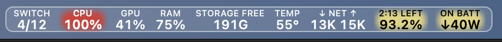

**After.** Here is my menu bar on battery with Sparewatt doing its job: only 2 of my 12 background services
switched on, the processor at 26% and the graphics chip at 4%. The Mac draws about 13 W, and with 85.7% left macOS
estimates **6 hours 26 minutes** — where the same Mac used to be empty in about an hour.

So I started listing what I actually needed. When I need the battery to last, which app should I close? Which apps
can keep running without costing much? What is quietly draining it right now? I kept asking an AI coding assistant to
add one more feature, then another, and along the way those small requests became an app of my own.

Today Sparewatt helps the same Mac last **more than five hours on battery**. It also lets me run heavy work safely:
offline AI models that keep the graphics chip at 100%, and MCP servers (the small services AI assistants connect to)
that I turn on and off with **[Switches](Switches.md)** — and that can switch themselves off when I unplug. When
something power-hungry is running, Sparewatt [shows me which app or service it is](Power.md#power-per-app-share-of-battery-drain), and I can
[hunt it down and stop it](Who-is-using-it.md#look-closer-then-quit-or-force-quit).

## Features

**[Every feature in detail](Features.md)** — purpose, what it does, use cases, benefits, settings and limits, with a
catalogue and everyday scenarios ("a full day on battery", "the battery drops overnight", "running local AI models").

| Area | Page |
|---|---|
| Menu bar: readings, grouped item with outline, hover panels, steadier figures, colours, warnings, the Menu Bar settings page | [Menu bar](Menu-bar.md) |
| Processor, graphics, memory | [Processor, graphics and memory](Processor-graphics-and-memory.md) |
| Temperature and fans, slowing down to cool, network, the connection and internet check, data used per app, storage space, drive health, Time Machine, other disks | [Temperature, network and storage space](Temperature-network-and-storage-space.md) |
| Named processes, quitting, background normals, Watchlist | [Who is using it](Who-is-using-it.md) |
| Battery state, charge plan, wear, what keeps the Mac awake, overnight drain, keyboard / mouse / headphones / game controller batteries with time left, Macs without a battery | [Battery](Battery.md) |
| Power flow, charger details and history, USB power out, power per app, idle apps | [Power](Power.md) |
| Energy modes, On Battery settings, Extreme Saver, keep awake, profiles | [Power controls](Power-controls.md) |
| Every notification, and its Quit / Show buttons | [Alerts and notifications](Alerts-and-notifications.md) |
| Latest File, Shelf, caches, Downloads tidy-up, clipboard | [Files and storage](Files-and-storage.md) |
| Local services on/off, with a progress line and bar for long jobs | [Switches](Switches.md) |
| Dashboard, Find a setting, Mac health, history, "My Mac today" and "My Mac this week" cards, Startup Items, This App, settings export, Report a problem, Uninstall, the Privacy page | [Dashboard, history and this app](Dashboard-history-and-this-app.md) |
| Widgets for the desktop and Notification Center: Battery, and Mac at a glance | [Widgets](Dashboard-history-and-this-app.md#widgets) |
| AI Assistant: an MCP server for Claude Code, Codex and other assistants | [AI Assistant](AI-Assistant.md) |
| Reading values in Shortcuts: battery %, time left and more for your own automations | [AI Assistant](AI-Assistant.md#reading-values-in-shortcuts) |
| Keyboard shortcuts that work from any app, each one changeable or off | [Keyboard shortcuts](Keyboard-shortcuts.md) |
| In English, German and Spanish, following your Mac's language | [Language](Getting-started.md#language) |
| Updates that install with one click, checked against the release's SHA-256 | [Updates](Getting-started.md#updates) |

## Guide

| Page | What it covers |
|---|---|
| [Getting started](Getting-started.md) | what it runs on, install, the unsigned-app warning, the welcome window, language, open at login, presets, moving to another Mac, updating from 1.4, uninstalling |
| [Menu bar and panels](Using-the-menu-bar.md) | the menu bar item, hover panels, what each part shows |
| [Battery and power](Using-battery-and-power.md) | power per app, idle-app suggestions, charge plan, wear, charger and sleep checks, device batteries, Macs without a battery |
| [Controls](Using-the-controls.md) | energy modes, On Battery settings, Extreme Saver, profiles, Watchlist, Switches, alerts |
| [Files and storage](Using-files-and-storage.md) | Latest File, the Shelf, Downloads tidy-up, caches, folder sizes, other disks, clipboard |
| [Dashboard and history](Using-the-dashboard-and-history.md) | the dashboard window, Find a setting, history charts, battery stretches, CSV export, Mac health, the Privacy page |
| [How the estimates work](How-the-estimates-work.md) | energy impact, watts per app, battery time gained, the idle-app rule |
| [Privacy and permissions](Privacy-and-permissions.md) | what stays on your Mac, which prompts appear and why |
| [Troubleshooting](Troubleshooting.md) | hidden menu bar item, missing readings, password and permission prompts |
| [What Sparewatt runs and reads](What-Sparewatt-runs-and-reads.md) | every program it starts, every file it reads or writes, every permission it may ask for, its network use |
| [Developer guide](Developer-guide.md) | setting up switches for your own servers and jobs, showing a job's progress and log (worked example: a nightly cloud backup), `switches.json` by hand, driving Sparewatt from scripts |

## Reference

- [Keyboard shortcuts](Keyboard-shortcuts.md)
- [Links for Shortcuts and scripts](Links-for-Shortcuts-and-scripts.md) — `sparewatt://` links for Extreme Saver, energy modes, panels, dashboard pages and Switches
- [Where Sparewatt keeps its data](Data-files.md)
- [Changelog](Changelog.md)
- [Research](Research.md) — notes on similar Mac apps and what their users complain about, written while designing Sparewatt

## Screenshots

| Processor | Memory | Temperature & fans |
|---|---|---|
| 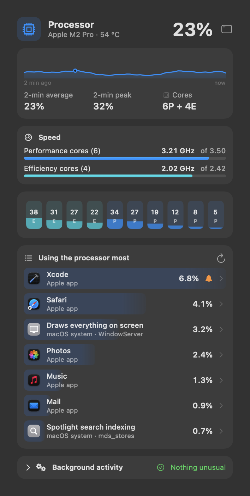 | 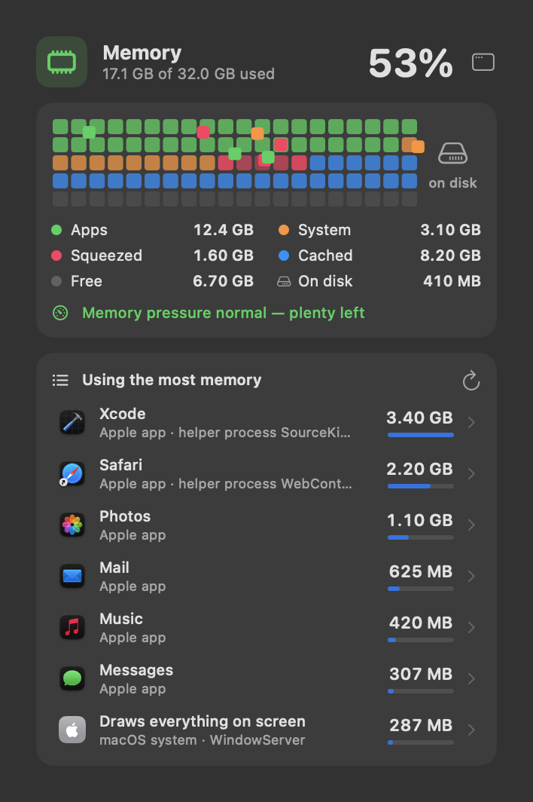 | 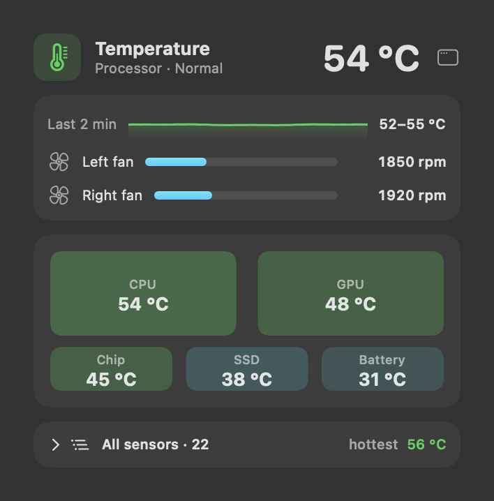 |

| Battery | Power | Graphics | Network |
|---|---|---|---|
| 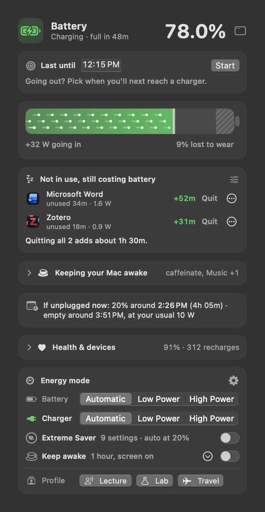 | 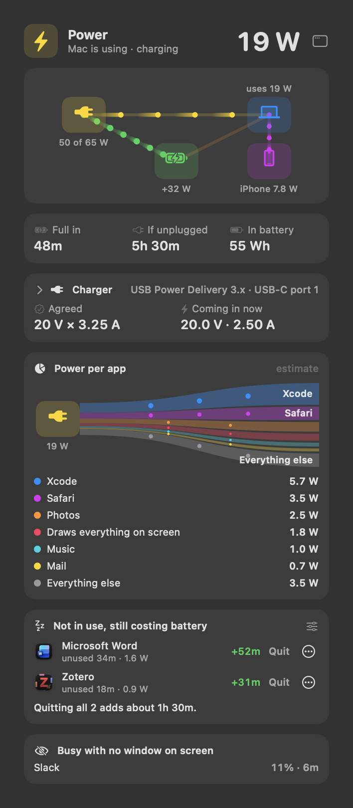 | 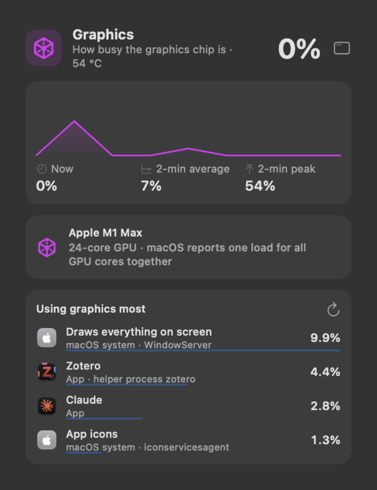 | 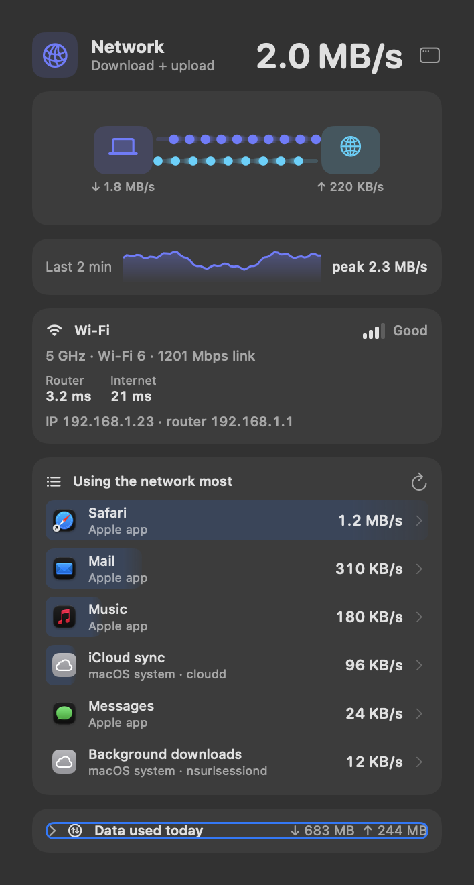 |

| History | On Battery settings |
|---|---|
| 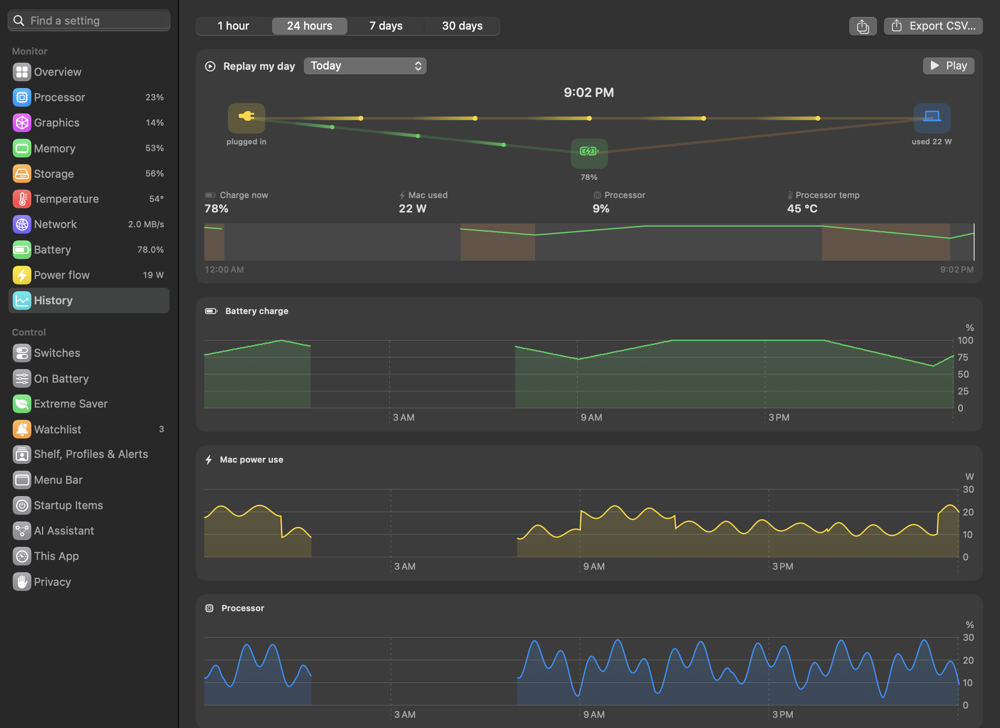 | 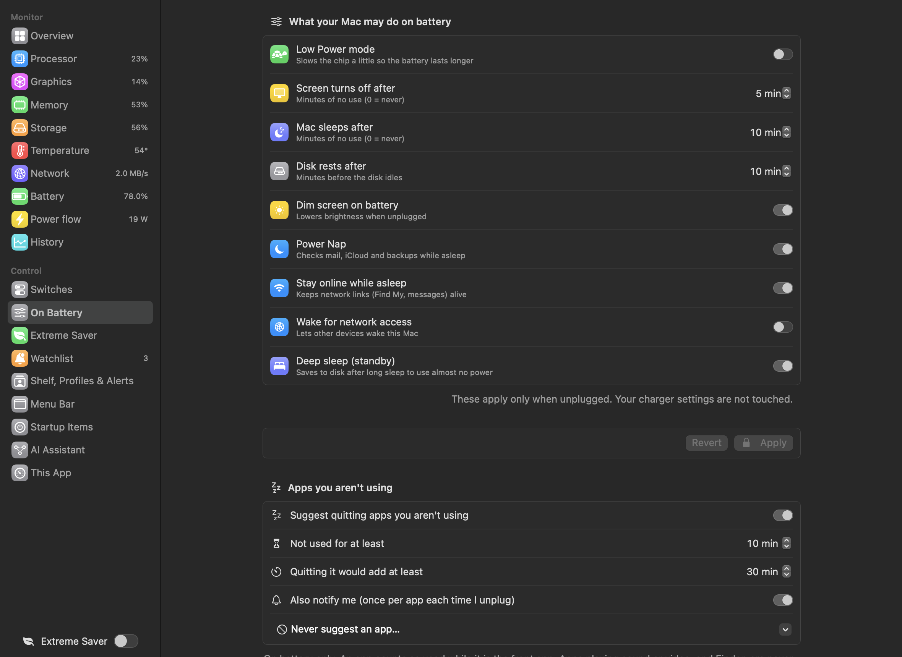 |

Screenshots are made from a made-up demo dataset: no real names or folders.

## License

Sparewatt is freeware: free to download and use, at home or at work. © 2026 Shiraz Ahmad. All rights reserved.

You may share the official download unchanged and free of charge. You may not sell it, distribute changed copies, or
reverse engineer it.

It comes as is, without warranty of any kind. The author is not liable for any loss or damage from using it, including
lost data.

These pages are also © 2026 Shiraz Ahmad.

---

[Home](index.md) · [Getting started](Getting-started.md) · [Features](Features.md) · [Switches](Switches.md) · [Developer guide](Developer-guide.md) · [Troubleshooting](Troubleshooting.md) · [Changelog](Changelog.md) · [Download](https://github.com/MShirazAhmad/Sparewatt-docs/releases/latest)

Sparewatt is free. © 2026 Shiraz Ahmad. [These pages on GitHub](https://github.com/MShirazAhmad/Sparewatt-docs)
